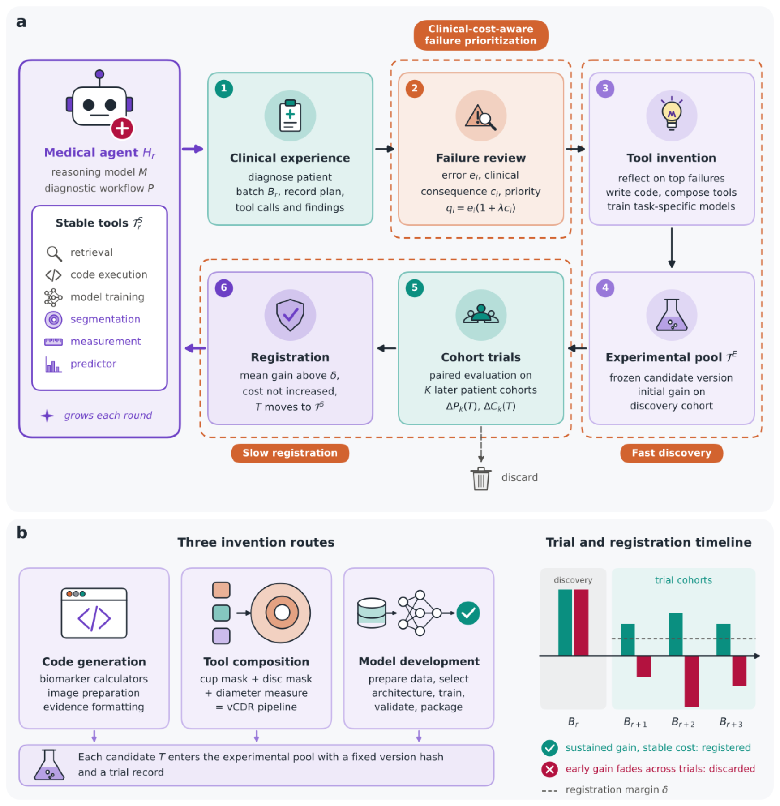
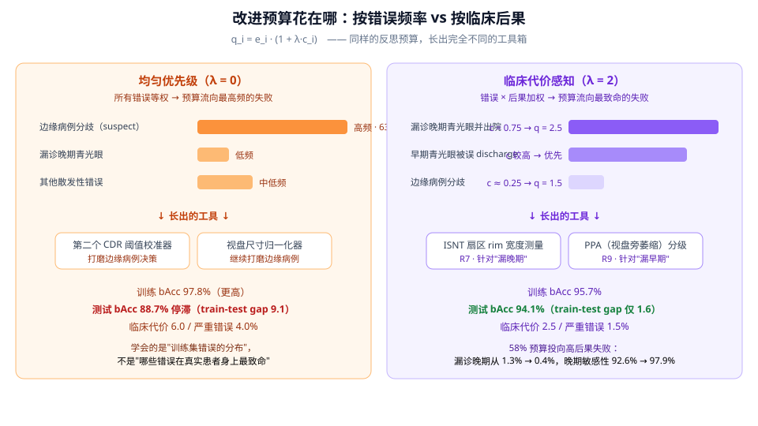
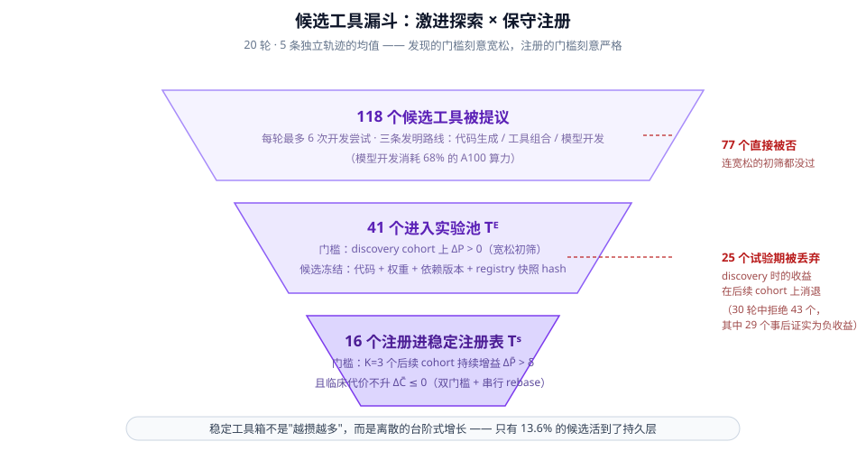
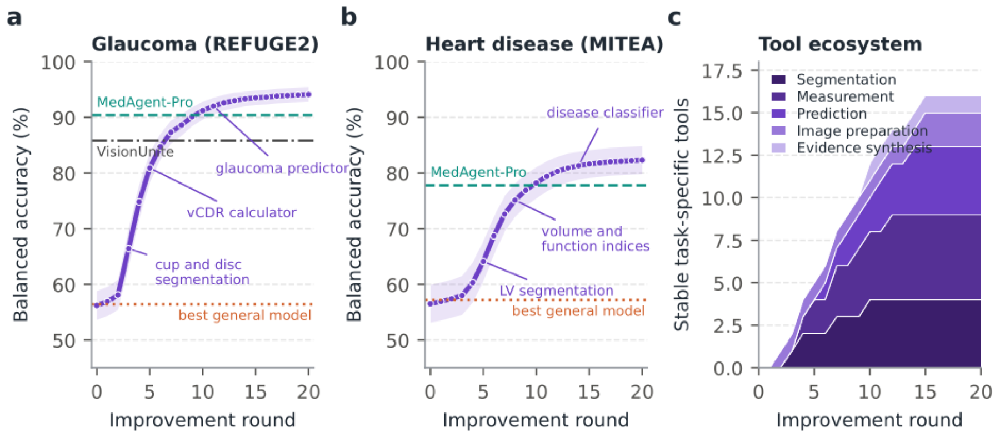
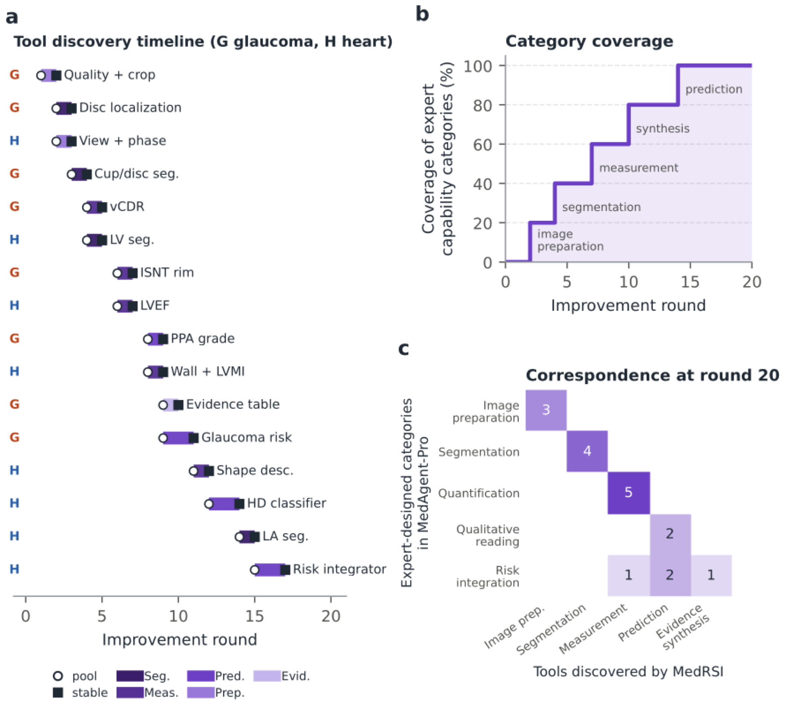
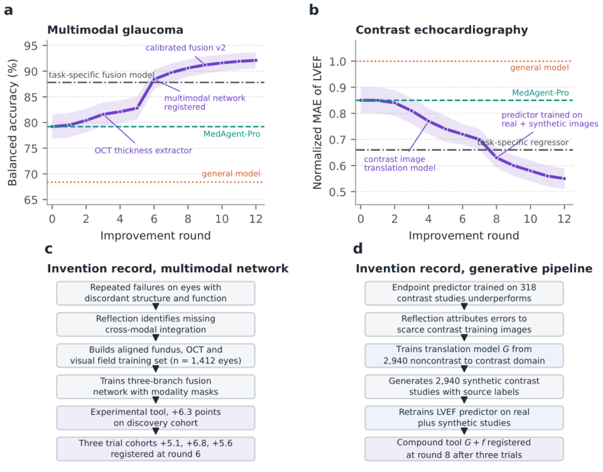
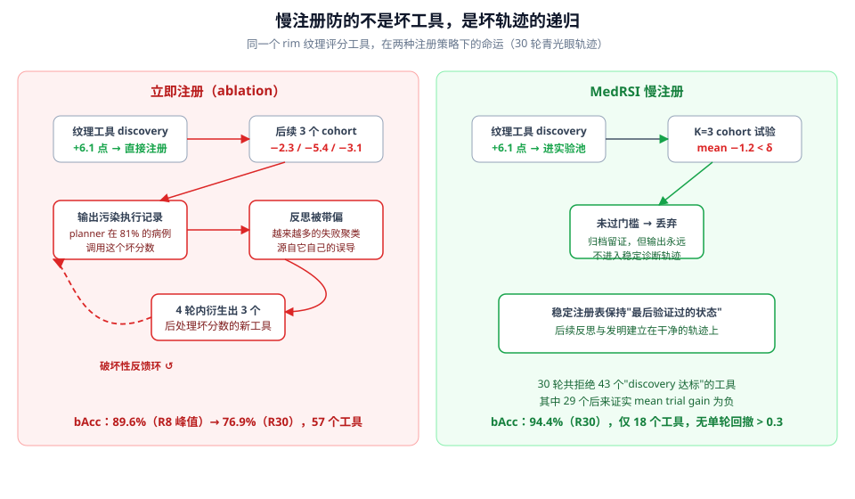
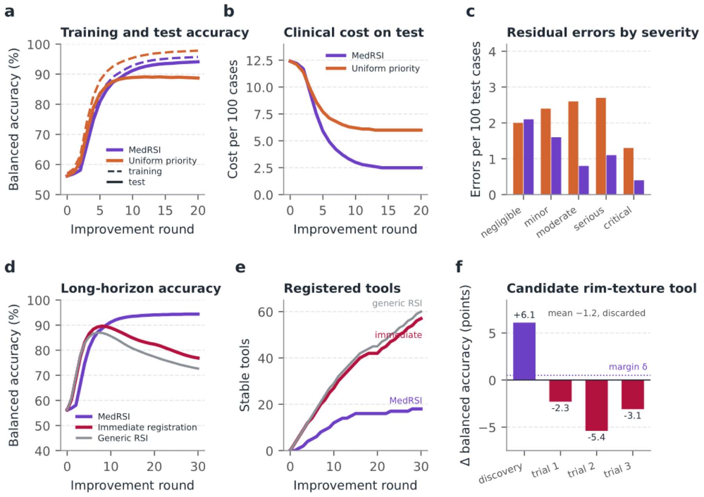
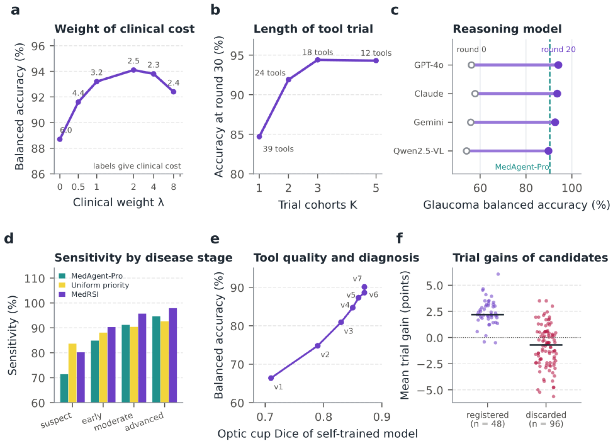

# 解读笔记：MedRSI — Recursive Self-Improvement for Medical Agents via Clinically Aligned Self-Evolution

- **arXiv**: [2609.24838](https://arxiv.org/abs/2609.24838)（TeX 源码归档在工作区 `agent-harness-survey/papers/2609.24838/`，主文件 `medrsi_arxiv.tex`）
- **作者/机构**: Junde Wu, Jiayuan Zhu, Minghao Hu, Fenglin Liu（牛津大学）; Jiazhen Pan（斯坦福）
- **代码**: https://github.com/ImprintLab/MedRSI
- **体裁**: 约 12 页方法+实验长文（ACL 模板），单篇系统论文而非 survey
- **一句话**: 第一个面向医学领域的 RSI 框架：让通用 agent 从自己的诊断失败出发，自主发明、验证并注册新临床工具/模型，同时用两个"临床对齐"机制保证自我改进不越安全边界
- **TL;DR**: 医疗 agent 不必被部署前人工设计的工具箱锁死能力——只要"改进什么"由临床后果加权、"保留什么"由跨队列验证把关，agent 就能从诊断经验中持续构建并积累新能力，最终反超人类专家手工设计的医学 agent

---

## 1. 动机与定位

> 左图 a：五阶段循环（临床经验 → 失败审查 → 工具发明 → 实验池 → 队列试验 → 注册），橙色虚线框标出两个机制的作用范围；右图 b：三条发明路线 + 候选从 discovery 到 K 个 trial cohort 的注册时间线。

**现状**：医疗 agent = 通用推理模型 + 固定的人类设计工具箱（分割网络、测量代码、VQA 等，如 MedAgent-Pro）。每个工具都是临床医生识别需求 → 工程师组装数据代码 → 开发者写调用规范的结果。部署后 agent 积累了成千上万次诊断和失败，却没有任何机制把这些经验转化为新能力。

**RSI 的机会与风险**：RSI 让 agent 自己评估失败 → 识别能力局限 → 提出修改 → 保留有效改动（参考 DGM、AlphaEvolve、ADAS 等）。但直接搬到高风险的医学领域有根本性张力：
- 性能指标上的小回归，在医学里可能是漏诊、不当干预等真实患者伤害
- 自我改进的修改会被保留并传播到后续"世代"，不安全的变化可能规模化影响患者
- RSI 需要足够自治才能发现超越人类设计的 capability，但开放式进化必须被临床安全约束

**核心论点**：改进什么（what to improve）和保留什么（what to retain）都应该锚定在临床实践原则上，而不是通用 benchmark 分数。

## 2. 方法：五阶段循环 + 两个核心机制

### 2.1 整体工作流

每一轮改进 r 中，稳定 medical agent 表示为 **H_r = (M, P, T^S_r)**：
- M = 多模态推理模型（如 GPT-4o），**固定不动**
- P = 通用执行工作流，**固定不动**
- T^S_r = 稳定工具注册表 —— **RSI 只作用于这里**

五阶段循环：**诊断 → 优先级排序 → 反思 → 能力开发 → 试验与注册**

信息流：`experience → failure → capability gap → candidate tool → validated capability`

关键细节：
- 参考标签在诊断执行时** withheld**，事后才给 evaluator——保证每次诊断是"承诺"之后再复盘
- 工具发明有三条路线：
  1. **代码生成**（deterministic 操作：图像预处理、定量测量、计算）
  2. **工具组合**（如 cup/disc 分割 + 直径测量 → vCDR = d_cup/d_disc）
  3. **模型开发**（构建训练 manifest、选架构、训练、选 checkpoint——如分割网络、临床预测器、多模态融合模型）
- 还能构建**多阶段能力链**：目标域标注稀缺时，先造生成模型合成训练数据，再用合成数据训练下游预测器，作为版本化依赖链整体保留

### 2.2 机制一：Clinical-Cost-Aware Failure Prioritization（临床代价感知的失败优先级）

**问题**：常见的小错（边缘病例分歧） vs 少见的大错（漏掉晚期青光眼直接出院），临床后果天差地别。按错误频率分配改进预算，RSI 会越来越擅长纠正高频错误，反复忽略高临床后果的失败。

**做法**：把"是否错了"和"错得多严重"分开：
- 正确性：对照任务参考判定
- 临床后果：frozen judge（相同模型、独立 prompt）按**预定义任务 rubric**（列出各诊断输出对应的临床动作路径：出院/常规复诊/进一步检查/专科会诊）给 ordinal 分数 s_i ∈ {0,1,2,3,4}（negligible → critical），并**必须附证据链**（支持该评分的临床观察、隐含的处理变化、缺失的信息）
- 证据不足的案例标记 unresolved，退出后果排序等待裁定

优先级公式：**q_i = e_i (1 + λ c_i)**，其中 c_i = s_i/4，λ≥0 控制权重强度。λ=0 退化为普通的均匀错误优先级（ablation 基线）。示例（λ=2）：早期青光眼误判为 suspect（minor, c=0.25）→ q=1.5；晚期青光眼误判为正常并出院（serious, c=0.75）→ q=2.5。

预算分配策略：失败先按推断的能力缺口**聚类**，每个 cluster 内按 q_i 排序，选择器从每个 cluster 取最高优先级代表，避免单一反复出现的失败模式吃光全部开发预算。

**联合指标**：同一套后果评估还产出 cohort 级 **临床代价 C(H,V) = (1/n)Σ e_i·c_i**（每100患者的后果加权错误数）+ 严重错误率（s≥3 的比例）。这让"选择改进什么"和"改进是否真的减少临床意义上的错误"用同一个量连起来了。

均匀 vs 临床代价两种优先级，同样的反思预算长出完全不同的工具箱：前者打磨边缘病例的决策，后者发明 ISNT 扇区 rim 测量、PPA 分级这类针对高后果失败的工具。

连续预测（射血分数）的适配：用预设临床容差 ε=5 个百分点定义 e_i，按误差大小/方向/临床上下文分档后果，预设边界在 5/10/15/20 个百分点处。

### 2.3 机制二：Fast Discovery with Slow Registration（快速发现、缓慢注册）

**问题**：候选工具通常是从一小撮困难病例开发的，首见收益可能只反映队列特异性的成像特征或与现有工具的交互，而不是可泛化的临床收益。更关键的是：一旦工具进入稳定注册表，它的输出会成为后续执行记录的一部分 → 影响后续反思和发明方向。不稳定工具会改变 RSI 自身的未来轨迹。

**两套工具集**：
- **稳定注册表 T^S_r**：部署中的 agent 只用这套收集新诊断经验
- **实验池 T^E_r**：候选工具暴露给 evaluator 的 agent 副本做对照测试

**分阶段门控**：
1. **Discovery（宽松）**：候选 vs 稳定 agent 在同 discovery cohort 上配对比较，ΔP_disc > 0 即进入实验池——刻意宽松，只做初筛
2. **冻结**：进入实验池时锁定完整候选包（代码、权重、预处理、调用规范、依赖版本），reference registry 快照也记录；任何修改=新版本+新评估历史
3. **Trial（严格）**：在 K=3 个**后续**患者 cohort 上前瞻评估（这些 cohort 不用于候选拟合或发现）。配对比较 H^ref_T vs H^ref_T ⊕ T（⊕只让 planner **可选择**调用，不强制），planner 不调用、调用失败都计入——衡量的是"把这个能力加进完整工作流"的实际贡献
4. **注册条件**（双门槛）：
   - 平均性能增益 ΔP̄ > δ（分类 δ=0.005，即 0.5 个 balanced accuracy 点）
   - 平均临床代价变化 ΔC̄ ≤ 0（不允许用更严重的残余错误换总体分数）
5. **串行提交**：因为 RSI 是累积的，候选的贡献取决于它引入时已有哪些能力。注册前比较候选的 reference-registry hash 与当前 registry——如果期间 registry 变了，先在新上下文里重新评估

论文明确指出：slow registration 不只是常规的模型验证，**它保护的是未来的自我改进过程本身**。快速发现保留 RSI 的探索性，缓慢注册控制哪些发现被允许影响未来。二者分离防止"短暂收益被递归放大成持久退化"。

发现门槛刻意宽松、注册门槛刻意严格：20 轮提议的 118 个候选只有 13.6% 活到持久层。

## 3. 实验设置

| 项目 | 配置 |
|---|---|
| 初始 harness | OpenHands v0.20（CodeAct，容器化工作区，网络限白名单） |
| 推理模型 | GPT-4o (2024-08-06)，诊断 temp=0，反思/建工具 temp=0.7 |
| 临床 judge | 同模型单独 prompt，frozen rubric，clinician 校准集 + weighted κ |
| 任务 | 青光眼（REFUGE2 1200 图）+ 心脏病（MITEA 536 3D echo）|
| 私有任务 | 多模态青光眼（1898 眼/1236 患者，3 模态）+ 造影超声心动图 EF 预测（318 造影 + 2940 非造影）|
| 协议 | 20 轮（长程 ablation 到 30），每轮最多 6 个候选、12 A100 小时 |
| 架构库 | U-Net / nnU-Net / ResNet-50 / 三分支融合 transformer / CycleGAN |
| 关键超参 | λ=2, K=3, δ=0.5 bAcc 点 / 0.01 nMAE |
| 统计 | 5 seeds，2000 次 bootstrap CI，10000 次配对置换检验，测试集在全部 checkpoint 冻结后才评估 |
| 患者分离 | **patient identity 是切分单位**，同一患者所有数据不跨分区 |

## 4. 主要结果

### 4.1 通用 agent 长成医学诊断系统（实验一）

- Round 0 只有 56.2% / 56.5% bAcc（约等于裸 GPT-4o 水平，行为是定性描述"视杯中度扩大"之类）
- Round 20 达到 **94.1%**（青光眼）/ **82.3%**（心脏病），超过手工设计的 MedAgent-Pro 3.7 / 4.5 个点
- 3 轮就超过最强通用多模态模型，9-10 轮超过 MedAgent-Pro；5 条独立轨迹全部复现（93.4–94.7% / 81.2–83.1%）
- 不只是准确率：敏感性 28.4→92.0%，ECE 0.29→0.05（用测量替代主观印象让校准同步改善）

> a/b：两条任务的 test bAcc 轨迹，标注了关键工具的注册时点；c：稳定工具箱的台阶式增长——分 5 类能力累积到 16 个。

**工具增长是选择性的，不是堆积**：
- 20 轮提议 118 个候选 → 41 个进实验池 → **只有 16 个**通过队列试验注册（4 分割 + 5 测量 + 4 预测 + 2 图像预处理 + 1 证据合成）
- 成本：每条轨迹 212 A100 小时 + 1.9B 推理 token，68% 算力花在模型训练

### 4.2 RSI 重建了专家设计的工具生态（惊喜发现）

MedRSI 在**看不到 MedAgent-Pro 工具箱**的情况下，独立重新发现了几乎相同的能力结构，且出现顺序符合临床诊断的依赖结构：
1. 图像预处理（Round 1-2：视盘裁剪、舒张末期选择）
2. 分割（Round 3-5）
3. 定量测量（Round 4-9）
4. 预测与证据合成（Round 9+）

专家能力类别覆盖率：Round 0=0% → Round 14 = **100%**。自训模型的内在质量：视杯/视盘分割 Dice 0.87/0.95，vCDR 相关性 r=0.91；LV 分割 Dice 0.90。

> 提示：能力分层结构可能不是人类设计者的独有洞见，而是任务本身施加的依赖结构——不同推理骨干（Claude Sonnet 4.5 / Gemini 2.5 Pro / Qwen2.5-VL-72B）也独立收敛到相似结构（16 个工具函数中 11 个被 4/4 骨干复现）。

> a：16 个稳定工具的注册时间线（空心圆 = 进实验池，实心方块 = 注册）；b：专家能力类别覆盖率的台阶式爬升；c：Round 20 时自发现工具对专家类别的覆盖矩阵。

### 4.3 为从未见过的任务发明新临床 AI 模型（实验二）

初始化为完整的 MedAgent-Pro，暴露于两个设计者没预料到的私有任务：

**多模态青光眼**（结构 vs 功能证据冲突是主要失败模式，占前 3 轮 71% 的优先失败）：
- 先加单模态工具（OCT 厚度提取、视野指数解析）→ 81.6%
- Round 4 反思发现"模态可用但被独立解读"→ 训练三分支融合网络（带 modality mask 处理缺失）→ Round 6 注册 → 88.4%
- Round 9 注册重校准 v2 → 最终 **92.1% bAcc**，超过同预算人工训练的 task-specific 融合模型（87.8%）
- 融合网络被调用率 94%，在**不一致病例**上 bAcc 86.7% vs late fusion 71.4%

**造影超声心动图 EF 预测**（展现了更深层的递归能力开发）：
- 瓶颈不是缺预测器，是**缺合适数据**：只有 120 个造影训练研究，2716 个非造影研究带标签但有 domain shift
- Round 4：训练 image translation 模型把非造影映射到造影域，用已有的 LV 分割能力验证解剖一致性，生成 2716 个合成研究（继承源标签）
- Round 6：在真实+合成数据上重训预测器 → Round 8 注册
- 最终 nMAE **0.55**（MAE 5.1 个 EF 点），好于只用真实造影数据训练的 task-specific 回归器（0.66）；只用合成数据是 0.79（说明收益来自数据增强而非替代）
- 合成图像与 42 例配对真实造影的 SSIM=0.81

> a/b：两个任务的性能轨迹；c：多模态融合网络的完整发明记录；d：生成式管线的发明记录——先造数据再训预测器的版本化依赖链。

### 4.4 Ablation：两个机制各自不可少

| 配置 | bAcc@20 | 临床代价 | 工具数 | bAcc@30 |
|---|---|---|---|---|
| Generic RSI（均匀优先+立即注册）| 77.4 | 9.2 | 45 | **72.7**（崩塌）|
| 均匀失败优先级 | 88.7 | 6.0 | 15 | 88.3 |
| 立即注册 | 82.4 | 7.6 | 42 | 76.9 |
| 单试验 cohort | 90.6 | 4.7 | 31 | 84.7 |
| 无失败聚类 | 90.2 | 3.9 | 14 | 90.1 |
| 仅代码生成 | 79.8 | 7.1 | 9 | 79.4 |
| 无模型开发 | 84.3 | 5.4 | 11 | 84.0 |
| 无工具组合 | 89.1 | 4.1 | 13 | 89.0 |
| **MedRSI** | **94.1** | **2.5** | 16 | **94.4** |

**均匀优先级的教训**：训练集分数反而更高（97.8% vs 95.7%），但 test 停在 88.7%（train-test gap 9.1 vs 1.6）。预算被吸引到高频的边缘病例（前 10 轮 63% 反思预算花在 glaucoma suspect 上），发明的是"第二个 CDR 阈值校准器"这类边际工具；而临床加权版把 58% 预算给高后果失败，发明出 ISNT 扇区 rim width、PPA 分级等关键工具。漏诊晚期青光眼从 1.3% 降到 0.4%。

**立即注册的崩塌机制**（论文最有洞察力的部分）：一个视盘 rim 纹理评分工具 discovery +6.1 点 → 立即注册 → 但后续三个 cohort 是 -2.3/-5.4/-3.1（纹理特征过拟合了 discovery 队列的相机型号和光照）。一旦注册，planner 在 81% 的后续病例调用它，输出污染执行记录 → 4 轮内 agent 又开发出 3 个后处理这个坏分数的工具，越来越多的失败聚类源于它自己的误导 → **破坏性反馈环：坏工具→坏轨迹→基于坏轨迹发明更多坏工具→崩塌**。

慢注册防的不是单个坏工具，而是坏工具污染未来反思轨迹后的**递归放大**。

MedRSI 下同一个纹理工具进实验池后 mean trial gain -1.2 → 被丢弃，30 轮里共拒绝 43 个"discovery 达标"的工具，其中 29 个后来证实是负收益。

> a：均匀优先级的 train-test gap；b/c：临床代价与残余错误分布；d/e：30 轮长程下三种策略的分化；f：那个 rim 纹理工具 discovery 与 3 个 trial 的完整轨迹。

**三条发明路线互补**：仅代码生成 79.8%（能操作证据但无法获得新感知能力）；模型开发贡献了 code-only 到完整版 14.3 个点差距中的 9.8 个点。

**失败聚类**：去掉后出现 4 个针对同一能力缺口的近重复候选。

### 4.5 鲁棒性

- λ 从 0→2 单调提升到峰值 94.1%，λ=8 降到 92.4%（过度聚焦少数严重病例）；1-4 都是可用的宽操作区间
- K=1（39 工具，84.7%@30）vs K=3（18 工具，94.4%）vs K=5（12 工具，94.3% 但每候选多等 2 轮）——速度 vs 稳定性的清晰权衡
- 换骨干：4 个骨干中 3 个最终超过 MedAgent-Pro（89.8–93.6%）；且骨干间独立收敛到相似能力结构

> a：λ 的宽操作区间；b：K 的速度-稳定性权衡；c：四种骨干都收敛；d：按疾病分期的敏感性；e：工具内在质量与诊断收益的分级关系；f：注册 vs 丢弃工具的 trial gain 分布。

### 4.6 成本

| 任务 | 轮数 | 候选 | 注册 | A100 h | Token | 天数 |
|---|---|---|---|---|---|---|
| 青光眼 (REFUGE2) | 20 | 64 | 8 | 96 | 0.9B | 2.1 |
| 心脏病 (MITEA) | 20 | 54 | 8 | 116 | 1.0B | 2.4 |
| 多模态青光眼 | 12 | 41 | 6 | 174 | 0.7B | 3.2 |
| 造影 echo | 12 | 38 | 5 | 265 | 0.6B | 4.6 |

## 5. 与本仓库其他 RSI 笔记的关系

- 对照 `reading_notes_genuine_rsi_2609.11873.md`（"The Last AI Built by Humans"）：那篇是 40 人团队的 position/survey，提出自治级别分类学；MedRSI 是一个**具体的 L 级自治实例**——改进循环完全自治，但通过 frozen rubric + 试验门控 + 串行提交把安全锚点外置。可以看作 2609.11873 中"经验证的改进 + 保留机制"两个瓶颈在医学域的一次完整落地。
- 对照 `reading_notes_rsi_verification_hierarchy_2607.07663.md`：MedRSI 的"fast discovery / slow registration"本质是一个**验证层级**的两级——discovery 是宽松初筛（ΔP>0 即可），registration 是严格前瞻验证（K=3 cohort + 双门槛 + 串行 rebase）。和那篇论文的"verification hierarchy"论点高度呼应：改进的保留标准必须显著严于改进的生成标准。
- 对照 `reading_notes_what_makes_a_harness.md` / `agent_harness_engineering_survey_report.md`：MedRSI 的 harness 分层很清晰——M（模型）和 P（工作流）固定，只演化 T（工具注册表）。这与"code-as-harness"路线相反：它刻意**不**让 agent 改自己的 prompt/workflow，只让它扩展能力面。这可能是在风险敏感域的一种实用折中：改工具面（可版本化、可冻结、可回滚、可独立评估），不改决策逻辑本身。
- MedRSI 崩塌实验（立即注册 → 纹理工具污染执行记录 → 反馈环）是 harness 设计文献里少见的**长程 RSI 失败模式的机制级解剖**，值得单独记住。

## 6. 可借鉴的设计模式（通用化，不限医学）

1. **改进预算按"错误代价"而非"错误频率"分配** —— 任何 agent 自我改进场景都可用：q_i = e_i(1+λc_i)，其中 c_i 由 frozen judge 按预定义 rubric 打分。防止 RSI 优化训练错误分布、忽略罕见但致命的失败。
2. **双轨制工具注册表**（stable / experimental）：部署实例只用 stable 收集经验，experimental 只暴露给评估副本 —— 优雅地隔离了探索对生产轨迹的污染。
3. **发现门槛宽松 + 注册门槛严格**，且注册要求**后续独立 cohort 的持续性**而非 discovery 当时的峰值 —— 抑制对特定难例集的过拟合进持久层。
4. **串行提交 + registry hash 比对**：候选注册前检查其评估时的 registry 快照是否仍与当前一致，不一致则在新上下文重评 —— 解决累积演化中的"评估过期"问题（类似 software 里的 rebase-and-retest）。
5. **能力规格化反思**：先把失败聚类，再把 cluster 转成"缺失能力"的测试性假设（spec），而不是从单个错误直接 propose 工具 —— 减少重复发明。
6. **把"评估是否改进"和"改进是否降低临床代价"用同一个后果量表连接**，使选择压力与验收标准一致 —— 通用化：改进的优化目标和保留门槛应共享度量。
7. **多阶段能力链**：当瓶颈是"缺训练资源"而非"缺工具"时，先发明资源生成能力，再用它开发下游能力，整个链条版本化保留。

## 7. 局限与疑问

- **judge 依赖**：临床后果评分本质是 GPT-4o 自评（哪怕 frozen rubric + 校准集），λ 越大，改进方向越受这个 judge 的偏见影响。论文没有讨论 judge 本身出错时的系统性漂移风险
- **M 和 P 固定是双刃剑**：安全上合理，但意味着 RSI 无法改进工作流本身（如 planner 策略、反思方式）——而这些也是 harness 的一部分。能力天花板由工作流质量决定
- **标注依赖**：所有失败判定需要 reference label；真实部署中很多病例没有金标准
- **试验 cohort 从训练分区切出**：私有任务里 discovery/trial cohort 都很小（15 个研究 ×3），小 cohort 上配对比较的统计功效存疑
- **成本不小**：公共任务每条轨迹 212 GPU 小时 + 1.9B token，对个人/小团队不友好；且 4.5 天一个轨迹，迭代周期长
- **未讨论对抗性/分布外失败**：rubric 是部署前固定的，遇到 rubric 未覆盖的新型错误模式（如新设备、新成像协议）时后果评分的 handling 未说明
- 测试集评估依赖 checkpoint 回溯生成 round-wise 曲线，干净但意味着中间轮的"test 曲线"不是真正的前瞻监控
