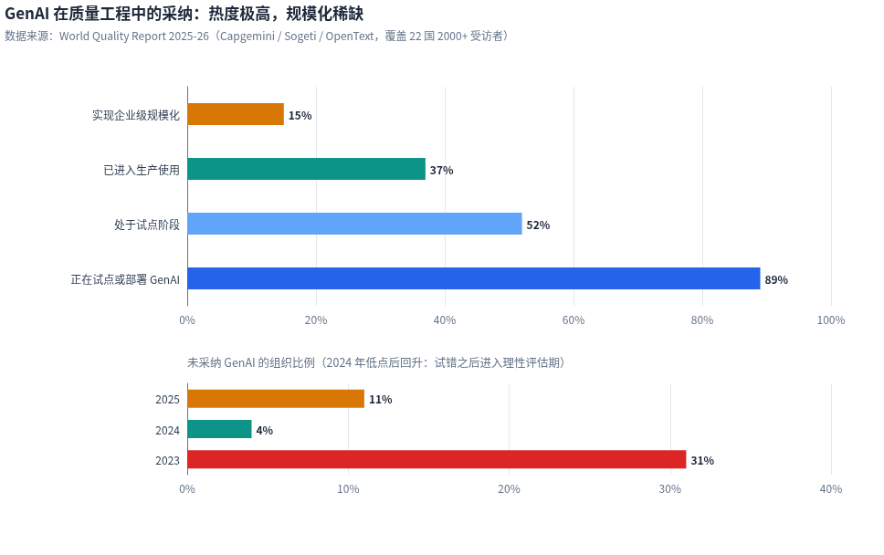
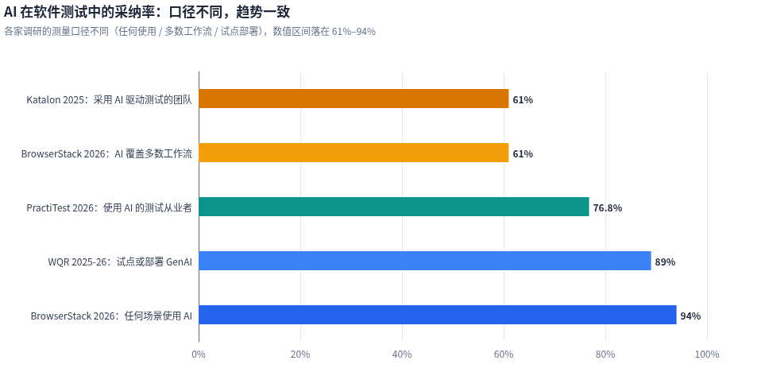
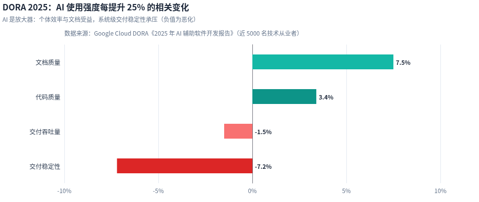
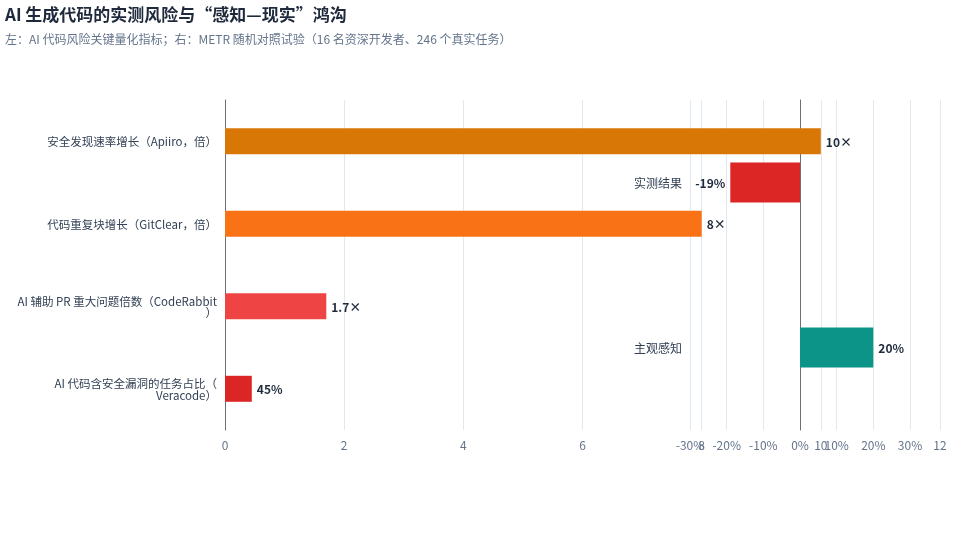
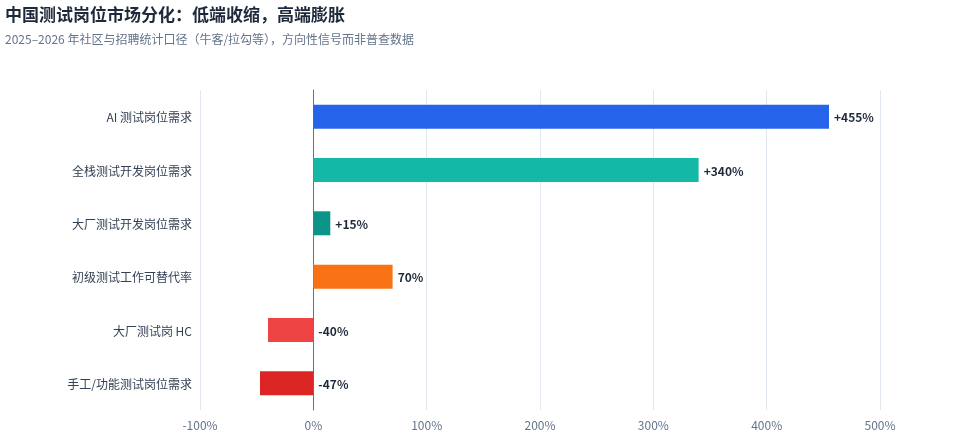
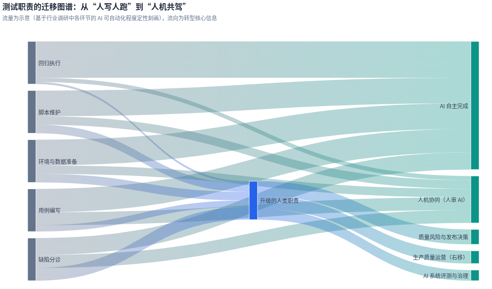

# AI 时代软件开发测试岗位职责的转化与应对策略

**——面向测试团队与工程管理者的深度研究报告**

> 报告视角：企业 / 测试团队管理者 | 数据截至 2026 年 9 月 | 引用来源随文标注

---

## 摘要

AI 对软件测试的冲击不是"测试岗位消失"，而是一次**质量工作供需关系的结构性重构**。一方面，生成式 AI 已经能够承担测试用例编写、回归执行、脚本自愈、缺陷分诊等大量执行性工作——全球约 **89%** 的组织正在质量工程中试点或部署 GenAI，但仅 **15%** 实现企业级规模化，转型的难点已从"要不要用"转向"如何规模化用好"（[OpenText](https://www.opentext.com/ca-fr/about/press-releases/world-quality-report-2025-ai-adoption-surges-in-quality-engineering-but-enterprise-level-scaling-remains-elusive)）。另一方面，AI 生成的代码本身引入了新型质量风险——约 **45%** 的 AI 生成代码含有已知安全漏洞、代码重复块增长约 8 倍（[SecondTalent](https://www.secondtalent.com/resources/ai-generated-code-quality-metrics-and-statistics-for-2026/), [NextLevels](https://next-levels.de/en/blog/vibe-coding-vs-good-code)），而 DORA 2025 年研究证实 AI 使用强度与交付稳定性呈负相关（[DORA](https://dora.dev/ai/gen-ai-report/)）。**验证与治理正在成为新的瓶颈，这恰恰是测试职能的价值放大器而非掘墓人。**

对管理者而言，本报告的核心结论可归纳为五点：第一，岗位职责正在沿"执行层消亡—操作层迁移—判断层升值"三条线分化，测试架构师、质量效能工程师、AI 系统测试员成为新增量角色；第二，中国市场的岗位分化尤为剧烈，手工测试需求同比下降约 47%，而 AI 测试岗位需求增长超过 4 倍，薪资两极分化明显（[阿里云开发者社区](https://developer.aliyun.com/article/1747072), [博客园](https://www.cnblogs.com/hogwarts/p/22827985)）；第三，组织形态应从"集中式测试部"转向"**嵌入式质量工程师 + 中央质量平台**"的混合模式，人机比从传统的 1:3–1:5 走向 1:8–1:10（[ContextQA](https://contextqa.com/blog/qa-team-structure/)）；第四，落地路径必须"左移 + 右移"双翼推进，并以四层度量栈对抗"生产力错觉"；第五，人才再培训是最大杠杆——全球 50% 的组织存在 AI/ML 技能缺口，但系统化的技能重塑可将现有测试团队转化为转型资产而非裁员对象（[TestDino](https://testdino.com/blog/state-of-ai-automation)）。

---

## 一、行业变局：质量供需的结构性重构

### 1.1 采纳现状：从试点热潮到规模化鸿沟

AI 在软件测试中的采纳已越过早期萌芽期，进入"广泛试点、稀缺规模化"的第二阶段。第 17 版《World Quality Report 2025》对 22 个国家 2000 余名高管的调研显示，**89%** 的组织正在质量工程（QE）中试点或部署生成式 AI，其中 52% 仍处于试点阶段、37% 已进入生产使用，而真正实现企业级规模化部署的只有 **15%**；与此同时，未采纳者比例从 2024 年的 4% 回升至 11%，说明一部分组织在试错后转入理性评估期（[Capgemini](https://www.capgemini.com/it-it/news/comunicati-stampa/world-quality-report-2025-ladozione-dellai-accelera-nel-quality-engineering-ma-portarla-su-scala-enterprise-rimane-una-sfida-non-ancora-superata/)）。这组数据对管理者的含义非常直接：**竞争差距不再产生于"用不用 AI"，而产生于"能否把 AI 从演示变成生产线"**，而跨越这道鸿沟的主要障碍并非技术——数据显示数据隐私风险（67%）、集成复杂度（64%）、幻觉与可靠性担忧（60%）和技能缺口（50%）才是前四大拦路虎（[SecondTalent](https://www.secondtalent.com/resources/ai-in-software-development-statistics/)）。

多家机构的调研口径虽有差异，但趋势高度收敛。BrowserStack 2026 年对 250 余位 CTO、工程 VP 与 QA 负责人的调研显示 94% 的团队在测试中使用 AI、61% 覆盖多数工作流；PractiTest 第 13 版《State of Testing 2026》给出的全球采纳率为 76.8%；Katalon 2025 年对 1500 余名质量从业者的调研为 61%（[TestDino](https://testdino.com/blog/state-of-ai-automation), [PractiTest](https://www.practitest.com/state-of-testing/)）。需要提醒管理者的是，这些数字大多来自厂商自发布调研、样本自选，应作为"行业风向"而非"精确普查"来解读；真正值得关注的不是采纳率本身，而是**采纳的深度结构**——PractiTest 发现约 70% 的团队用 AI 生成测试用例，但仅 19.9% 将其用于风险识别，研究者称之为"AI 陷阱"：大量团队在用它更快地生产更多测试，而非用它做出更好的测试决策（[QATouch](https://www.qatouch.com/blog/best-test-case-management-tools-for-jira/)）。

### 1.2 质量悖论：AI 写得越快，验证越贵

AI 时代测试职能面临的核心悖论是：**上游产出的速度和质量风险同步放大，而验证环节的人手与注意力并没有同步扩张。** Google Cloud 的 DORA 2025 年报告（近 5000 名技术从业者）给出了迄今最有影响力的系统级证据——AI 使用强度每提升 25%，代码质量感知改善 3.4%、文档质量改善 7.5%，但交付吞吐量下降 1.5%、**交付稳定性下降 7.2%**；报告的定性部分将 AI 定义为"放大器"：流程成熟的组织用 AI 变得更快更稳，流程脆弱的组织用 AI 更快地制造不稳定（[DORA](https://dora.dev/ai/gen-ai-report/), [AIJournal](https://aijourn.com/esynergy-highlights-key-lessons-from-2025-dora-report-on-ais-impact-in-software-development/)）。机制并不神秘：AI 让代码变更的生产速度翻倍，如果评审、测试与发布控制不随之扩容，单位时间内未经充分验证的变更就会更多。

代码本身的实测质量数据进一步放大了这个悖论。Veracode 2025 年 GenAI 代码安全报告测试了 100 余个主流大模型，发现约 **45%** 的 AI 生成代码样本引入了 OWASP Top 10 漏洞，且该比例跨模型代际几乎没有改善——模型越大写出的功能代码越漂亮，但安全性并不成比例提升（[SecondTalent](https://www.secondtalent.com/resources/ai-generated-code-quality-metrics-and-statistics-for-2026/)）。CodeRabbit 对 470 个开源项目的 PR 分析发现，AI 辅助提交的代码含有约 **1.7 倍** 的重大问题；GitClear 对 2 亿余行代码变更的纵向研究显示，AI 编码工具普及后重复代码块增长约 **8 倍**，刻意重构占比从 24.1% 跌至 9.5%；Apiiro 对财富 50 强企业的追踪则记录到 AI 辅助开发下安全发现速率增长约 **10 倍**（[NextLevels](https://next-levels.de/en/blog/vibe-coding-vs-good-code), [TheIntelligenceStack](https://theintelligencestack.substack.com/p/phase-two-when-ai-stops-assisting)）。更要警惕的是感知偏差：METR 的随机对照试验（16 名资深开源开发者、246 个真实任务）发现，使用早期 2025 年 AI 工具的开发者实测慢了 **19%**，却主观确信自己快了 **20%**——如果连专业开发者都无法凭感觉判断 AI 的真实贡献，管理者就更不能依赖轶事汇报来做投入决策（[Quasa](https://quasa.io/media/metr-study-reveals-ai-tools-slow-down-experienced-open-source-developers-by-19)）。

### 1.3 岗位市场分化：低端收缩，高端膨胀

岗位层面的变化不是均匀收缩，而是剧烈分化。全球市场信号显示，手工执行为主的初级测试岗位需求在萎缩，而兼具编程、自动化与 AI 素养的复合角色持续溢价：美国劳工统计局对"软件开发人员、质量保证分析师与测试员"合并职业类别的预测为 2024–2034 年增长 15%（注意该类别中开发人员占大头，不能直接读作 QA 单独预测）；更细颗粒度的行业调研显示，使用 AI 的测试从业者平均薪资高出约 27%，而坚持纯脚本执行的资深人员面临约 13.8% 的收入惩罚，专注策略与领导的资深人员则获得 10.6% 的溢价（[QuashBugs](https://quashbugs.com/blog/ai-testing-statistics), [Functionize](https://www.functionize.com/blog/intent-based-testing-how-you-write-tests)）。从业者心态数据同样值得管理者关注：PractiTest 2026 年报告显示 65.6% 的从业者对职业未来"非常担忧"，且焦虑呈"倒挂"分布——离代码最近的执行层（68.9%）比管理层（55.6%）更焦虑，而积极使用 AI 的人焦虑度反而低 17%（[PractiTest](https://www.practitest.com/state-of-testing/)）。**转型沟通本身就是管理动作：沉默会让最优秀的一线人员在焦虑中流失。**

中国市场的分化速度更快、烈度更高。社区与招聘平台统计显示，2025–2026 年手工/功能测试岗位需求同比下降约 **47%**，大厂测试岗 HC 下降约 40%；同期全栈测试开发岗位需求增长约 **340%**，AI 测试岗位需求增长约 **455%**，大厂测试开发岗位仍保持约 15% 增长（[博客园](https://www.cnblogs.com/hogwarts/p/22827985), [阿里云开发者社区](https://developer.aliyun.com/article/1747072)）。薪资两极分化同样刺眼：传统功能测试岗 46.2% 的招聘月薪集中在 8–15K，而 AI 测试开发岗月薪普遍在 30–70K，校招总包差距可达一倍以上（[博客园](https://www.cnblogs.com/hogwarts/p/22827985)）。需要说明的是，上述数字来自社区与招聘平台统计口径，属于方向性信号而非普查数据，但与全球趋势及国内 AI 编码工具的实际渗透互相印证——IDC 2025 年评估显示中国 AI 编程助手开发者覆盖率约 30%，平均带来 35% 的生产力提升，头部企业如中华财险代码生成占比已达 41%–46%，海信集团约 48%（[IDC](https://mfe-prod.idc.com/getdoc.jsp?containerId=prCHC53557425), [InfoQ](https://www.infoq.cn/article/2smsihcpuoqhv05k6pqg)）。**当近一半的代码由机器编写，验证体系的人力结构必然同步重构。**

### 1.4 合规与政策变量：质量职能的新增合法性

监管与政策正在为测试职能"重新立法"，这既是新增工作量，也是测试组织扩大话语权的契机。欧盟《AI 法案》已于 2024 年 8 月生效，其中附件 III 高风险 AI 系统（招聘筛选、信贷评估、关键基础设施等八类）的完整义务自 **2026 年 8 月 2 日**起强制适用，明确要求提供者建立覆盖设计开发全流程的质量管理体系、进行投放市场前的合格评定、完成准确性/鲁棒性/网络安全测试、实施日志记录与上市后监测，违规最高可处全球营业额 3% 或 1500 万欧元罚款（[NoCodeListed](https://nocodelisted.com/blog/eu-ai-act-high-risk-conformity-assessment-guide)）。这意味着"测试 AI 系统本身"——幻觉检测、偏见审查、分布漂移测试、对抗攻击防护、人机监督机制验证——将从可选创新变为合规刚需。

中国的政策信号同频共振。2025 年 7 月，人力资源和社会保障部在第七批新职业中，于"生成式人工智能系统应用员"职业下正式增设"**生成式人工智能系统测试员**"工种，官方职责定义为模型性能评估、安全测试、伦理合规审查与用户体验优化（[阿里云开发者社区](https://developer.aliyun.com/article/1764551), [新浪财经](https://guba.sina.com.cn/?s=thread&bid=252206&tid=5)）。中国信通院已联合地方政府共建人工智能软硬件测试验证中心，并建立可信 AI 数据集质量评估体系，2025 年完成招商局、中国中车、东航等多家央企的 200TB 级数据集评测（[信通院](https://aihub.caict.ac.cn/docs/EjaYciWPEjTE)）。职业标准与国家评测体系的出现，意味着 AI 系统测试正在从"企业内部的新潮实践"沉淀为"有国家标准与人才供给的正式职业"——**对测试团队管理者而言，这是十余年未遇的扩编与升格窗口。**

---

## 二、岗位职责的重构逻辑

### 2.1 消亡、迁移与新生：职责的三层拆解

岗位职责的转化可以沿三条线拆解。第一条线是**执行层消亡**：批量回归执行、照本宣科的手工用例、基于选择器的脚本维护、环境搭建等高度结构化工作，正在以远超预期的速度被 AI 接管——AI 工具已能完成 70% 以上的测试用例初稿编写，自愈机制将脚本维护量降低 50% 以上（[阿里云开发者社区](https://developer.aliyun.com/article/1747072), [RainforestQA](https://www.rainforestqa.com/blog/ai-in-software-testing-report-2025)）。第二条线是**操作层迁移**：用例设计、缺陷分诊、测试数据分析等环节不会消失，但工作形态从"亲手做"变成"设计目标—投喂上下文—审核产出—纠正偏差"，PractiTest 数据显示 69.6% 的团队已将 AI 用于测试创建、59.6% 用于测试维护，但伴随的新职责是"AI 输出的验证者"——有案例显示 AI 曾报告"全部测试通过"而登录流、支付表单实际均已损坏，幻觉性测试结论是比漏测更危险的新型质量事故（[TestCaseLab](https://www.testcaselab.com/qa-blog/ai-assisted-exploratory-testing-useful-but-not-magic), [BetterQA](https://betterqa.co/10-reasons-ai-cant-replace-human-testers/)）。第三条线是**判断层升值**：风险建模、测试策略、发布决策、AI 系统本身的评测与治理、生产质量运营，这些职责的量与权重都在上升——World Quality Report 将"测试架构师"列为 QA 角色的进化方向：从手写用例转向设计策略、管理 AI 生成的测试资产、拥有质量数据管道并治理 AI 的使用方式（[QASkills](https://qaskills.sh/blog/world-quality-report-2026-qa)）。

| 职责域 | 传统形态（AI 之前） | 转化后形态（AI 时代） | 转化性质 |
|---|---|---|---|
| 测试用例设计 | 测试人员依据需求文档手工编写用例 | AI 依据验收标准批量生成，人负责等价类/边界/负面路径的审查与补强 | 迁移（人审 AI） |
| 回归测试执行 | 人工执行或半自动执行，按版本排期 | 流水线全自动触发，AI 按代码变更风险精准选择测试子集 | 消亡（AI 自主） |
| 自动化脚本维护 | 手工修复失效定位符、适配 UI 变更 | 自愈系统修复定位符漂移，人工处理业务流程级变更 | 消亡 + 少量迁移 |
| 缺陷管理与分诊 | 人工读日志、复现、定级、指派 | AI 聚类相似失败、生成根因假设，人做最终定级与业务影响判断 | 迁移 |
| 测试数据与环境 | 人工准备数据、维护测试环境 | 合成数据生成 + 环境即代码 + 平台自助供给 | 消亡 + 平台化 |
| 测试策略与发布评估 | 测试负责人凭经验制定策略、签字放行 | 基于风险模型、质量信号与业务上下文的量化发布决策 | 升值 |
| AI 系统评测 | 基本不存在 | 幻觉/偏见/鲁棒性评测、红队测试、合规验证（EU AI Act 等） | 新生 |
| 生产质量运营 | 运维域职责，测试少有参与 | 可观测性、灰度/金丝雀、混沌工程驱动的持续质量验证 | 新生（右移） |

### 2.2 新角色画像：四类增量角色

职责重构在组织内落为四类新增或显著扩权的角色。其一是**测试架构师（Test Architect）**：不亲手写用例，而是设计测试策略、策划 AI 生成的测试资产、拥有质量数据管道并制定质量门禁规则——当前市场上 AI 能生成测试，但没有任何工具能替组织决定测试金字塔的形状、门禁的阈值和框架选型，这正是该角色的不可替代性所在（[QASkills](https://qaskills.sh/blog/world-quality-report-2026-qa), [JobZoneRisk](https://jobzonerisk.com/roles/test-architect)）。其二是**质量效能工程师（Quality Enablement Engineer）**：建设供全工程组织使用的质量平台、测试环境、合成数据与度量看板，把质量能力做成"自助服务"，Gartner 预测到 2027 年 50% 的软件工程组织将使用智能平台度量开发者生产力，平台化质量基础设施正是其底座（[Narwal](https://narwal.ai/5-bold-qe-predictions-for-2026-the-trends-that-will-redefine-quality-engineering-in-the-era-of-ai/), [ByteIota](https://byteiota.com/developer-productivity-2026-ai-and-platform-engineering-shift/)）。

另两类角色直接对应监管与合规的新需求。其三是**AI 系统测试员**：对应人社部新工种，负责模型性能评估、安全测试、伦理合规审查与用户体验优化，工作遵循《生成式人工智能服务管理暂行办法》对幻觉与数据安全的防范要求（[阿里云开发者社区](https://developer.aliyun.com/article/1764551)）；ISTQB 已推出 CT-AI（测试 AI 系统）与 CT-GenAI（用 GenAI 做测试）两个方向的认证，为这一角色提供了国际标准化的知识框架（[iSQI](https://isqi.org/ISTQB-Certified-Tester-AI-Testing-v2.0-CT-AI/CT-AI-v2.155)）。其四是**质量治理负责人**：制定 AI 在测试中的使用政策、管理数据隐私与幻觉风险、对接监管合规，World Quality Report 显示治理、ROI 与跨职能影响已成为 2025 年后 QE 领导者的核心议程（[Capgemini](https://www.capgemini.com/it-it/news/comunicati-stampa/world-quality-report-2025-ladozione-dellai-accelera-nel-quality-engineering-ma-portarla-su-scala-enterprise-rimane-una-sfida-non-ancora-superata/)）。四类角色并非都需要新招——测试架构师多由资深测试负责人成长而来，AI 系统测试员可由具备业务理解的手工测试骨干转训，质量效能工程师则接近平台工程与测试开发的交叉地带；**管理者应优先盘点内部转化空间，把招聘预算留给真正稀缺的第五层 Agent 工程能力**。

### 2.3 不变量：人类判断的护城河

在强调剧变的同时，管理者必须清醒认识哪些职责在可预见的周期内不会转移。**探索式测试**首当其冲：它需要好奇心、直觉与对脚本路径的主动偏离——AI 看到异常要么报错要么跳过，它不会"想知道"别处是否也坏了（[BetterQA](https://betterqa.co/10-reasons-ai-cant-replace-human-testers/)）。**用户体验判断**同理：可用性测试测量的是真实人类的认知——注意力的分散、疲劳、行业经验带来的预期，AI 合成用户无法复现这些，行业实践共识是"用 AI 准备、补充与分析，但始终用真实用户验证"（[Emerline](https://emerline.com/blog/can-ai-replace-humans-in-usability-testing)）。**业务上下文与测试预言（test oracle）问题**构成第三道护城河：一个缺陷是否阻塞发布，取决于上周客户会议里的口头承诺，AI 对此天然失明；Ox Security 的研究还发现 AI 生成的代码中存在 20%–30% 的"幻影缺陷"——为不可能出现的边界场景设计的过度复杂逻辑，这类"看起来对但不可靠"的代码只有具备业务判断的人类能识别（[Forbes Councils](https://councils.forbes.com/blog/ai-is-creating-a-new-class-of-invisible-technical-debt)）。

第四道护城河更为微妙：**对 AI 判断本身的判断**。当测试环节引入 LLM 评判（LLM-as-a-judge）来评估 AI 系统输出时，评判者本身存在自偏好（部分模型对自己同类输出的胜率偏好高达 10%–25%）、冗长偏好、位置偏差与评分不一致性，研究显示 LLM 评判与人类专家在心理健康、营养学等专业领域的一致率仅 64%–68%；对 Agent 系统还存在"轨迹盲视"——只看最终回答无法发现中间调用了错误的工具或跳过了权限检查（[Zyrix](https://zyrix.ai/blogs/ai-agent-testing-vs-llm-as-a-judge/), [ConfidentAI](https://www.confident-ai.com/blog/why-llm-as-a-judge-is-the-best-llm-evaluation-method)）。PractiTest 2026 年将"批判性思维"列为测试从业者首要技能，超越沟通能力的排名变化，其含义正是：**验证 AI 产出的批判能力，已成为质量工作量的中心**（[CrossCheck](https://crosscheck.cloud/blogs/state-of-qa-2026-trends/)）。

这四道护城河共同决定了转型策略的基调——不是"用 AI 替换测试人员"，而是"**把测试人员从执行者升级为 AI 产出物的验证者与质量系统的设计者**"。对管理者而言，护城河的实践意义在于配置原则的校准：凡是落在护城河内的工作（探索、体验判断、业务裁决、AI 评判的评判），应当配置最优秀的人类并为其保留充足时间；凡是护城河外的工作（执行、维护、初稿、分诊），应当毫不犹豫地交给 AI 与平台。把资深测试者的时间耗在可以被机器替代的回归执行上，在 AI 时代不仅是浪费，更是质量风险——因为你的竞争对手正把同等预算投向那些护城河内的高判断工作。

---

## 三、组织应对策略：管理者落地框架

### 3.1 组织形态：嵌入式 + 平台化的混合质量组织

组织设计的第一决策是形态。纯集中式测试部的响应速度跟不上 AI 时代的交付频率，纯嵌入式又容易丢失标准与职业发展通道；2026 年的主流答案是**混合模式**：质量工程师按 1:8–1:10 的人机比嵌入业务 squad，承担风险设计、AI 输出评审与发布评估；中央保留一个小型质量平台团队，统一负责测试工具链、质量门禁标准、测试数据与度量体系（[ContextQA](https://contextqa.com/blog/qa-team-structure/)）。作为参照基准：传统经验比为 1 QA : 3–5 开发者，AI 承担测试编写与维护后，高绩效团队可运行 1 : 8–10，且"省下的编制"不应简单裁撤，而应再投资于**资深质量工程师与测试数据/平台基础设施**——一个 30 名开发者的组织，传统需 8–10 名 QA，转型后约需 4–5 名更高阶的质量工程师（[ContextQA](https://contextqa.com/blog/qa-team-structure/)）。受监管行业（金融、医疗、航空）比例压缩应更保守（约 1:5），因为独立验证层与可审计文档是强制要求，AI 能吸收编写与维护工作，但**可问责的签字放行必须由人承担**。

| 组织阶段 | 规模特征 | 推荐形态 | 关键动作 |
|---|---|---|---|
| 初创期 | <15 名工程师 | 无专职测试团队，设 1 名质量负责人 | 用 AI 工具承担执行劳动；把测试策略写成文档，避免质量知识只存在于个人脑中 |
| 成长期 | 15–60 名工程师 | 首位资深质量工程师嵌入最高风险 squad | 先于初级测试员招聘资深者；同季度内同步搭建自动化平台，否则首个 QA 招聘会在半年内退化为手工瓶颈 |
| 中型期 | 60–200 名工程师 | 1:8 嵌入式 + 中央平台组 + 性能/安全专项 | 明确自动化释放的预算再投资去向，否则会被一般性研发编制稀释 |
| 受监管行业 | 任意规模 | 独立验证层 + 合规导向质量角色 | 保留 1:5 左右比例与审计就绪文档，AI 吸收编写维护、人承担签字问责 |

第二个组织决策是**质量卓越中心（QCoE/TCoE）的职能重塑**。传统 TCoE 的价值在于统一流程与工具，AI 时代其职能升级为"AI 原生质量工程中枢"：治理与负责任 AI 控制、角色技能与运营模式设计、人机协同验证规范、测试管理与工具集成、采纳变革管理、以及证明业务价值的度量。实践案例显示，以治理、流程、敏捷对齐、工具、人才发展五支柱重构的 TCoE，配合左移实践与 AI 自愈自动化，可显著压缩交付周期与维护成本（[LinkedIn](https://www.linkedin.com/posts/sureshkrishnaiah_qualityengineering-artificialintelligence-activity-7476659062965755904-NTUQ), [LTIMindtree](https://www.ltm.com/insights/case-studies/ai-powered-software-quality-engineering)）。管理者需要盯住 TCoE 的一个典型失败模式：把它办成"工具采购办公室"。它的产出物应该是**质量门禁规则、AI 使用规范、度量基线与人才认证体系**，而不是一份工具清单。

### 3.2 流程再造：左移右移闭环与质量门禁

流程侧的主线是把质量验证从"发布前的一道闸"改造为"贯穿全生命周期的连续系统"，其经济学依据数十年稳定：**同一缺陷在需求阶段修复成本为 1 个单位，编码阶段约 5–10 倍，测试阶段 15–40 倍，生产阶段 60–100 倍**；美国软件业每年为劣质软件付出的总成本估计高达 2.41 万亿美元（[Morph](https://www.morphllm.com/ai-automated-testing), [GetAutonoma](https://getautonoma.com/blog/software-testing-statistics)）。在 AI 加剧下游风险的背景下，左移的回报进一步放大——AI 编码工具普及后，缺陷的产生速度也在加快。可执行的左移动作包括：需求与验收标准评审制度化（让 AI 从书面验收标准直接生成测试，消除需求到覆盖的翻译损耗）、CI 流水线内置质量门禁（静态分析 + 单测 + 契约测试 + AI 代码评审）、以及让 QA 在 sprint 规划阶段就介入——ThinkSys 2026 年数据显示 71.5% 的团队已让 QA 进入 sprint 规划，89.1% 采用 CI/CD，左移与右移正在从"最佳实践"变为"标准配置"（[ThinkSys](https://thinksys.com/qa-testing/qa-trends-report-2026/)）。

右移（Shift-Right）是 AI 时代更容易被忽视、但回报递增的另一半。生产环境是任何预发环境都无法完全复现的测试场：真实流量的形状、第三方延迟、配置漂移造成的故障，只能在运行态暴露；World Quality Report 显示 38% 的组织已开展基于生产遥测的右移试点，用真实用户行为反向生成测试（[Functionize](https://www.functionize.com/blog/intent-based-testing-how-you-write-tests)）。可落地的右移工具体系包括：OpenTelemetry 可观测性三件套（追踪/指标/日志）、关键旅程合成监控、特性开关 + 金丝雀/渐进式发布、按计划的混沌工程，以及以 SLO 与错误预算为语言的发布门禁（[QASkills](https://qaskills.sh/blog/shift-right-testing-observability-guide-2026)）。管理者的关键认知是：**左移与右移不是竞争关系而是互补结构**——左移低成本地拦截确定性缺陷，右移捕获涌现性故障，两者通过遥测数据闭环，让生产信号反哺上游测试设计。

| 流程环节 | 左移动作（提交前） | 右移动作（部署后） | 质量门禁信号 |
|---|---|---|---|
| 需求与设计 | 验收标准可测试性评审；AI 从需求生成测试用例矩阵 | 生产用户行为分析反哺需求验证 | 需求缺陷拦截率 |
| 编码 | 单元测试 + 契约测试 + AI 代码评审（CodeRabbit/Qodo 类） | — | 覆盖率增量、静态分析阻断级问题数 |
| 集成与交付 | CI 中运行风险优先的测试子集；自愈测试降低噪音 | 金丝雀对比基线指标；特性开关渐进放量 | 变更失败率、构建时长、 flaky 率 |
| 生产运营 | 测试左移中获取的遥测规范在此兑现 | 合成监控 + 混沌演练 + SLO 错误预算 | MTTD/MTTR、逃逸缺陷率、错误预算燃烧率 |

### 3.3 工具链与平台选型

AI 测试工具格局在 2026 年已形成清晰的四层结构，管理者的任务是按自身上下文组装而非追新。第一层是**编码智能体自带的验证能力**：Claude Code、Cursor、Copilot 等可在开发流程内直接生成并运行测试，配合 Playwright MCP 等接口让编码智能体操作真实浏览器完成自验证——这正在成为"AI 原生开发"流水线的默认配置（[DevToolLab](https://devtoollab.com/blog/best-ai-qa-autonomous-testing-tools)）。第二层是**AI 增强的自动化平台**：mabl、Functionize、Testim、Momentic 等提供从自然语言生成测试、自愈定位符、视觉回归与根因分析的一体化能力，适合无专职自动化工程师的团队（[Wopee](https://wopee.io/blog/ai-testing-agents/)）。第三层是**开源底座**：Playwright 已确立为自动化新标杆（45.1% 采纳率，对 Selenium 形成替代，相关技能附带约 38% 的薪资溢价），配合 LLM API 可自建"规划—生成—执行—自愈"的 Agent 循环，成本约每次复杂运行 0.5–2 美元（[TestDino](https://testdino.com/blog/state-of-ai-automation), [Vervali](https://www.vervali.com/in/blog/top-software-testing-companies-in-mumbai-2026-reviews-pricing-and-selection-guide/)）。第四层是**托管式/结果付费模式**：QA Wolf 等以"按需购买通过/失败结果"的方式完全接管测试维护，适合希望零测试编制的团队，代价是失去内部能力积累（[Wopee](https://wopee.io/blog/ai-testing-agents/)）。

| 工具层 | 代表工具 | 适用场景 | 管理要点 |
|---|---|---|---|
| 编码智能体验证 | Claude Code / Cursor + Playwright MCP / Shiplight | 已在用 AI 编码的团队 | 让验证成为智能体工作流的原生步骤，测试资产以可读格式入库（如 Git 中的 YAML） |
| AI 增强自动化平台 | mabl、Functionize、Momentic、Applitools（视觉） | 无专职自动化工程师、UI 变更频繁 | 关注自愈的是"定位符"还是"意图"——业务流程级变更仍需人工 |
| 开源底座 | Playwright + LLM API、Midscene.js（字节，视觉驱动） | 有工程能力、重控制与成本 | 自建 Agent 循环需自行承担提示注入等安全风险 |
| 托管服务 | QA Wolf、ContextQA（含 IBM 案例） | 追求零维护、结果导向采购 | 评估"覆盖是否连接业务风险"，而非只看脚本数量 |

选型之外，一个更关键的架构原则是**质量平台的内部产品化**。把测试数据管理、环境供给、合成数据生成、度量看板做成工程组织可自助使用的平台能力，是 DORA 所指"强内部平台"在质量域的兑现——DORA 2025 年发现高质量内部平台直接决定组织能否从 AI 中获得净收益（[Aviator](https://www.aviator.co/blog/ai-2025-dora-report/), [HCLTech](https://www.hcltech.com/trends-and-insights/platform-engineering-trends-ai-native-enterprises)）。World Quality Report 也显示合成测试数据使用率仅 25%，是多数组织的明显短板（[QuashBugs](https://quashbugs.com/blog/state-of-qa-automation-2026-report)）。工具预算的思考方式应当从"买软件"转向"建能力"：**凡是让 AI 产出可验证、让验证可复用、让质量信号可度量的投入，都是在给 AI 时代的交付系统上保险。**

### 3.4 人才转型：技能矩阵与再培养路径

人才是转型中最大的杠杆，也是最现实的瓶颈——World Quality Report 显示 50% 的组织存在 AI/ML 技能缺口，58% 的组织正在对 QA 团队进行技能升级（[TestDino](https://testdino.com/blog/state-of-ai-automation)）。可操作的起点是建立团队的**五层技能模型**，并对每位成员做盘点定位：第一层编程与基础工程（Python/Java、Linux、Git），是入场券；第二层接口与协议能力（HTTP、Mock、幂等性、鉴权），自动化主战场已从 UI 转移到接口；第三层自动化框架设计与 CI/CD 落地，这是"脚本执行者"与"测试建设者"的分水岭；第四层 AI 应用测试能力（LLM、RAG、Agent、MCP），2026 年 JD 的分水岭；第五层 Agent 工程能力（重试兜底、熔断、Harness 设计），当前市场供需比约 1:8（[博客园](https://www.cnblogs.com/hogwarts/p/22827985)）。这套模型可直接转化为个人发展计划（IDP）与内部认证体系。

再培养路径要回答"现有人往哪里去"。对手工测试背景的员工，现实路径是"接口自动化 → 框架建设 → AI 测试"三步走，配合 1–2 个月一个里程碑的项目制练习；对自动化工程师，路径是向"智能自动化架构师"升级，掌握自愈系统的治理与多工具编排；对测试负责人，路径是"质量编排者（Quality Orchestrator）"——Tricentis 将未来测试者定义为"AI 测试编排者"，McKinsey 估计约 20%–25% 的 QA 岗位将被转化，主要集中在初级执行层（[JobZoneRisk](https://jobzonerisk.com/roles/test-architect)）。激励与留任同样关键：行业数据显示掌握 AI 技能的测试者薪资溢价约 27%，熟练使用现代测试管理工具的从业者薪资高 23.7% 且 AI 采纳成功率高 13.5%——这意味着**转型投入本身就是一种留才手段**（[Robonito](https://robonito.com/blog/post/will-ai-replace-qa-engineers/), [PractiTest](https://www.practitest.com/state-of-testing/)）。管理者应避免两个极端：一是"鸵鸟式"保留纯手工编制直到被市场强制出清，二是"休克式"整体裁撤重建——前者错失窗口，后者浪费组织记忆与业务上下文，而这些恰是 AI 无法替代的资产。

| 现有角色 | 主要风险 | 转型方向 | 12 个月可验证的里程碑 |
|---|---|---|---|
| 手工/功能测试 | 最高：执行层自动化替代率已达 70% 左右 | 业务风险分析师 / 探索式测试专家 | 独立完成接口自动化项目；主导一次需求可测试性评审 |
| 自动化工程师 | 中：脚本编写本身被 AI 平权 | 智能自动化架构师 | 建成带自愈与风险选择的流水线测试集；框架被 2 个以上团队复用 |
| 性能/安全测试 | 低：专业深度难以替代 | AI 辅助的深度性能与安全专家 | 建立 AI 代码安全评审流程（对照 Veracode 类基线） |
| 测试负责人/经理 | 低：职责向编排与治理扩张 | 质量编排者 / 质量治理负责人 | 交付组织级质量度量看板与 AI 使用规范 |
| 全体 | — | AI 素养底线 | 完成 CT-GenAI 类认证；能在代码评审中识别 AI 生成代码的典型缺陷模式 |

### 3.5 度量体系：AI 时代的质量度量栈

AI 时代度量体系的头号敌人是"虚荣指标"——"AI 生成代码占比""用例生成数量""token 消耗"都不构成价值证据，行业实践明确建议拒绝这类度量，转而度量端到端结果（[RBT](https://rbt.rs/blog/running-ai-under-governance-engineering/)）。对抗"生产力错觉"（METR 揭示的感知—现实鸿沟）的方法是**四层度量栈**，每层校验上一层的健康度：第一层为交付层（DORA 四指标：部署频率、变更前置时间、变更失败率、恢复时长），这是结果底线；第二层为质量扩展层（逃逸缺陷率、生产事故 P0/P1 率、返工率、AI 代码 30 天存活率——即被回滚或大改写的比例）；第三层为杠杆层（高价值工作占比、评审深度、资深工程师时间分配）；第四层为体感层（开发者体验季度调查，作为必要而非可选的校验）（[Prateek Sharma](https://www.prateek-sharma.com/blog/measuring-engineering-productivity-ai-era/), [Larridin](https://larridin.com/developer-productivity-hub/why-dora-metrics-break-ai-era)）。纪律要求是"**制衡式度量**"：任何一个指标上升时，检查下一层是否下降——PR 数量升而变更失败率也升，说明系统在恶化而非提速。

| 度量层 | 核心指标 | 参考基准 | 管理用途 |
|---|---|---|---|
| 交付层（DORA） | 部署频率、前置时间、变更失败率、MTTR | 精英团队变更失败率 <5%；一般 8%–16% | 向管理层证明 AI 投入的净交付效果 |
| 质量扩展层 | 逃逸缺陷率、AI 代码 30 天存活率、AI 归因事故占比、flaky 率 | 逃逸率 <5% 为良好、<2% 为高绩效（[TestDino](https://testdino.com/blog/cost-of-bugs)）；Google 内部 flaky 占 CI 失败 4.56%（[QuashBugs](https://quashbugs.com/blog/state-of-qa-automation-2026-report)） | 捕捉"速度快了但质量借债"的早期信号 |
| 杠杆层 | 高价值工作占比、评审深度、测试维护工时占比 | 基线自测，看趋势不看绝对值 | 验证 AI 是否让资深者做更资深的事 |
| 体感层 | 开发者体验季度调查（含 AI 工具信任度、焦虑信号） | 趋势优先于绝对值 | 对冲感知偏差，预防转型期人才流失 |

需要特别说明 DORA 指标在 AI 时代的盲区：变更失败率只看得见生产事故，看不见"技术上能跑但被同事几周内重写"的隐性浪费，而 GitClear 数据显示这类隐性返工正在翻倍——因此必须补充"30/90 天存活率"这类新指标（[Larridin](https://larridin.com/developer-productivity-hub/why-dora-metrics-break-ai-era)）。同样值得建立的是**AI 使用的透明度基线**：多少提交含 AI 辅助、AI 辅助提交的问题密度是否高于人工提交、哪些模块的 AI 生成代码通过了同等深度评审。这些度量不是为监控个人，而是为回答董事会真正关心的问题：AI 投入是否转化为了更快且更可靠的交付。

### 3.6 治理与风险控制：给 AI 上"质量笼头"

治理是 89%→15% 鸿沟背后的第一组障碍（隐私 67%、集成 64%、幻觉 60%），也是测试管理者可以直接认领的职责。最低可行治理框架包括六个组件：**使用政策**（明确哪些数据可进入外部模型、影子 AI 的禁令与疏导——2025 年一项对 1.2 万名白领的调查显示 60.2% 的人在工作中用过 AI，但仅 18.5% 知道组织有相关政策）、**同级评审纪律**（AI 代码过与人类代码完全相同的质量门，认证、密钥、部署等敏感区域强制资深人工评审——研究显示 41% 的开发者承认曾未充分评审就将 AI 代码推入生产）、**AI 输出可验证性**（强制 AI 结论引用具体工件：测试 ID、日志、截图；将 AI 断言重构为假设而非结论）、**幻觉监控**（追踪 AI 测试工具的假阳性/假阴性率，抽样人工复核）、**供应商与模型版本管理**（模型更新会改变行为，需像管理依赖一样管理模型版本）、**审计留痕**（记录模型版本、提示版本、数据来源、审核人，满足 EU AI Act 及国内监管的日志要求）（[Forbes Councils](https://councils.forbes.com/blog/ai-is-creating-a-new-class-of-invisible-technical-debt), [RBT](https://rbt.rs/blog/running-ai-under-governance-engineering/), [BugBug](https://bugbug.io/blog/software-testing/ai-hallucinations/)）。一个可参考的纪律表述是："**同等门禁 + 披露 + 敏感区资深评审**"——AI 不享受更宽松的标准，只享受更透明的记录。

治理的另一半是数据与合规风险的前置管理。IBM 2025 年数据泄露成本报告显示影子 AI 相关事件平均损失 463 万美元，比常规泄露高出 67 万美元，63% 经历过 AI 相关泄露的组织当时没有任何 AI 治理政策（[TheIntelligenceStack](https://theintelligencestack.substack.com/p/phase-two-when-ai-stops-assisting)）。对测试场景特别重要的是**测试数据治理**：生产数据脱敏进入测试环境的通道、合成数据的生成标准（信通院的数据集质量评估体系提供了现成的六维度框架：完整性、准确性、一致性、多样性、时效性、合规性）、以及向外部测试工具/模型发送代码与数据的审批流（[信通院](https://aihub.caict.ac.cn/docs/EjaYciWPEjTE)）。治理投入的商业逻辑与测试左移同构：**在流程里花一块钱，胜过在事故里花一百块。**

---

## 四、落地路线图与风险清单

本节将前三章的分析收敛为可执行的两个管理工件：一张三阶段路线图（用于对齐节奏与资源）和一张风险清单（用于建立预警与问责）。两者的使用方式是配套的——路线图回答"先做什么、后做什么"，风险清单回答"每一步在哪里最容易失败、由谁盯防"。建议将路线图纳入季度 OKR 评审，将风险清单纳入月度质量例会，使转型从"倡议"变为"有节奏、有刹车的工程"。

### 4.1 三阶段路线图

转型路径应遵循"**先度量、再改造、后规模化**"的次序，每一阶段都有可验收的产出物。0–3 个月为诊断与试点期：建立质量与交付度量基线（无基线则无法识别 AI 的真实贡献，这正是 METR 研究给管理者最重要的方法论警示）、完成团队技能盘点与分层、选择 1–2 个低风险业务线试点"AI 生成测试 + 人审"工作流、发布 AI 使用与数据政策 v1。3–9 个月为流程改造期：将质量门禁嵌入 CI/CD、上线自愈测试与风险优先选择、启动手工测试人员的结构化再培训、建成质量度量看板并向管理层按月汇报。9–18 个月为规模化期：将验证过的工作流推广至全产品线、组建质量平台组、建立 AI 系统测试能力（对齐 ISTQB CT-AI/CT-GenAI 与信通院评测体系）、把质量治理对接合规要求（EU AI Act 2026 年 8 月死线是硬性时间约束）（[NoCodeListed](https://nocodelisted.com/blog/eu-ai-act-high-risk-conformity-assessment-guide), [iSQI](https://isqi.org/ISTQB-Certified-Tester-AI-Testing-v2.0-CT-AI/CT-AI-v2.155)）。

| 阶段 | 时间窗 | 关键动作 | 验收标准 |
|---|---|---|---|
| 诊断与试点 | 0–3 月 | 建度量基线；技能盘点；AI 测试试点；AI 使用政策 v1 | 有基线报表；试点线测试维护工时下降 ≥30% 且逃逸率不升 |
| 流程改造 | 3–9 月 | 质量门禁进 CI；自愈 + 风险选择上线；再培训启动；度量看板 | 变更失败率、逃逸率、flaky 率三项指标改善或持平于基线 |
| 规模化与升格 | 9–18 月 | 全产品线推广；质量平台组成立；AI 系统测试能力；合规对接 | 1:8 人机比运转；AI 系统测试纳入发布流程；EU AI Act 义务就绪 |

路线图的设计逻辑是"**每一阶段都为下一阶段购买信息**"：诊断期买到的信息是"AI 在本组织的真实贡献曲线"（多数组织会发现它高度不均——某些环节提升 50%，另一些环节反而变慢），流程改造期买到的是"哪些职责迁移是平滑的、哪些会遭遇组织阻力"，规模化期买到的才是"平台化与治理的边际收益"。切忌跳过基线直接进入工具采购，那等于在不知道坐标的情况下全速航行；同样切忌把路线图做成一次性大项目——Gartner 预测到 2027 年超过 40% 的 Agentic AI 项目可能因编排架构与成本失控被取消，分阶段、可回滚、带验收闸门的推进方式是更稳妥的押注（[Voce](https://voce.com/@aymenkhelifi3/august-2026-engineering-trends-agentic-bcvjqn)）。

### 4.2 关键风险与对策

风险清单按"发生概率 × 损失程度"排序管理优先级。其中**生产力错觉**与**幻觉性测试结论**是 AI 时代特有的新型风险，传统的测试管理经验并不覆盖，需要新建监控机制；**隐性技术债加速**与**试点—规模化鸿沟**是组织层面最普遍的失败模式；**人才流失**与**合规 Deadline** 则是有明确时间约束的硬风险。每条风险都应指定单一责任人（Owner）与触发式升级路径，避免"大家都知道风险、没人对风险负责"的经典困境。

| 风险 | 早期信号 | 对策 |
|---|---|---|
| 生产力错觉 | 汇报中充满"感觉快了"的轶事，缺少交付指标对照 | 先建基线再用数据验收；抵制虚荣指标（[Quasa](https://quasa.io/media/metr-study-reveals-ai-tools-slow-down-experienced-open-source-developers-by-19)） |
| AI 幻觉性测试结论 | "全部通过"与线上故障并存；AI 断言无工件佐证 | 强制可追溯性；抽样复核；断言重构为假设（[BugBug](https://bugbug.io/blog/software-testing/ai-hallucinations/)） |
| 隐性技术债加速 | 重复代码上升、重构占比下降、AI 代码短期被大量改写 | 监控 30/90 天存活率与重复率；资深评审覆盖 AI 密集模块（[NextLevels](https://next-levels.de/en/blog/vibe-coding-vs-good-code)） |
| 转型期人才流失 | 焦虑调查显示执行层恐慌；关键人员离职 | 透明沟通转型路径；技能溢价与认证激励；让一线参与工具选型（[PractiTest](https://www.practitest.com/state-of-testing/)） |
| 试点—规模化鸿沟 | 试点成功但推广停滞于隐私/集成/技能障碍 | 平台化与治理先行；把试点经验固化为自助服务能力（[Capgemini](https://www.capgemini.com/it-it/news/comunicati-stampa/world-quality-report-2025-ladozione-dellai-accelera-nel-quality-engineering-ma-portarla-su-scala-enterprise-rimane-una-sfida-non-ancora-superata/)） |
| 合规Deadline错过 | 2026 年 8 月 EU AI Act 义务无负责人 | 立即指定 AI 合规负责人；对照附件 III 分类盘点在研 AI 系统（[AILawsByState](https://www.ailawsbystate.com/eu-ai-act)） |

---

## 结语

AI 时代测试岗位的转化，本质上是软件工业"信任基础设施"的一次换代：当代码的生产成本趋近于零，**验证、治理与质量决策的稀缺性反而上升**。全球数据给出的图景高度一致——执行性工作在被 AI 吸收，判断性工作在被人类放大；岗位的总量故事不是消失而是分化，组织的胜负手不是工具采购而是"能否把 AI 从演示变成生产线"。对测试团队管理者而言，最危险的策略是观望（等待不确定性消散，但 89% 的采纳率已宣告窗口过半），最昂贵的策略是休克式替换（丢掉业务上下文与组织记忆），最稳健的策略是**以度量基线为罗盘、以人才再培养为杠杆、以治理体系为护栏、以平台化为路径**的渐进式重构。测试职能非但没有走到终点，反而正在抵达它历史上权责最重的位置——成为 AI 时代软件交付系统中，人与机器之间最后的、也是最值钱的一道质量闸门。

> **数据说明**：本报告引用的行业数据主要来自 World Quality Report、DORA、PractiTest、Katalon、BrowserStack 等机构发布的年度调研。除特别标注外，此类调研多为厂商自发布、样本自选，宜作趋势性参考；涉及中国市场岗位变化的数据来自社区与招聘平台统计口径，为方向性信号。建议在内部决策时以本组织自建基线数据为最终依据。
