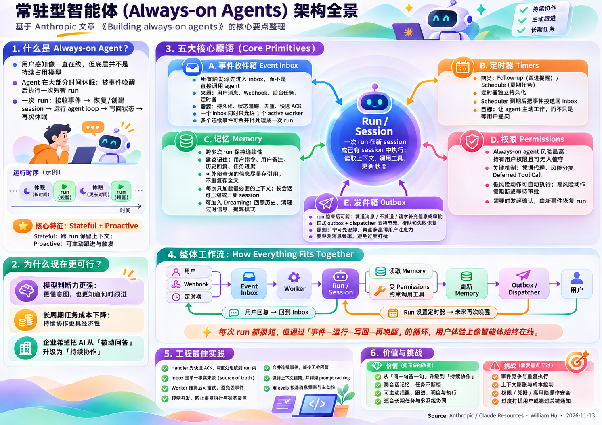
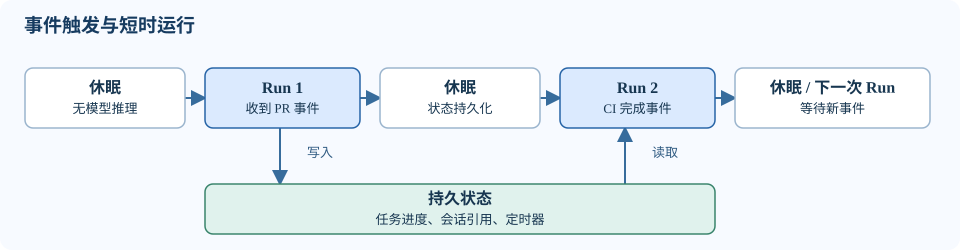
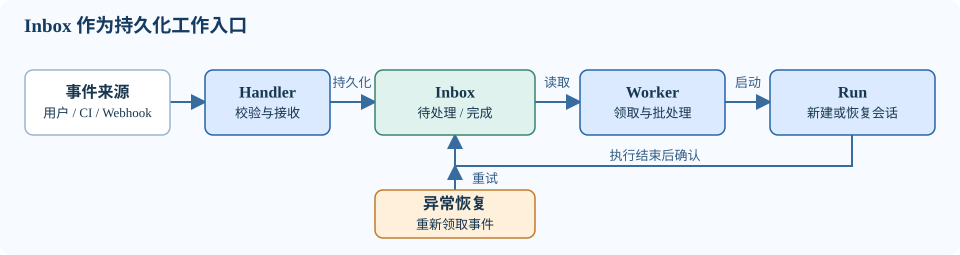
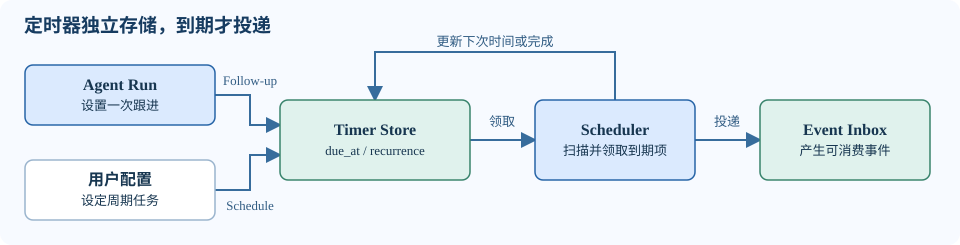
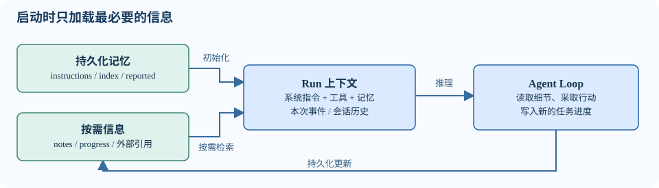
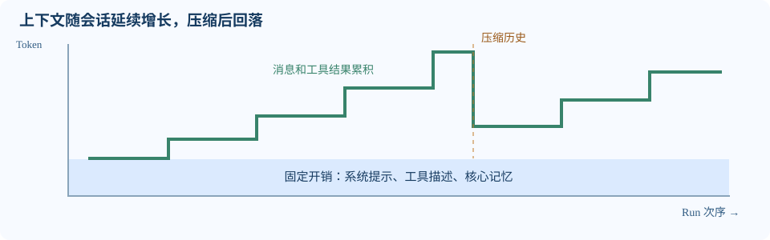
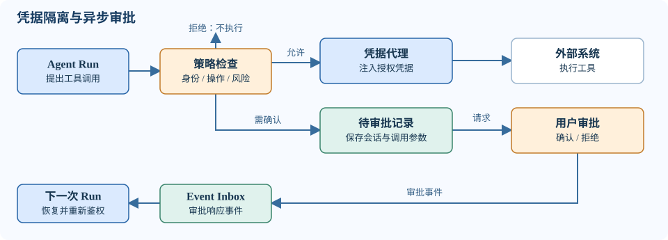
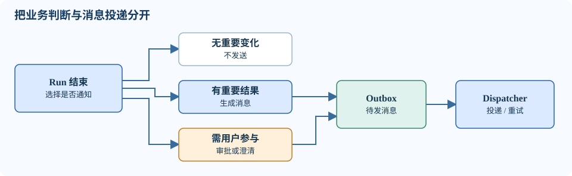
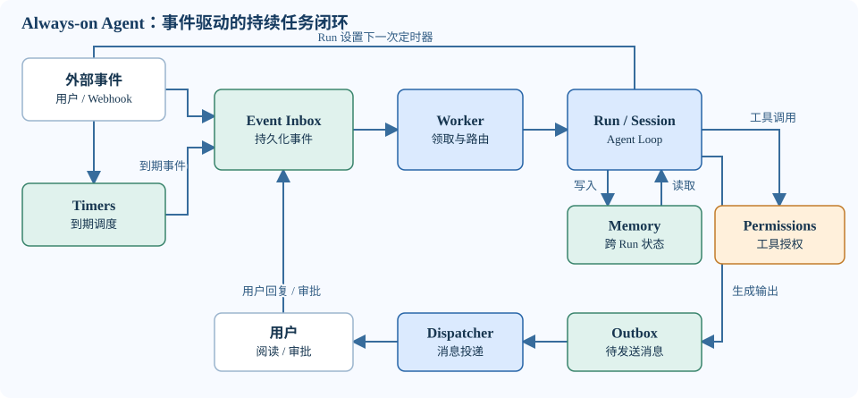

# Always-on Agent 工程学习手册

> 阅读对象：Agent 应用研发、Runtime 与平台架构工程师。  
> 原文：[Building always-on agents](https://claude.com/resources/articles/building-always-on-agents)，William Hu，Anthropic，2026-11-13。  
> 本手册不是逐段翻译。以原文五个原语为索引，图为自主重绘的静态示意，案例、数据结构与可靠性设计属于工程延伸，并非 Anthropic 已披露的内部实现。

## 1. 先理解问题：如何让 Agent 持续负责一件事？

可以把普通聊天 Agent 理解为一次请求驱动的计算任务，把 Always-on Agent 理解为长期存在的逻辑实体，由短暂的计算任务不断推进。关键是把生命周期与模型执行解耦。原文将外围能力归纳为事件收件箱、定时器、记忆、权限和发件箱五类。

**学习案例（贯穿全文）：** 一个代码质量助手持续关注某仓库的 PR，在 CI 完成后检查结果；如果需要通知开发者则发送摘要；如果修复需要审批，则保存现场、等待确认；次日上午再检查未关闭的问题。它不需要一直占用模型或容器。

先看一张常驻型智能体架构的全景 infographics（外部引入的成图，非本手册自绘），建立整体印象后再逐节展开：



### 图 1：生命周期——逻辑在线，计算按需发生



四个概念必须分开：

| 概念 | 在案例中的含义 |
|---|---|
| Agent | 长期存在的质量助手身份与职责 |
| Run | 一次唤醒后的有限执行单元，具有独立执行记录 |
| Session | 可延续的消息、工具调用及其结果记录；多个 Run 可以复用它 |
| Task | 业务层的长期目标，例如跟踪 PR #123；不必等同于 Session |

这里的 Task 是手册额外引入的业务建模概念。生产系统可以让一个 Agent 同时管理多个 Task，但仍需定义它们之间的隔离边界。

## 2. Event Inbox：把事件接入与推理解耦

### 图 2：事件接入、消费与恢复



原文强调统一的持久入口。工程上尤其重要的是：ACK 表示事件已被可靠接收，不代表业务已经成功。Worker 重启后不应依赖内存中的待办列表。

### 工程设计延伸

建议将事件生命周期建模为 `PENDING → CLAIMED → DONE`，异常进入 `RETRY` 或 `DEAD`。示例字段：

```text
inbox_event(event_id, agent_id, source, source_event_id,
            event_type, payload_ref, session_id, status,
            attempts, available_at, lease_until, created_at)
UNIQUE(agent_id, source, source_event_id)
```

同一逻辑分区可采用租约与 fencing token 实现互斥领取；不同用户或任务分区可以并行。不能把数据库唯一键误认为外部工具的 exactly-once 保证：例如发送评论成功后进程崩溃，重试仍可能重复发送，因此需要业务幂等键或先查询已有结果。

**案例：** CI 平台重复推送完成事件，只生成一个待处理记录；用户同时补充要求时，可合并相关事件，或者留给下一次 Run。不能不加区分地合并不同任务的事件。

## 3. Timers：时间也是事件来源

### 图 3：主动跟进与周期调度



| 类型 | 案例 | 生命周期 |
|---|---|---|
| Follow-up | 30 分钟后检查 CI 是否完成 | 一次性；到期后完成，或由 Agent 再安排 |
| Schedule | 每个工作日上午检查未关闭 PR | 按周期计算下次触发时间 |

### 工程设计延伸

```text
timer(timer_id, agent_id, task_id, kind, due_at,
      recurrence, timezone, status, version)
```

核心故障窗口是「更新定时器成功但写入 Inbox 失败」。若同库可在事务中生成事件并更新定时器；跨库可采用可靠投递机制。周期事件可以使用 `timer_id + scheduled_at` 作为去重键。还要定义停机补偿、时区、取消与修改语义。避免 Agent 不断安排过密的自唤醒，给每个任务设频率和预算上限。

## 4. Memory：让任务连续，而非无限堆积历史

### 图 4：分层加载的记忆布局



可以使用逻辑文件组织记忆，但不要求底层真的采用本地文件系统。

| 记忆类别 | 示例 |
|---|---|
| instructions | 不直接合并 PR；只通知相关开发者 |
| notes | 团队偏好简洁摘要，测试环境告警可合并 |
| reported | 已经告知用户的失败原因及消息 ID |
| progress | PR #123 已检查测试，等待审批 |

工程建议：业务事实优先保留可验证的来源引用（例如 PR URL、commit SHA、CI job ID），而不是把动态业务数据复制成永久记忆。权限与患者或客户隐私等敏感约束不能只保存在模型可编辑的记忆文件中，应由独立策略强制执行。

### 图 5：Session 历史与上下文开销（定性示意，非测量数据）



新 Session 不应被理解为失忆：只要必要的任务状态已经持久化，就能从新的上下文继续工作。会话压缩可能丢掉细节，因此不能用摘要代替审批凭证、工具执行结果等可靠记录。Dreaming 可以作为独立的记忆维护任务，对旧记录做归并和过期处理，但建议保留来源与版本以便纠错。

## 5. Permissions：无人值守不等于无限授权

### 图 6：工具权限决策及暂停恢复



工程设计可将权限拆为三层：身份与凭据（谁在调用）、确定性策略（是否具备该资源的操作权限）、风险判断（是否需要人工复核）。风险分类模型不是授权系统的替代品。

```text
approval(approval_id, agent_id, session_id, task_id,
         tool_name, args_hash, requester, status, expires_at)
```

**案例：** 读取 CI 日志可以在既定授权内自动执行；修改分支保护策略则应由组织策略禁止或要求相应审批。等待审批时不应长期阻塞 Worker。下一次 Run 接收到审批结果后，仍要验证审批是否过期、参数是否变化、授权是否撤销。凭据代理也必须约束目标域名、资源与操作范围，不能只是无条件注入 token。

## 6. Outbox：主动通知是一项独立能力

### 图 7：一次 Run 的三种输出路径



原文将正式的 Outbox 视为按需引入的能力，而非任何 Agent 都必备的数据库表。简单应用可直接调用发送工具；有复杂投递和故障恢复需求时，再分离 Dispatcher。

工程设计延伸：消息应区分业务重要性、目标渠道、去重键、发送状态、失败次数及下次重试时间。将业务状态与待发消息尽可能原子写入，避免任务已完成却没有生成通知。接收端支持幂等时使用稳定消息 ID。

**案例：** 10 个测试用例失败不应必然发 10 条消息；聚合成一个问题摘要可能更有用。衡量通知质量时，可观察重复通知率、被忽略比例、关键事件漏报率和用户处理时延，而非只看发送数量。

## 7. 五个原语如何协同（全局重点）

### 图 8：整体架构及两条反馈回路



### 用一条真实可理解的任务时序串联

以下为手册假设的 PR 助手场景，不是原文产品演示。

| 时间 | 发生什么 | Run 的结果 |
|---|---|---|
| 09:00 | PR 创建事件进入 Inbox | R1 读取 PR，记录任务进度，设置跟进定时器后退出 |
| 09:12 | CI 失败 Webhook 到达 | R2 分析日志，记录失败原因，生成摘要；Dispatcher 投递 |
| 09:15 | 用户要求自动修复 | R3 准备修改；若策略要求审批，保存现场并退出 |
| 09:18 | 用户审批事件到达 | R4 恢复会话，重新鉴权并执行被批准的操作 |
| 09:30 | 跟进定时器到期 | R5 检查最新状态；如无新信息则静默结束 |
| 次日 | 周期任务触发 | R6 扫描未关闭事项，按需发送合并摘要 |

关键理解：Run 不是长期任务的边界。即使 R3 在等待批准，Worker 也可以处理其他满足隔离要求的事件。长期任务是否完成应由业务状态判定，而不是由最后一条模型回复决定。

## 8. 从架构图到可实现的 Java Runtime（工程延伸）

既有 Spring Boot / Workflow 系统无需为了 Always-on 重写全部 Agent Loop。可以把工作流作为一次 Run 的执行器，新增事件与调度层、持久状态和异步交互协议。

| 模块 | 可采用的实现 | 必须验证的问题 |
|---|---|---|
| Event 接入 | HTTP Handler、消息消费者、关系数据库 | 重复投递、事件丢失、同分区并发 |
| 调度 | 数据库定时扫描或可靠执行引擎 | 到期延迟、取消、停机补偿 |
| Run Runtime | Worker + 现有 Workflow 执行器 | 超时、恢复点、执行预算、终止条件 |
| Memory | 数据库或对象存储、版本化引用 | 过时信息、隔离、并发写入 |
| Policy | RBAC/ABAC、工具代理、审批服务 | 越权、凭据泄露、审批重放 |
| Outbox | 消息表 + Dispatcher | 重复通知、失败重试、投递状态 |
| Observability | Run trace + 事件与任务关联索引 | 能否还原跨多次 Run 的完整决策链 |

建议保持 `agent_id / task_id / session_id / run_id / event_id / tool_call_id` 的明确语义。一次 Run 可对应既有的执行 trace，长期任务则由 task_id 串联，不必将所有运行压进一个 trace。

### 最小验证清单

| 故障注入 | 期望行为 |
|---|---|
| 相同 Webhook 投递两次 | 同一个业务事件不重复推进 |
| Worker 在工具成功后崩溃 | 通过幂等或状态核对避免重复副作用 |
| Scheduler 在投递前后崩溃 | 到期事件可恢复、不永久丢失 |
| 审批等待数小时 | Worker 释放，重启后仍可正确恢复 |
| 用户撤销授权 | 恢复时拒绝已失效的操作 |
| 消息投递失败 | 独立重试，不重复执行业务任务 |
| 上下文超长 | 按任务持久状态继续，关键凭证不丢失 |
| Agent 频繁自唤醒 | 调度预算与频控生效 |

## 9. 阅读后的判断

Always-on Agent 最值得学习的不是再写一个无限循环，而是如何将一次性模型推理变成可长期运营的业务过程。对企业 Agent 平台来说，事件可靠性、长期任务管理、权限与恢复协议通常比单纯增加模型调用次数更重要。

这不是说所有问答或固定 SOP 都应该变成 Always-on Agent。只有任务需要跨时间推进、外部事件响应或异步等待时，这些额外的基础设施才有清晰价值。

---

**阅读来源与图示说明：** [Anthropic 原文](https://claude.com/resources/articles/building-always-on-agents)。图 1–5、7–8 对应原文七处图示的主题，图 6 是针对权限部分补充的原创示意。图示为独立 SVG 文件（`figures/fig-1.svg` … `figures/fig-8.svg`），静态绘制，不复刻原文动画；开头的全景 infographics（`figures/always-on-architecture-overview.png`）为外部引入的成图，非本手册自绘；工程示例与字段为本手册补充。Markdown 渲染器（如 GitHub）会过滤内联 SVG，因此图示以图片引用方式嵌入；另提供自包含的 [HTML 阅读版](always-on-agent-handbook.html)，图示已内联，可离线查看。