# 《业务价值的艺术》读书笔记

**英文书名**：The Art of Business Value
**原著**：Mark Schwartz（IT Revolution Press，2016）
**副标题**：一本关于「业务价值到底是什么」的侦探小说 —— 排除法 + 中心定义 + 落地实验
**笔记信息**：v4.0 · 约 60 分钟 · 文中 13 张示意图在本页 `assets/` 目录下，浏览器中可直接显示，含 title/desc 无障碍元数据

## ⚡ 30 秒读懂

**一句话**：业务价值**不是一个值**，是组织领导层的一个**假设**（关于什么最能实现组织目标），需要整个团队用实验去发现和验证。

**为什么这本书重要**：敏捷二十年，PO 天天喊"最大化业务价值"，但没人定义过这个概念。本书给出的答案是：**不是公式，是假设**——所以价值没法"算"出来，只能"经营"。

**三条核心带走**：
1. **价值是组织特定的**——股东价值只是特例（上市 5008 家 vs 美国 2700 万家），其他组织的价值是老板/董事的主观选择，藏在该组织的**文化**和**规则**里。
2. **价值随时间演化**——用 **CD3**（延迟成本/工期）、**情景规划**、**实物期权**这三个工具经营"时间维度"上的价值判断，比 ROI/NPV 实在得多。
3. **开发即业务**——本书的真正靶子是「业务 vs IT」这堵墙，从瀑布的"扔需求"、到敏捷的"PO 传话"，Schwartz 的终点是**拆墙**：开发不是 IT 的事，是业务本身的事。

**怎么读这本笔记**：
- 🚀 **5 分钟扫读**：只看每节末尾的「核心收获」和 §0、§5、§9 三节。
- ⏱️ **15 分钟速读**：跳过"我的判断"标注和"延伸思考"，只看主线。
- 📚 **25 分钟精读**：从头读到尾，重点看图和案例。

**何时不适用**（详见 [§21 本书盲点](#21-本书盲点schwartz-可能错的地方)）：

- 生死攸关的实时系统（航空 / 手术 / 核电站）—— 命令-控制才是对的
- 5 人以下创业团队 —— 降级使用，规则三问 + CD3 就够
- 领导层完全不听反馈 —— 先解决组织健康，再谈这套工具

**本周就能做的三件事**（完整版见 [§10 行动清单](#10-行动清单按角色)）：

1. 把 backlog 用 CD3 排一遍（延迟成本 ÷ 工期），不拍脑袋
2. 下个功能动手前，先把业务指标建到仪表盘里（BiDD）
3. 挑 3 条烦人规则，用"三问"找底层需求

---

## 读者指南

这不是一份原书摘要，而是一份**带立场的阅读笔记**：

- **不按章节**写，按"这本书在我脑子里的逻辑"重新组织 —— 重要概念多着笔墨，边角一笔带过。
- **每个核心论点附判断标记**：✓ 认同 / △ 有保留 / ✗ 存疑。标的是我当时读到这里信了几分，方便日后回看。
- **每章末有"核心收获"**，扫读也能抓到要。
- **附 13 张 SVG 示意图**贯穿全文（`assets/` 目录），含 `<title>`/`<desc>` 无障碍元数据（屏幕阅读器友好），帮助建立心智模型。

### 三种读法路径



## 目录

0. [一句话记住这本书](#0-一句话记住这本书)
1. [排除法：为什么财务答案必死](#1-排除法为什么财务答案必死)
2. [线索一：文化 —— 组织"过去什么算有效"的沉积](#2-线索一文化--组织过去什么算有效的沉积)
3. [线索二：规则 —— 官僚制是被编码的业务需求](#3-线索二规则--官僚制是被编码的业务需求)
4. [主角归位：IT 不能置身事外](#4-主角归位it-不能置身事外)
5. [中心定义（全书唯一真正核心）](#5-中心定义全书唯一真正核心)
6. [三个时间工具（最实用的部分）](#6-三个时间工具最实用的部分)
7. [被会计漏掉的资产](#7-被会计漏掉的资产)
8. [八个打法（按"我愿不愿意试"重排）](#8-八个打法按我愿不愿意试重排)
9. [终审判决](#9-终审判决)
10. [行动清单（按角色）](#10-行动清单按角色)
11. [金句备查](#11-金句备查)
12. [延伸思考（不只是作者说的）](#12-延伸思考不只是作者说的)
13. [常见疑问 / FAQ](#13-常见疑问--faq)
14. [附录：原书各章对照](#14-附录原书各章对照)
15. [术语表](#15-术语表)
16. [延伸阅读](#16-延伸阅读)
17. [可粘贴分享卡片](#17-可粘贴分享卡片)
18. [应用踩坑指南（读完后真正用起来）](#18-应用踩坑指南读完后真正用起来)
19. [致谢](#19-致谢)
21. [本书盲点（Schwartz 可能错的地方）](#21-本书盲点schwartz-可能错的地方)
24. [实战案例索引](#24-实战案例索引)

---

## 0. 一句话记住这本书

> **业务价值不是一个值，是组织领导层的一个假设。**

围绕这一句，作者把敏捷界所有现成答案挨个打倒（财务指标 × / 客户价值 × / PO 独裁 × / 官僚消灭论 ×），然后**只**给一个工具箱（CD3、情景、实物期权）和一组实验（八个打法）。

> **读后最深的反直觉**：作者不是在教你"如何衡量"价值，他是在告诉你 —— **衡量本身就是个伪问题，别再追公式了，去问老板到底赌什么。**

整本书真正打的只有一个靶子：**「业务 vs IT」这堵墙**。敏捷二十年，从瀑布的「扔需求」、到 Scrum 的「PO 传话」，都在维护这堵墙；作者的终点是**拆墙** —— **开发即业务**。

### 论证链一图流


### 价值假设如何运转（全书操作心法）



> **核心收获**：本书不是讲"如何衡量"，而是讲"假设如何经营"。记一句话：价值是假设；记一张图：排除法 → 两条线索 → 中心定义 → 工具 → 落地；记一个循环：假设 → 翻译 → 实验 → 观察 → 修订。

---

## 1. 排除法：为什么财务答案必死

这是全书最硬的一段，也是后来定义能立住的根基。

### 1.1 主流操作化的失败链

股东价值 → MVA/SVA → **NPV**（Brealey & Myers：管理者应"最大化净现值"）。

作者用一个 MBA 课堂笑话开刀：学生做 NPV 作业算出 **−$49,000**，老师答 "**Don't do it!**" —— 讽刺指标把决策退化成一行算式。

### 1.2 NPV/ROI 三宗罪



> 这三条每一条都够单独写一篇文章。**最致命的是第三条** —— 财务指标的"客观"幻觉让我们忘了预测者本人的偏见。

△ **有保留**：作者用"魔法解读"命名第三条，但避开了更关键的一层 —— 很多组织里的 NPV 就是被"魔法解读"推出来，故意服务特定激励（部门利益、CEO 套现）。这不是哲学问题，是**治理问题**。

### 1.3 更根本一击：股东价值不是普遍答案

**2700 万 vs 5008** —— 美国约 2700 万家企业，上市的只有 5008 家。剩下那 2700 万家，"价值"是什么就完全是另一回事了：



**结论（✓ 铁定认同）**：业务价值是**组织特定**的，财务教科书替你回答不了，只能自己进组织里去找。

**推论（✓ 同样铁定）**：既然是组织特定的，它必然藏在该组织的**制度记忆（institutional memory）**里。两个载体：**文化**和**规则**。引出下两节。

> **核心收获**：NPV/ROI 三宗罪（假精度 / 忽略期权 / 假装客观）+ 股东价值不普适 → 价值必须从组织内部发现 → 藏于文化与规则。

---

## 2. 线索一：文化 —— 组织"过去什么算有效"的沉积

> **📖 前置阅读**：[§1 排除法](#1-排除法为什么财务答案必死)（理解"价值藏在组织里"为什么是必然结论） / [§0 一句话](#0-一句话记住这本书)（建立整体框架）

### 2.1 先拆掉 PO 单一接口模型

Scrum 用 PO（产品负责人）这个角色来回答价值问题：团队只需要听 PO 的。作者给这个角色起了个外号 **OPYCLT（The Only Person You Can Listen To，唯一能听的人）**，指出它本质上是**封装/防火墙** —— 团队与组织隔开，PO 是唯一接口。

Pichler 说 PO "sits in the driver's seat"（坐在驾驶座上）—— 作者质问：

> **OPYCLT / 驾驶员，和等级组织里团队向她汇报的经理有什么区别？敏捷是不是为了让命令-控制层级接纳自己，才发明了 PO 这个角色？**

OPYCLT 装不下的两个事实：

- **安全 / 非功能需求**横跨多个系统、多个 PO 的辖区，单一接口吞不下；
- **业务自己也不知道什么创造价值**（Lean Startup 前提）—— PO 拍板也是瞎拍，价值必须靠**实验**发现，实验是团队用快速反馈回路做的，PO 挡在中间反而堵死团队与组织的接触。

### 2.2 角色反转：PO 从"驾驶员"到"语境设定者"


### 2.3 核心反转

> **「企业文化不是敏捷采用的障碍；它是一条宝贵线索。」**

Schein 给文化的定义：一群人在解决外部适应、内部整合这些问题的过程中**学到的**共享基本假设 —— 因为当年确实管用，才一代代传了下来。说白了：**文化 = 这个组织过去"什么行为真正创造过价值"的沉积**。

**方法论**：Avery 的 **provoke and observe**（试探加观察），和敏捷的 inspect and adapt 一个路数 —— 小步试探组织边界，观察反应，看什么被鼓励、什么被抵抗 —— 团队就这样亲身参与**组织定义价值的过程**，替组织做价值实验。

△ **有保留**：作者把"文化"浪漫化得有点过头。**坏文化就是坏文化**，有些组织沉积的不是"有效"，是"路径依赖 + 既得利益"。对待坏文化不能只 provoke and observe，必要时得明确挑战。

我同意的是：**别把文化当借口先动手** —— 先考古，再拆迁。

> **核心收获**：文化 = 制度记忆。PO 不该是 OPYCLT（团队与组织之间的防火墙），而该是语境设定者。团队与组织保持接触，provoke and observe，才能参与价值发现。

---

## 3. 线索二：规则 —— 官僚制是被编码的业务需求

> **📖 前置阅读**：[§1 排除法](#1-排除法为什么财务答案必死)（理解"为什么不能外包给财务"）/ [§2 文化](#2-线索一文化--组织过去什么算有效的沉积)（与本节构成"制度记忆的两载体"）

### 3.1 软木板方法论

> **30 秒版**：Schwartz 进入一个新组织看到软木板签到，他没有抱怨，而是**把"烦人规则"当成了解组织的窗口**。问 3 个问题 → 找到底层需求 → 找更精益的方式。

开场：门厅软木板要求访客签到签退。作者**没抱怨，问了三件事**：

- 这条规则在保护什么价值？→ 安全
- 谁需要？→ 物业、HR、法务
- 哪些更精益的方式能满足同一需求？→ 数字签到、门禁卡

> **这个思考动作就是全书的方法论样板。**

**为什么软木板这个例子这么重要**：

- **小到不起眼** —— 任何组织都有的"烦人小事"
- **完整走通三问** —— 不是抽象原则，是**具体动作**
- **能立刻套用** —— 读者读完立刻能对自己组织试
- **颠覆直觉** —— 大多数人看到烦人规则的反应是"绕开"或"硬砍"，**没人想到"找底层需求"**

> 这就是 Schwartz 的方法论 —— **不假设规则错，先假设规则背后有真实需求，再找更优解**。

### 3.2 论证

- **程序员是天生的官僚**（作者原话）：最爱规则 —— 代码规范、测试必过、构建必绿。敏捷没有消灭规则，只是**把规则写成了测试和流水线**。
- **Weber**：官僚制是人类组织最理性的形式（规则化、非人格化、可预期）。**别跟官僚制打意识形态仗，把它当工程问题来解。**
- 正解公式：**找每条规则背后的底层业务需求 → 用更精益的方式更好地满足它。**
- **合规不是浪费**（✓ 极认同，作者在原书第 4 章讲的这条被业界严重低估）：透明度帮管理、安全测试保护老兵（防回归）、法务降风险、遵守品牌规范强化品牌 —— 都是**业务价值**（不是客户价值，呼应 [§1.2](#12-npvroi-三宗罪)）。
- 两种官僚制（Adler, NUMMI 研究）：
  - **合规型**（照章办事防出错）→ 该精益化
  - **学习型**（规则由一线持续修订）→ 该建强调优
- 顺手批判敏捷领袖的口吻："安全实践 not optional" —— 这是命令-控制的调子。

> **「官僚制交付业务价值。只是有时不够多。」** —— 本章题眼。

### 3.3 规则处理流程



> **核心收获**：烦人规则 ≠ 浪费。找底层业务需求 → 找更精益方式。CD 流水线本质是"自动化的学习型官僚"。

---

## 4. 主角归位：IT 不能置身事外

> **📖 前置阅读**：[§2 文化](#2-线索一文化--组织过去什么算有效的沉积)（PO 单一接口为什么不行）/ [§3 规则](#3-线索二规则--官僚制是被编码的业务需求)（规则不是浪费）

### 4.1 Intrax 失败案例

作者入职 Intrax 时接手一个"成功"项目：按时、按预算、完整交付业务部门要的一切 —— **然后没人用**。

> **这不是执行失败，是价值失败。** 需求方自己也没想清楚什么创造价值。**「按时按预算交付了业务要的一切」照样可能彻底失败。**

### 4.2 CEO 的红字

CEO Takeshi 对当时担任 CIO 的作者说：

> **「你的工作，就是确保我从 IT 投资里获得良好的回报。」**

一句话把 IT 的责任从「交付功能」改写为「**交付回报**」。

### 4.3 点单员 vs 时装店员

敏捷常把 IT 比作快餐店点单员（接单、照做）。但**时装店员也是**接单 —— 区别在哪？

| 角色 | 接单方式 | 价值判断 |
|---|---|---|
| 快餐点单员 | "您点什么我做啥" | 无 |
| 时装店员 | 问场合、给搭配、说服您买配套商品 | **有** |

> **问题从来不是"接不接单"，是接单时有没有价值判断参与。** 推论：
> - IT 必须从「接单员」升级为「**业务价值的解释者（interpreter of business value）**」；
> - **PO 可以从 IT 组织里出** —— 最懂技术潜在价值的人最清楚毛球里藏着什么；
> - 再从结构上看：安全加固、云迁移这类**跨项目工作**本来就不属于任何单个产品的 backlog，OPYCLT 根本装不下，IT 必须以**组织级角色**参与价值定义。

### 4.4 全书真正的靶子：拆墙

整本书表面在定义一个词，**实际在打一面墙**：


△ **有保留**：作者让 IT 自认"价值回报责任"，说得漂亮，但实际出了价值失败，**账算到谁头上**？"按时按预算交了差、照样被追责"的 IT 部门并不少见。这需要治理层面的支撑，光靠 CIO 自己认领解决不了。

> **核心收获**：IT 责任从"交付功能"升级为"交付回报"；真正的终局不是 PO 传话，是墙拆了 —— **开发即业务**。

---

## 5. 中心定义（全书唯一真正核心）

> **📖 前置阅读**：[§1 排除法](#1-排除法为什么财务答案必死)（理解"为什么不能用公式定义价值"）/ [§2 文化](#2-线索一文化--组织过去什么算有效的沉积)（+ [§3 规则](#3-线索二规则--官僚制是被编码的业务需求) = 制度记忆的两载体） / [§4 IT 归位](#4-主角归位it-不能置身事外)（理解 IT 的位置）
>
> **💎 本节是全书唯一非跳过的核心**。如果只读 5 分钟，**只读本节 + §0**。

> **🎯 本节 30 秒版**：
> - **不变量**：业务价值 = 领导层的一个**假设**（关于什么最能实现组织目标）
> - **三个推论**：① 可被检验（不是真理）② 是一组指标（不是单一数字）③ 随时间演化（CAS 自然选择）
> - **实践含义**：把"价值"从**抽象口号**变成**可执行取舍标准**（如 Netflix 的"留存新试用用户→股东价值"）

### 5.1 缺失的维度：时间 + 不确定性

前面所有讨论都是**静态**的。敏捷其实已经给功能决策加上了时间维度（小批量、快速反馈），但"价值是什么"仍然被当成给定的前提。作者在这之上又加了两点：

1. 组织对价值的**理解**随学习演化 —— 今天的价值定义明天就该被修正；
2. 价值评估必须考虑**时间价值** —— 同样一笔收益，早到比晚到值钱。

理论支撑：**组织是复杂适应系统（CAS）**（Clippinger《The Biology of Business》）。
领导无法"控制"这样的系统，只能**塑造其进化** —— Anderson 关键句：

> 「经理通过**强调某些指标**来塑造网络的行为 —— 他们相信这些指标最终会导向长期盈利。」

**推论**：领导影响力的一半就在"定义什么算数"上。**折现率选多高，其实就是在替整个组织拍板：要长期还是要短期**。Takeuchi/Nonaka 1986 年就说过"微妙控制（subtle control）与自组织团队相容" —— 领导设语境，团队自组织。

### 5.2 定义宣读

> **💡 「业务价值，是组织领导层所持有的一个假设（hypothesis）：关于什么最能实现组织的最终目标或期望成果。」**
>
> *"Business value is a hypothesis held by the organization's leadership as to what will best accomplish the organization's ultimate goals or desired outcomes."*

**Schwartz 的写作背景**（帮你理解这定义为什么这么"短"）：

- **不说"价值 = X"**（如"价值 = 股东财富最大化"）—— 因为不同组织"X"不同，**等于逼每个组织交出自己的专属定义**
- **不说"价值 = a + b + c"**（如"价值 = 营收 + 满意度 + 风控"）—— 因为那是**结果**不是**定义**；他说的是**驱动这些结果的那个东西**
- **用"假设"** —— 因为假设**可被检验**，不是真理
- **强调"领导层"** —— 因为**定义权**有归属，下一步才能谈"假设证伪后怎么修订"
- **强调"组织目标"** —— 而不是"客户目标"或"员工目标"——把视野**限定在组织层级**

> **这定义不是"答案"，是"问题"**。它逼每个组织回答"我们到底赌什么"。

### 5.3 三个推论 —— 这三条最值得背



**第一条详解**：Netflix 领导层赌的是「**留存新试用用户**（专指新客，不含回归老客）直到转化为付费用户，将驱动股东价值」。这个定义一落地，团队立刻知道"先保新客还是先保老客"冲突时听谁的 —— **价值从抽象口号变成可执行的取舍标准**。这才是定义的真正威力。

**第二条**：营收 + 客户满意度 + 风险管理 + 品牌建设 …… 加总逼近最终目标。所以疟疾组织的"涨知识"也合法。

**第三条**：CAS 里的自然选择 —— 领导设好指标和激励，组织去做实验，有效的行为自然沉淀下来。

△ **有保留**：这个定义政治上有点滑头。"是领导层的假设" —— 言下之意，团队不必为价值失败负责，因为定义权不在团队。但实操中**领导层定义不清就是 IT 背锅**（[§4.1 Intrax 反例](#41-intrax-失败案例) 就是）。**读这本书的 IT 人，别拿"假设"两个字给自己开脱** —— 你仍然是那个翻译者，是把领导层模糊的假设落成可执行指标的苦力。

> **核心收获**：业务价值 = 领导层的假设。可证伪 / 指标组 / 时间演化 —— 这三个推论让"价值"从一个哲学问题变成可操作问题。

> **🤔 反思问题**（给自己 5 分钟）：
> 1. 你组织当下**明确说出的价值假设**是什么？（提示：翻最近一次全员会、年报、CEO 邮件）
> 2. 如果是口号，**能改成"可被检验"的格式**吗？（格式：「如果做 X，那么 Y 指标在 Z 个月内上升」）
> 3. 你组织**现在最缺哪条推论**？（假设不清楚？指标缺失？从不修订？）
> 4. 假设你是领导层，**你会赌什么**？**配套什么指标**？
>

---

## 6. 三个时间工具（最实用的部分）

> **📖 前置阅读**：[§5 中心定义](#5-中心定义全书唯一真正核心)（理解"价值是假设"才用得上这三个工具）/ [§1 排除法](#1-排除法为什么财务答案必死)（理解"为什么 NPV 不够"）
>
> 这一节我认为是**整本书真正值得反复读**的部分。前 5 章是哲学，这是真刀真枪。

### 6.1 对比一图流



### 6.2 详述

> **三个工具的速查（一句话版）**：
> - **CD3**：问"晚 2 周上线亏多少钱"
> - **情景规划**：准备 2-3 套未来剧本，配先导指标
> - **实物期权**：投资 = 花钱买选择权，不确定性越大等待越值钱

---

**① CD3**（Reinertsen《Product Development Flow》）

> **一句话**：拿"晚交付的损失"除以"工期"，用这个比值替代 ROI/NPV 来排优先级。

延迟上线的成本**可以算**。判据：「缩短交期的投资」 < 「延迟成本」 → 投资增值。
优先级用 **CD3 = 延迟成本 ÷ 工期**。Maersk 航运实战（Arnold & Yüce）。

妙处：不需要知道功能全生命周期的收益（这是 NPV 假精度的根源），只需要"够用于横向对比"的信息 —— **绕开了假精度**。

> ✓ **最值得在团队立即试**。比 ROI 简单得多。
> 
> 🎯 **本节动手题**：打开你的当前 backlog，选 3 个 story，**算一下"晚 2 周上线亏多少钱"**。你会发现 NPV 排不出的优先级，CD3 一目了然。

**② 情景规划**（Peter Schwartz《The Art of the Long View》）

> **一句话**：放弃"baseline 一条线"，准备 2-3 套未来剧本，每套配先导指标。

> 「情景不是预测未来，而是在**当下感知多种未来**。」

不把多种未来加权平均成一个数（那又回到假精度），而是**保留每个情景的高清细节**；为每个情景配好**先导指标（leading indicators）**，哪条先应验，就知道"现在上演的是哪一出" —— 所谓"**使用情景，就是排练未来**"。

比 ROI/NPV 更丰富的价值构成视图，还顺带提升了组织敏捷性。

> 🎯 **本节动手题**：写下你组织**最关心的 3 个不确定性**（如"竞品降价"/"监管变化"），为每个找 1 个"如果 X 发生就代表 Y" 的**先导指标**。

**③ 实物期权**（Dixit & Pindyck, HBR）

> **一句话**：投资 = 花钱买选择权；不确定性大时，**等待本身就有价值**。

> 投资机会 = 一张看涨期权。决定投资 = 行使期权，**放弃等待新信息的权利**。

书里用苹果股票举例：花 $0.41，买一份一个月期、行权价 $140 的权利（有权无义务）。

NPV 规则必须修正：

> 现值不仅要超过成本，且**超出部分 ≥ 持有期权的价值**。

推论：不确定性越大，等待越值钱 → **"在最后责任时刻决策"这条精益原则有了经济学证明**；给组织留后路的功能（灵活架构、R&D、BI 仪表盘）的真实价值高于其现金流。

作者的讽刺我太喜欢了：

> **「实物期权，就是给敏捷（agility）估值的方式」** —— 敏捷社区天天把"创造选择权"挂嘴边，却用忽略选择权价值的 ROI 排优先级。

> 🎯 **本节动手题**：列你组织**未来 12 个月**的 3 个大额投资决策，**算一下"现在决策 vs 等 6 个月再决策"哪个亏** —— 多数情况下"等"是更值的。

### 6.3 三工具对比（什么时候用哪个）

| 场景 | 用哪个 | 为什么 |
|---|---|---|
| **排 backlog 优先级** | CD3 | 简单到能团建时算，只需要"够用"信息 |
| **面对竞争博弈 / 不确定战略** | 情景规划 | 不预测未来，而是排练未来 |
| **评估"是否做 R&D / 灵活架构 / BI 仪表盘"** | 实物期权 | 这些投资的价值 = 给组织留的选择权 |
| **季度 OKR 设定** | CD3 + 情景 | CD3 排，情景防"baseline 一条线"陷阱 |
| **跨年长期投资决策** | 实物期权 | 不确定性大，等待本身值钱 |
| **说服 CFO / 财务** | 期权 | 财务人员熟悉 NPV，加一个修正项比推翻 NPV 容易 |

> **核心收获**：CD3、情景、期权 —— 三个工具都带时间维度，都不假装算得准未来。**比 ROI 实在得多**，建议团队选一个先试。

---

## 7. 被会计漏掉的资产

> **📖 前置阅读**：[§5 中心定义](#5-中心定义全书唯一真正核心)（理解"价值是假设"才明白为什么会计漏掉）/ [§4 IT 归位](#4-主角归位it-不能置身事外)（理解 IT 责任升级为"交付回报"）

这一段在原书是一带而过的（原书 §6.4），但**我读时反而觉得最有价值** —— 因为这才是数据 / IT 部门最大的价值来源被低估的地方。

组织真正的资产不止资产负债表上的：

- **已验证的学习**（最被低估）
- **数据**（不是"大数据"那种废话，是业务里运行出来的可信数据流）
- **企业架构**（那团 legacy 毛球）
- **规则与文化**（= 制度记忆本身）

这些是**潜在价值流**，需要催化剂在未来解锁。围棋里叫 **aji（余味）** —— 你现在不落子，但未来某手棋时它会发挥作用。



点估计式的估值全都看不见它们 —— 这就是**IT 部门永远"显得"不值钱的原因**：财报上不存在的东西，市场是看不见的。

Hubbard《How to Measure Anything》给了一条出路：

> **信息的价值 = 期望损失之差**（有这条信息时的损失 − 没有这条信息时的损失）

这就是"为什么这个仪表盘值得做"的可计算答案。

△ **有保留**：作者诚实承认这些"资产"有时是负的（糟糕的 legacy 反而是负担）。**但判断哪些是资产、哪些是负担，本身就需要先有正确的价值假设** —— 又绕回第 5 节的循环。这是**架构治理的永恒难题**，不是一本书能解的。

> **核心收获**：IT 的真实资产（学习/数据/架构/制度记忆）大多不在财报上，**用期望损失之差为它们估值**，是 IT 部门讲清楚自己价值的最实用句式。

---

## 8. 八个打法（按"我愿不愿意试"重排）

> **📖 前置阅读**：[§5 中心定义](#5-中心定义全书唯一真正核心)（理解"价值是假设"才用得着这八个）/ [§6 三个时间工具](#6-三个时间工具最实用的部分)（CD3 是打法 4，期权思维是 4 的灵魂）
>
> 作者声明：这是**实验**不是处方。下面把八个按"我个人最有动力试"的顺序排，并标注每个的**尝试理由**。

### 8.1 三档金字塔



### 8.2 最值得试（前 3 名）

| 打法 | 一句话 | 立刻能做的事 | 我的理由 |
|---|---|---|---|
| **🥇 #4 Explore the fourth dimension** | CD3 + 期权池 + 简单设计 | 把当前 backlog 拿来算 CD3 重排；生成 4-5 倍可选故事 | 成本极低（流程动作），立刻改变决策视野 |
| **🥈 #2 Extend the pipeline（BiDD）** | 先建指标仪表盘再写代码 | 下次新功能前先在 BI 系统建业务指标 | 把"团队对业务结果负责"机制化（△ 前提是得有那批指标） |
| **🥉 #1 Build the pipeline（CD = 自动化学习型官僚）** | 测试即规则，自动化合规 | 给当前流水线加测试 / 加安全扫描 | CD 是地基；测试就是规则，通过安全测试 = 安全（sine ira et studio） |

### 8.3 第二档

| 打法 | 一句话 | 适用场景 | 我的理由 |
|---|---|---|---|
| **#3 Search for gems in the waste** | 烦人规则三问 + Impact Mapping + 招安合规 | 团队抱怨"合规 / 法务 / 审计太重"时 | 组织里最被忽略的价值矿（△ 合规"招安"是政治工程） |
| **#5 Polish the hairball** | 把 legacy / EA 资产当"潜在价值流" | 评估"哪些老系统该下马 / 哪些是宝"时 | 数据 / 架构 / 学习是被低估的资产（[§7](#7-被会计漏掉的资产)） |
| **#6 Govern wisely** | 投结果不投项目；奖励有价值的失败 | 年终治理 / 季度 OKR 评审脱节时 | 治理和执行的错配必须修（△ 但极度依赖 CFO 配合） |

### 8.4 思想实验级

| 打法 | 一句话 | 我的理由 |
|---|---|---|
| **#7 Change partners** | 团队拥有整条价值链；PO 反转（向团队汇报） | 理论上最彻底的组织变革（△ 实操中**完全反人性**） |

**#8 Feed the CIO**
CIO 六顶帽：价值语境合伙人 / 乐队指挥 / 毛球打磨者 / 障碍清除者 / 团队园丁 / **规则守门人**。书里有一段少见的坦白：作者承认自己直接下过命令（团队不写自动化测试，他没等他们"回顾悟道"，直接下令必须写）—— 但公式是：定目标 → 从团队学习 → 把学习固化成规则（制度记忆）→ 循环。
→ **理由**：六顶帽是愿景。具体落地因组织而异。

> **核心收获**：八个打法不是均权的 —— **第一档三件事成本最低、最该先试**；第七、八是组织深层变革，留给"想动大手术"的人。

---

## 9. 终审判决

> 业务价值不是「业务方」才懂的东西，没有什么 MBA 魔法。它是我们所有人都可以讨论、质疑、争论、贡献的东西 —— 是我们**必须**讨论的东西，因为光交付功能不会自动变出价值。
>
> **「最终，业务价值就是业务所看重的东西，仅此而已（business value is what the business values, and that is that）。」**
>
> 如果开发和业务之间根本没有硬边界 —— 开发本来就是业务的一部分 —— 那就，**去吧，去创造业务价值。**

---

## 10. 行动清单（按角色）

> **📖 前置阅读**：[§8 八个打法](#8-八个打法按我愿不愿意试重排)（看清三档分层）/ [§5 中心定义](#5-中心定义全书唯一真正核心)（行动背后的世界观）/ [§18 踩坑指南](#18-应用踩坑指南读完后真正用起来)（避免常见错误）



### 如果你是 PMO / CIO

- 排 backlog 用 CD3；每个 epic 多问一句："它给组织留下什么**选择权**？"
- 推动修正**治理与执行的节奏错配** —— 立项不锁功能清单，锁要解决的问题和指标
- 招安合规人员比教育他们更有效

### 如果你是产品经理 / PO

- 写代码前先和业务定 2–3 个**可观测指标**（BiDD），盯仪表盘代替主观汇报
- 你的工作不是"替团队决定价值"，是"把领导层的假设翻译成可执行指标"
- 团队找你提需求时，多问一句"对哪条业务价值假设有利？"

### 如果你是 team lead / 工程师

- 遇到烦人流程：先问"当年解决什么问题" → 找底层需求 → 提精益方案
- 团队吵优先级吵不动时，识别一下：这不是执行分歧，是**价值定义不一致** —— 升级到领导层去对假设
- 别绕过 CD 流水线去"快" —— 流水线就是学习型官僚，它的速度上限就是你的学习速度上限

### 如果你是组织最高层

- 选哪几条指标进入你的 NPV / OKR 评审，就是在替整个组织拍板：要长期还是要短期
- 你的 NPV 折现率是一个**政治选择**，不是技术参数
- 让团队参与价值实验比让团队听你指挥更能创造价值

> **🤔 90 天承诺**（学完就动起来）：
> 1. **本周**：选 1 件你**无需老板同意**就能试的事 —— 比如 [CD3 排优先级](#82-最值得试前-3-名) 或 [BiDD 先建指标](#82-最值得试前-3-名)。
> 2. **第一个月**：和团队一起 [provoke and observe](#2-线索一文化--组织过去什么算有效的沉积) 文化—— 故意做 1 件"违反直觉但可能更对"的小事，看反应。
> 3. **第三个月**：把 CD 流水线**链到业务指标仪表盘**（见 [§18 坑 3](#18-应用踩坑指南读完后真正用起来) 的预防检查）。
> 4. **90 天后**：回看本节行动清单 + [§18 6 个坑](#18-应用踩坑指南读完后真正用起来) 自查。
>
> 30 天后 / 90 天后如果迷茫了，**回到 [§13 常见疑问](#13-常见疑问--faq) 和 [§18 踩坑指南](#18-应用踩坑指南读完后真正用起来)**。

---

## 11. 金句备查

5 句最值得背的原话，附中译和出处，引用时直接取用：

| 英文原文 | 中文 | 出处 |
|---|---|---|
| "Bureaucracy delivers business value. Just sometimes not enough." | 官僚制交付业务价值，只是有时给得不够多。 | [§3 规则](#3-线索二规则--官僚制是被编码的业务需求) |
| "Real options are a way of valuing agility." | 实物期权，就是给敏捷估值的方式。 | [§6.2 实物期权](#62-详述) |
| "Scenarios are not about predicting the future; they are about perceiving futures in the present." | 情景不是预测未来，而是在当下感知多种未来。 | [§6.2 情景规划](#62-详述) |
| "Corporate culture is not an impediment to Agile adoption; it is a valuable clue." | 企业文化不是敏捷落地的障碍，而是一条宝贵线索。 | [§2.3 核心反转](#23-核心反转) |
| "Ultimately, business value is what the business values, and that is that." | 说到底，业务价值就是业务所看重的东西——仅此而已。 | [§9 终审判决](#9-终审判决) |

---

## 12. 延伸思考（不只是作者说的）

这一节是**本笔记作者**的独立思考，不是 Schwartz 的观点。

1. **"价值=假设"才是革命性句子** —— 把谈价值的资格从 MBA / 老板特权变成**全员可实验**的日常。**这才是这本书最革命性的句子**，不是八个打法。八个打法是落地工具，定义是哲学解放。

2. **敏捷的真正终局不是"更快交付"**，是"开发即业务" —— 墙要拆。Schwartz 没明说，但每一节都在推。**如果一个组织还在用 OPYCLT 思维，它就还是瀑布 —— 不管它叫 Scrum 还是 SAFe。**

3. **CD 流水线是认识论设备** —— 它不是工程设施，是"组织能多快知道自己错了"的物理上限。**学习速度 = 价值速度**。这条对未来 AI 时代尤其重要：当 AI 让写代码的成本趋近于零时，**决定价值的就是组织能多快知道"什么值得做"。**

4. **Schwartz 的"假设"定义隐含一个治理漏洞** —— 把"价值定义"踢给领导层后，**没有制衡机制**。如果领导层的假设错了，谁来发现、谁来推翻？我的补充建议是建立**价值审计** —— 定期回看领导层的假设，检验有没有足以证伪它的证据，并把这件事纳入治理流程。

5. **跨书联想**：这本书的"假设 + 指标 + 演化"模型，跟 *Good Strategy Bad Strategy*（Richard Rumelt）的"连贯行动 + 关键资源 + 杠杆点"高度互补 —— Schwartz 解决了"什么是价值"，Rumelt 解决了"怎么聚焦价值"。

---

## 13. 常见疑问 / FAQ

这一节收录了读者读完笔记后最容易冒出的 6 个疑问，每个给一个简明答案。

### Q1: 既然价值是"假设"，那领导层是不是可以随便说？

**A:** 是，也不是。

- **是** —— 形式上，假设就是"领导层认为 X 能带来价值"。理论上谁都能给。
- **不是** —— 假设的可贵在于**可被证伪**：领导层把假设说成"留存新试用用户→股东价值"后，团队可以**用指标检验它**。说得清 ≠ 说对了。
- **所以关键不是"谁定义"，是"假设能不能被检验"**。无法检验的假设（如"我们提供世界一流服务"）= 口号；可检验的假设 = 真假设。

### Q2: 那我作为 IT / 工程团队，到底该听谁的？

**A:** 三层关系：

- **听老板的**（听他赌什么）→ 拿到**价值假设**；
- **听数据的**（指标说什么）→ 拿到**反馈回路**；
- **听业务的**（日常痛点）→ 拿到**上下文**。

三者矛盾时，**优先级：数据 > 老板 > 业务**。因为数据告诉你"假设到底对不对"，老板告诉你"我们赌的是什么"，业务只告诉你"眼下缺什么"。数据和老板对不上时，**把争论升级到"假设对不对"这一层**，不要闷头执行。

### Q3: 八个打法我应该全做吗？优先级是什么？

**A:** 不需要全做。按 [§10](#10-行动清单按角色) 的三档分：

- **必做**（成本低、立刻见效）：CD3 排优先级、BiDD 先建指标、CD 流水线
- **应该做**（需协调）：合规淘金、毛球打磨、智慧治理
- **想清楚再做**（要动组织）：PO 反转、CIO 六帽

具体到团队，可以从 [§8](#8-八个打法按我愿不愿意试重排) 三个 🥇 开始试，**90 天内能见效果**。

### Q4: CD3 / 情景规划 / 实物期权，听起来都很"咨询"——小团队用得上吗？

**A:** 用得上，且**小团队反而更该用**。

- **CD3**：哪怕一个 3 人团队，3 个 backlog 里哪个先做？算一下"晚两周上线少赚/多烧多少钱"就出来。比拍脑袋快得多。
- **情景规划**：哪怕只有"乐观 / 悲观 / 现实"三情景，也比"baseline 一条线"好太多。
- **实物期权**：本质就是"我先做个小东西试试好不好用"。小团队本来就该这么干，只是给它起了个学术名字。

**这三个工具不是"大公司专属"，是"任何要做判断的人都需要"**。

### Q5: 这本书和我刚读的《精益创业》/《Good Strategy Bad Strategy》冲突吗？

**A:** 互补。**不冲突**。见下表：

| 书 | 关注什么 | 与本书关系 |
|---|---|---|
| 《精益创业》（Ries） | 怎么**验证**产品假设 | 提供"实验"具体方法 → 本书 [§6](#6-三个时间工具最实用的部分) 时间工具呼应 |
| 《Good Strategy Bad Strategy》（Rumelt） | 怎么**聚焦**价值 | 提供"战略"框架 → 本书 [§12](#12-延伸思考不只是作者说的) 延伸思考 #5 |
| 《企业架构 as Strategy》（Ross） | 怎么**承载**长期价值 | 与本书 [§7](#7-被会计漏掉的资产) 漏掉的资产 + [§5](#5-中心定义全书唯一真正核心) 毛球打磨呼应 |
| 《Principles of Corporate Finance》（Brealey & Myers） | 怎么**计算**财务价值 | 本书批判对象 —— [§1](#1-排除法为什么财务答案必死) 指出其局限 |
| 《Project Management Body of Knowledge》（PMI） | 怎么**管控**项目 | 与本书 [§8.3](#83-第二档) Govern wisely 互补 |

### Q6: 我老板不读这本书 / 不认同这个观点，怎么在公司落地？

**A:** **不需要老板认同**。从 [§10](#10-行动清单按角色) 的"三件必做"开始：

1. **自己团队的 backlog 用 CD3 排** —— 没人拦得住你；
2. **下次开发功能前，先在 BI 仪表盘里建好业务指标**（BiDD）—— 自然逼出对"价值"的讨论；
3. **把 CD 流水线当"组织学习速度"而不是"工程工具"** —— 改改回顾会的话题清单。

**90 天后，团队开始用"价值指标"而不是"功能完成"汇报时，老板自己会好奇**。这时候再推荐书。这是先做再说，不是说服再做。

### 常见误读（转发前先读这一段）

读完笔记后最容易被简化的几条：

| 误读 | 实际 | 后果 |
|---|---|---|
| "价值 = 老板拍脑袋" | = 领导层**可被检验的**假设 | 把书当"老板说了算"的借口 |
| "Schwartz 反对财务指标" | 他反对**用财务指标代替价值判断**，不是反对财务本身 | 误以为可以不做预算 |
| "敏捷是为了快" | 敏捷是**学习的快**，不是**交付的快** | 又退回瀑布思维 |
| "PO 没用" | PO **作为唯一接口**没用；PO **作为语境设定者**仍必要 | 把"反 OPYCLT"读成"反 PO" |
| "IT 应该自承价值责任" | **应该参与价值定义**，但**责任需要治理支撑** | 单方面揽责导致背锅 |
| "本书是讲'什么是好财务指标'" | 本书是讲**"价值根本不是指标能衡量的"** | 完全跑偏 |

> **核心收获**：本书最反直觉的是"假设比公式值钱"；最容易误读的是"反财务/反 PO/反 IT" —— 实际他**反的是把这些角色当价值问题的终极答案**。

---

## 14. 附录：原书各章对照

| 原书章 | 标题 | 对应本笔记 |
|---|---|---|
| 1 | The Missing Technique | §0–§1 案发现场 + 客户价值先被排除 |
| 2 | The Meaning | §1 排除法（财务三宗罪 + 股东价值不普适） |
| 3 | The Culture | §2 文化线索 |
| 4 | The Rules | §3 规则线索 |
| 5 | The CIO | §4 IT 归位 |
| 6 | The Clue | §5 中心定义 + §6 三个时间工具 + §7 漏掉的资产 |
| 7 | The Delivery | §8 八个打法 + §9 终审判决 |

---

## 15. 术语表

| 缩写 / 术语 | 全称 | 含义 |
|---|---|---|
| **NPV** | Net Present Value | 净现值，财务上"价值"的标操作化 |
| **ROI** | Return on Investment | 投资回报率 |
| **MVA / SVA** | Market Value Added / Shareholder Value Added | 股东价值类财务指标 |
| **PO** | Product Owner | 产品负责人，Scrum 角色 |
| **OPYCLT** | The Only Person You Can Listen To | Schwartz 造词，批评 PO 单一接口模型 |
| **CD3** | Cost of Delay Divided by Duration | 延迟成本除以工期，Reinertsen 提出的优先级指标 |
| **CAS** | Complex Adaptive System | 复杂适应系统，组织类比 |
| **CD** | Continuous Delivery | 持续交付，DevOps 实践 |
| **BiDD** | BI-Driven Development | BI 驱动开发，先建业务指标仪表盘再写代码 |
| **BuDD** | Bureaucracy-Driven Development | Schwartz 戏称，规则=测试的自动化官僚 |
| **EA** | Enterprise Architecture | 企业架构，legacy 系统的"毛球" |
| **MVP** | Minimum Viable Product | 最小可行产品，Lean Startup 概念 |
| **aji** | （围棋术语）余味 | Schwartz 类比：legacy 毛球里沉睡着未来可被激活的潜在价值 |
| **HBR** | Harvard Business Review | 哈佛商业评论 |
| **PMO** | Project Management Office | 项目管理办公室 |
| **CFO** | Chief Financial Officer | 首席财务官 |
| **CIO** | Chief Information Officer | 首席信息官 |
| **NFR** | Non-Functional Requirement | 非功能需求（性能、安全等） |
| **Weber** | Max Weber | 社会学家，官僚制理论的奠基人 |
| **Schein** | Edgar Schein | 组织文化研究权威，三层文化模型 |
| **Brealey & Myers** | Richard Brealey & Stewart Myers | 《Principles of Corporate Finance》作者 |
| **Reinertsen** | Donald Reinertsen | 《Product Development Flow》作者 |
| **Hubbard** | Douglas Hubbard | 《How to Measure Anything》作者 |
| **Clippinger** | John Clippinger | 《The Biology of Business》作者，CAS 组织理论 |
| **Anderson** | Philip Anderson | 引用其"经理塑造网络行为"观点 |
| **Schwartz (Peter)** | Peter Schwartz | 《The Art of the Long View》作者，情景规划 |
| **Dixit & Pindyck** | Avinash Dixit & Robert Pindyck | 实物期权理论经典作者 |
| **Adler** | Paul Adler | NUMMI 研究，区分合规型与学习型官僚制 |
| **Adzic** | Gojko Adzic | 《Impact Mapping》作者 |
| **Bogsnes** | Bjarte Bogsnes | 《Implementing Beyond Budgeting》作者 |
| **Pink** | Daniel Pink | 《To Sell is Human》作者 |
| **Rumelt** | Richard Rumelt | 《Good Strategy Bad Strategy》作者（本笔记延伸联想） |
| **Takeuchi & Nonaka** | Hirotaka Takeuchi & Ikujiro Nonaka | 1986 论文提出"微妙控制"概念 |
| **价值假设** | Value Hypothesis | Schwartz 核心概念：领导层对"什么能创造价值"的可检验赌注 |
| **价值指标组** | Value Indicator Set | 一组可证伪的指标，替代单一数字 |
| **延迟成本** | Cost of Delay | 晚交付的损失，CD3 的分子 |
| **工期** | Duration | 交付所需时间，CD3 的分母 |
| **情景规划** | Scenario Planning | Peter Schwartz：多剧本排练未来 |
| **实物期权** | Real Options | 投资即买入选择权，不确定性越大等待越值钱 |
| **制度记忆** | Institutional Memory | 组织过去有效经验的沉积，藏在文化与规则里 |
| **学习型官僚制** | Learning Bureaucracy | Adler：规则由一线持续修订 |
| **合规型官僚制** | Compliance Bureaucracy | Adler：照章办事防出错 |
| **治理节奏错配** | Governance Cadence Mismatch | 治理按年、执行按周的批量失配 |
| **期望损失之差** | Expected Loss Difference | Hubbard：信息的价值 = 有无该信息的期望损失之差 |
| **拆墙** | Wall Removal | 本笔记用语：拆掉"业务 vs IT"那道墙 |

> **引用本笔记**：《业务价值的艺术》阅读笔记（2026）. *Reading Notes on "The Art of Business Value" by Mark Schwartz*（v4.0），CC BY-NC-SA 4.0。翻译时 OPYCLT / BiDD / BuDD / CD3 / CAS / NPV / ROI / OKR 这类缩写建议保留英文，以免歧义。

---

## 16. 延伸阅读

读完这本笔记后，**如果想深入某个角度**，下面是按主题分类的推荐书单。每本都和本书有明确的互补关系 —— 不是重复，是加深。

### 哲学基础（理解"为什么价值是假设"）

| 书 | 作者 | 与本书关系 | 适合谁 |
|---|---|---|---|
| *The Lean Startup* | Eric Ries | 把"假设可证伪"从 MBA 哲学变成创业实战 | 想理解 MVP / 实验 / 验证循环的产品人 |
| *How to Measure Anything* | Douglas Hubbard | 解决了"信息价值 = 期望损失之差"那部分的计算问题 | 觉得"价值不可量化"是逃避的读者 |
| *The Biology of Business* | John Clippinger | CAS 理论的源头，组织为什么是生态而非机器 | 想理解"领导=园丁"隐喻的读者 |

### 实操工具（直接用）

| 书 | 作者 | 与本书关系 | 适合谁 |
|---|---|---|---|
| *Product Development Flow* | Donald Reinertsen | CD3 的来源；精益产品开发的奠基 | 想用 CD3 替代 ROI 排优先级的团队 |
| *The Art of the Long View* | Peter Schwartz | 情景规划（scenario planning）的开创 | 面对不确定战略的 PMO / 战略部门 |
| *Implementing Beyond Budgeting* | Bjarte Bogsnes | Beyond Budgeting 的 Statoil 实战 | 想动"治理批量化错配"的 CFO / CIO |

### 战略 / 价值（上位概念）

| 书 | 作者 | 与本书关系 | 适合谁 |
|---|---|---|---|
| *Good Strategy Bad Strategy* | Richard Rumelt | 解决了"怎么聚焦价值"，与本书"什么是价值"互补 | 想升级战略思维的高层 |
| *Enterprise Architecture as Strategy* | Jeanne Ross | 与本书 §7 漏掉的资产 / §5 毛球打磨高度同源 | 想给 IT 部门讲清楚价值的 CIO |
| *Project Management Body of Knowledge* (PMBOK) | PMI | 与本书 §8.3 Govern wisely 互补（传统视角） | 想动项目治理的 PMO |

### 财务批判（理解 NPV 为何失灵）

| 书 | 作者 | 与本书关系 | 适合谁 |
|---|---|---|---|
| *Principles of Corporate Finance* | Brealey & Myers | 本书批判对象 —— 经典但有盲点 | 金融 / 财务背景的读者 |
| *Investment Under Uncertainty* | Dixit & Pindyck | 实物期权的源头 | 想深入期权思维的人 |
| *Valuation* | McKinsey (Koller et al.) | 价值评估的当代经典，比 NPV 更丰富 | 企业估值 / 战略财务读者 |

### 反向阅读（不同意本书的）

| 书 / 观点 | 立场 | 适合谁 |
|---|---|---|
| 经典 *股东价值* 学派 | 价值=股东价值，假设不需要被检验 | 想练反驳功的读者 |
| 古典管理学（Taylor / Drucker） | 价值可被工程师式拆解 | 想了解对立面 |

> **我的阅读顺序建议**：
> 1. 先读 *The Lean Startup*（最短，建立"假设可证伪"的世界观）
> 2. 再读 *How to Measure Anything*（建立量化不确定性的信心）
> 3. 然后才是本书（用前两本的世界观，看 Schwartz 在中间打了一个多深）
> 4. 之后根据工作需要选 *Product Development Flow* / *Beyond Budgeting* / *Enterprise Architecture as Strategy*

---

## 17. 可粘贴分享卡片

下面 3 张卡片已经写好，**直接复制粘贴到 Slack / 微信群 / Twitter / Notion 即可**。每张都是自洽的（不依赖上下文），且标了出处。

### 📌 卡片 1：核心定义

```
📘 业务价值 = 假设

不是公式，是组织领导的赌注。
Netflix 赌的是「留存新试用用户 → 股东价值」。
一套指标可证伪，一句口号不可证伪。

—— 《业务价值的艺术》阅读笔记（原著 Mark Schwartz）
```

### 📌 卡片 3：规则三问

```
📘 烦人规则 ≠ 浪费

面对任何烦人流程，别骂，先问三件事：
1. 它在保护什么业务价值？
2. 谁真的需要这条？
3. 哪些更精益的方式能满足同样需求？

答案通常是真实需求 + 更好的实现。
CD 流水线本质就是"自动化的学习型官僚"。

—— 《业务价值的艺术》阅读笔记
```

### 📌 卡片 5：CD 的真正意义

```
📘 CD 流水线 = 认识论设备

CD 流水线的速度上限 = 组织多快知道"什么值得做"。
学习速度 = 价值速度。

未来 AI 让代码生成无限便宜时，决定胜负的
不是写得多快，是试得多快、错得多快、学得多快。

—— 《业务价值的艺术》阅读笔记
```

> **使用建议**：每张卡片大概 100-200 字，刚好适合群发、单条微博、或团队 wiki 的"金句区"。卡片有冲突？以 §13 常见疑问为准。

### 卡片 ↔ 章节反向索引

| 卡片 | 对应主章节 | 用于"如要深入" |
|---|---|---|
| 📌 卡片 1：核心定义 | [§5 中心定义](#5-中心定义全书唯一真正核心) | [§13 Q1](#13-常见疑问--faq)（领导层能否随便说） |
| 📌 卡片 3：规则三问 | [§3 规则](#3-线索二规则--官僚制是被编码的业务需求) | [§8.2 #3 合规淘金](#83-第二档) |
| 📌 卡片 5：CD = 认识论 | [§8 #1 流水线](#82-最值得试前-3-名) | [§12 延伸思考 #3](#12-延伸思考不只是作者说的) |

> 这张表让"分享卡片"和"深度内容"双向打通 —— **分享后被追问细节的人，可以从这里跳转。**

---

## 18. 应用踩坑指南（读完后真正用起来）

笔记读完 / 书也读了，**但 90% 的人不会真的用**。下面是 6 类最常见的坑，以及各自的解药。

### 🕳️ 坑 1：把"价值是假设"当"价值是口号"

**症状**：领导层在 PPT 上写"我们要成为客户的首选"，团队不知道做什么。没人能反驳，因为假设不可证伪。

**解药**：用 [§13 Q1](#13-常见疑问--faq) 的"可被检验"标准要求每个价值假设必须**配 2-3 个可观测指标**。领导层如果说不出来，就是口号，不是假设。

**预防检查**：
- [ ] 每个价值假设都能写出"如果 X，那么 Y 在 Z 时间内上升"的格式？
- [ ] 团队能独立验证 X 是否发生？
- [ ] 验证失败的代价是谁负？

### 🕳️ 坑 2：把"PO 反转"当"PO 失业"

**症状**：把 §2.2 / §4.3 / §8.4 的"PO 不该是 OPYCLT"读成"PO 这个角色没用"，开始争论"我们要不要保留 PO"。

**解药**：本书的立场是 **PO 作为唯一接口没用；PO 作为语境设定者仍必要**。**反的是 OPYCLT，不是反 PO**。参见 [§13 常见误读表](#13-常见疑问--faq)。

**预防检查**：
- [ ] PO 还在，但不再垄断价值判断？
- [ ] 团队能直接联系业务代表（不只是 PO）？
- [ ] PO 翻译假设，团队做实验，不是 PO 替团队做实验？

### 🕳️ 坑 3：把"CD = 自动化官僚"当"用工具取代思考"

**症状**：以为装了 Jenkins / GitHub Actions / GitLab CI 流水线就完事了。测试覆盖率上去了，但功能交付后没人在乎"创造了什么价值"。

**解药**：CD 流水线是 **认识论设备**（[§12 #3](#12-延伸思考不只是作者说的)），不是工程设施。**真正的检验是：团队能多快知道"什么值得做、什么做错了"**。如果只跑 CI/CD 不知道业务指标变化，流水线就是空转。

**预防检查**：
- [ ] CD 流水线**链接到业务指标仪表盘**（BiDD 模式）？
- [ ] 每次故障 / 部署都回看"对业务指标影响几何"？
- [ ] 团队回顾会议程里有"我们学到了什么"而不只是"我们交付了什么"？

### 🕳️ 坑 4：把"敏捷的终局是开发即业务"当"明天就拆墙"

**症状**：读完书后热血沸腾，回公司就要"拆墙"。结果被组织政治反弹，所有变革夭折。

**解药**：拆墙是个**长期方向**，不是**明天动作**。具体步骤见 [§13 Q6](#13-常见疑问--faq) 的"90 天先做再说"。**个人能立即做的是 3 件事**：CD3 排优先级 / BiDD 先建指标 / 把 CD 当学习速度。**这 3 件事不需要老板同意。**

**预防检查**：
- [ ] 我有没有先做 90 天实验再谈组织变革？
- [ ] 我有没有**避开政治**用 3 件小事积累影响？
- [ ] 我有没有承认"拆墙是 3-5 年项目"而不是 1 个季度？

### 🕳️ 坑 5：把"NPV 三宗罪"当"财务人员没用"

**症状**：读完后觉得 ROI / NPV 完全是垃圾，跟财务部门对立。

**解药**：本书批的是 **"用 NPV 代替价值判断"**，不是 **"用 NPV 这个工具"**。财务指标依然是必需的，但**只用于有限场景**。详见 [§1 排除法](#1-排除法为什么财务答案必死) 和 [§6 三个时间工具](#6-三个时间工具最实用的部分)（CD3 替代 ROI 排优先级）。

**预防检查**：
- [ ] 我区分了"用 NPV 算账"和"用 NPV 决定价值"吗？
- [ ] 跟财务部门的对话是"补充 CD3"而不是"推翻 NPV"？
- [ ] 我能不能说出"在 X 场景下，CD3 优于 NPV"的具体例子？

### 🕳️ 坑 6：把"八个打法"当"必做清单"

**症状**：觉得作者既然列了八个，就该全做。开始大干快上，结果一个都没落地。

**解药**：作者明确说**这是实验不是处方**。八个打法**优先级差距巨大**（[§8 三档金字塔](#8-八个打法按我愿不愿意试重排)）。**90 天只试 3 个 🥇 即可**。**"全做"等于"全不做"**。

**预防检查**：
- [ ] 80% 的精力在 3 个 🥇 上？
- [ ] 每季度只新增 1 个尝试，不并行？
- [ ] 失败的尝试有没有记进团队 wiki，而不是默默放弃？

### 共同模式

读完这 6 个坑，**它们的共同模式**：

| 坑 | 模式 |
|---|---|
| 1 | 把"操作原则"当"具体答案" |
| 2 | 把"反 X"读成"无 X" |
| 3 | 把"工具"当"目的" |
| 4 | 把"方向"当"路线" |
| 5 | 把"批某个用法"读成"批整个工具" |
| 6 | 把"建议清单"当"必做清单" |

**真正的 Schwartz 风格**：**对每一类问题都给出原则性判断，但把"具体怎么做"留给组织自己去发现**。你如果想要"5 步搞定价值管理"这种清单，这本书给不了 —— 它做的是**让你重新认识"价值"这个词**，然后由你自己找到适合组织的路数。

---

## 19. 致谢

本笔记引用了大量他人思想，特此致谢（不分先后）：

**原书与作者**
- **Mark Schwartz** —— 写出这本挑战敏捷界共识的小书，**CIO 的视角** + **怀疑论** + **政治智慧**三者合一，是笔记的源头
- 英文原版 *The Art of Business Value*（2016, IT Revolution Press）

**直接引用的作者（按出场顺序）**
- **Brealey & Myers** ——《Principles of Corporate Finance》，NPV 教科书
- **Eric Ries** ——《The Lean Startup》,"构建-测量-学习"循环
- **Edgar Schein** —— 组织文化三层模型
- **Avery** —— provoke and observe 方法
- **Max Weber** —— 官僚制理论
- **Paul Adler** —— NUMMI 研究，区分合规型/学习型官僚制
- **John Clippinger** ——《The Biology of Business》,CAS 组织理论
- **Philip Anderson** —— "经理塑造网络行为"观点
- **Donald Reinertsen** ——《Product Development Flow》,CD3 来源
- **Arnold & Yüce** —— Maersk CD3 实战
- **Peter Schwartz** ——《The Art of the Long View》,情景规划
- **Dixit & Pindyck** —— 实物期权理论
- **Adrian Cockcroft** —— Netflix 关于"留存新试用用户"的内部洞察（书中脚注）
- **Kohavi et al.** —— Microsoft 在线实验研究（"90% 想法是错的"）
- **Douglas Hubbard** ——《How to Measure Anything》，信息价值公式
- **Jeanne Ross** ——《Enterprise Architecture as Strategy》
- **Gojko Adzic** ——《Impact Mapping》
- **Bjarte Bogsnes** ——《Implementing Beyond Budgeting》
- **Daniel Pink** ——《To Sell is Human》
- **Larman & Vodde** —— LeSS（Large-Scale Scrum）框架
- **Takeuchi & Nonaka** —— 1986 论文"微妙控制"
- **Richard Rumelt** ——《Good Strategy Bad Strategy》（本笔记延伸联想）
- **Mark Schwartz 自己的两段自传式案例**：Intrax 失败 + 担任 CIO 的 CEO 训话

**图片与排版**
- **Mermaid / mermaid-cli** —— 13 张图都基于 Mermaid v10
- **puppeteer + chrome-headless-shell** —— SVG 渲染

**特别致谢**
- **所有读到这里的读者** —— 你的注意力是这份笔记存在的原因

> 如果你发现引用错误或漏掉谁，请提 Issue / PR。

---

## 21. 本书盲点（Schwartz 可能错的地方）

**好笔记 = 作者说 + 笔记者批**。下面是 Schwartz 的论点**可能不对**或**过度简化**的地方——我尽量列得公平，不带立场。

### ⚠️ 盲点 1：把"组织"过度浪漫化

**Schwartz 的隐含假设**：组织是 CAS（复杂适应系统），领导只能"塑造"不能"控制"。

**可能的反驳**：
- **军队 / 医院 / 航空**等场景里，命令-控制不是"过时"而是**生死攸关**。在那种组织里说"价值是假设"等于让飞行员"自己判断今天该飞哪"。
- **创业早期**（5-10 人）：根本就是命令-控制，不是 CAS。把"开发即业务"硬套给 3 人创业团队，反而会拖慢决策。

**我同意 Schwartz 的部分**：在 50+ 人、3 层以上架构的成熟组织里，他的模型更适用。

### ⚠️ 盲点 2：把"作者举例"当"普遍现象"

Schwartz 大量用**自己当 CIO 时的故事**（Intrax、CEO 训话）。这些案例**有偏差**：
- **幸存者偏差**：他写出来的都是"对他有用的"，失败的没写
- **CIO 视角偏狭**：他从来不在前线当 PO / Scrum Master，他观察 IT 团队是被汇报出来的"价值"，不是真正体验到的
- **美国硅谷背景**：Intrax、Netflix、Maersk 都是西方文化；在亚洲 / 拉美 / 中东组织里，"领导层的假设"可能完全不是一个被讨论的话题

**应对**：把他的观点当**思考的起点**，不是**行动的处方**。

### ⚠️ 盲点 3：把"敏捷二十年没有定义价值"当问题

他批评敏捷界二十年来没人定义"业务价值"。但**反过来说**：
- 也许"业务价值"就是**不应该被定义**——一旦定义就开始僵化
- 也许它就是个**永远辩论的话题**——这恰恰是敏捷社区的活力，不是缺陷
- 也许**对每个组织来说都是新的**——所以每个人都要自己发现，而不是查书

**这条不是说 Schwartz 错**，是说"敏捷没有定义价值"也许**不是 bug，是 feature**。你完全可以觉得，有一个可检验的定义，总比没有强。

### ⚠️ 盲点 4：把"价值是假设"当万能解药

**理论漏洞**：如果一切都是假设，那**就没有"错误的"价值定义**？领导层说"我们要多元化扩张"，团队实验后发现赔钱，能不能说"假设错了"？

**Schwartz 的应对**：**假设可被证伪** + **可被修订**。但这预设了：
- **修订机制存在**（实际上很多组织修订不动，参见 §12 #4 治理漏洞）
- **证伪信号清晰**（实际上业务结果滞后，可能要 2-3 年才看清）
- **修订成本可承受**（如果多元化战略已经投入 10 亿，证伪就晚了）

**结论**：Schwartz 的模型假设了**良好的反馈回路 + 修订文化**——而这两者本身就稀缺，且难建设。这是他的乐观之处。

### ⚠️ 盲点 5：把"开发即业务"推到底 = 不要产品经理？

书最后一句"去吧，去创造业务价值"被一些读者读成"PO 失业，工程师直接对业务负责"。这是误读（见 [§13 常见误读](#13-常见疑问--faq)），但 Schwartz 也没明确说 PO 怎么保留。

**更细的盲点**：
- **跨业务线的协调者** 谁来当？工程师自己直接对业务，那跨 5 个产品的"统一登录"谁拍板？
- **新人 onboarding** 谁来带？产品 / 业务知识怎么传承？
- **对外的统一声音** 谁来当？销售去谈客户时，对方要见"产品负责人"还是"工程师"？

**我的解读**：Schwartz 想说的是"**PO 不该是唯一接口**"，不是"**PO 该消失**"。但他没把这话讲透。

### ⚠️ 盲点 6：没谈"如何面对糟糕的领导层"

**Schwartz 假设领导层是理性的、会接受反馈的、会修订假设**。现实是：
- 有的领导层**只听好消息**（数据反驳领导 → 走人）
- 有的领导层**没耐心做实验**（CD3 排优先级？明天就要 3 个新功能）
- 有的领导层**压根不知道自己在赌什么**（"我们要做最大"）

对这些组织，**Schwartz 的整套工具都用不上**——不是工具不好，是**前置条件**（良好的反馈文化、修订机制、领导层基本理性）**缺失**。

**应对**：换本书读。Schwartz 写给的是"本身已经理性、或者真心想把组织变好"的团队；组织本身不健康，就先解决组织健康，再回来读这套工具。

### 总结：怎么读 Schwartz

| 如果你是... | 该怎么读 |
|---|---|
| **成熟组织的高级 IT 领导** | 全盘接受，试着落地 3 个 🥇 |
| **初创 / 小公司** | 选 §3 规则三问、§6 三个时间工具，跳过 §4 拆墙、§5 中心定义（你们还不是 CAS 那类组织） |
| **传统行业（金融 / 政府 / 医疗）** | 选 §1 NPV 批判、§7 漏掉的资产；其他慢慢来 |
| **完全认同 Schwartz** | 警惕 [§21 盲点 1](#21-本书盲点schwartz-可能错的地方)（不要把组织浪漫化） |
| **完全不同意** | 警惕 [§21 盲点 4](#21-本书盲点schwartz-可能错的地方)（接受他的乐观，但要修订） |

> **真正的 Schwartz 风格**：他不写"我是对的，你是错的"——他写"这是我的假设，你可以反驳"。**读他最该学的是这种"开放但坚定"的思维方式**。

---

## 24. 实战案例索引

6 个案例的完整展开都在正文里，这里留一张索引表备查：

| 案例 | 组织类型 | 核心问题 | 详细展开 |
|---|---|---|---|
| Intrax"成功失败" | 教育交流 | 价值失败 vs 执行失败 | [§4.1](#41-intrax-失败案例) |
| Netflix 留存新试用用户 | 上市公司 | 让价值假设可执行 | [§5.3](#53-三个推论--这三条最值得背) |
| Maersk CD3 实战 | 航运 | 简单排序 vs 假精度 | [§6.2 ① CD3](#62-详述) |
| Statoil 超越预算 | 能源 | 治理批量 vs 执行批量 | [§8.3 #6](#83-第二档) |
| NUMMI 两种官僚制 | 汽车 | 合规型 vs 学习型 | [§3.2 论证](#32-论证) |
| 疟疾组织"涨知识" | 非营利 | 一组指标 vs 单一数字 | [§1.3](#13-更根本一击股东价值不是普遍答案) |

---

## 关于本笔记

- **底本**：Mark Schwartz, *The Art of Business Value*（2016）
- **写作原则**：保留推理链 + 附判断标记（✓ 认同 / △ 有保留 / ✗ 存疑）+ 案例支撑
- **图表**：13 张 SVG 示意图（本页 `assets/` 目录），含无障碍元数据
- **许可**：CC BY-NC-SA 4.0（欢迎在署名、非商业、同源共享条件下转载）
- **反馈**：欢迎在 GitHub 提 Issue / PR

> *"记录是为了更好地生活，而不是为了记录而记录。"*
