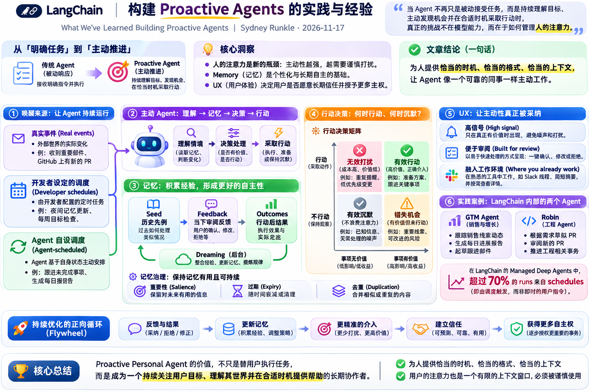
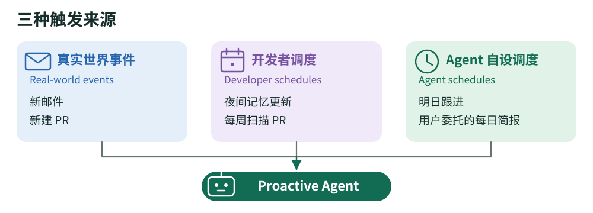
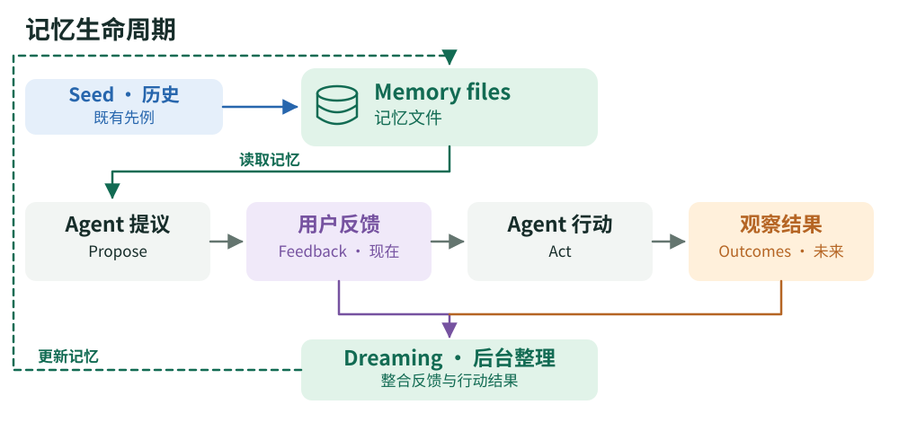
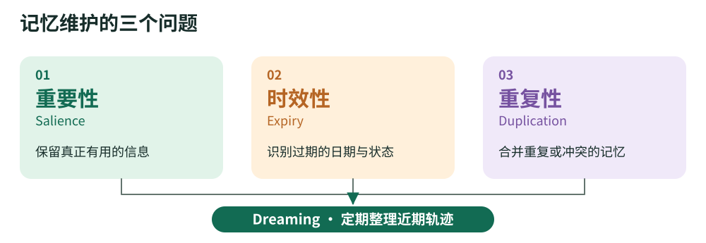
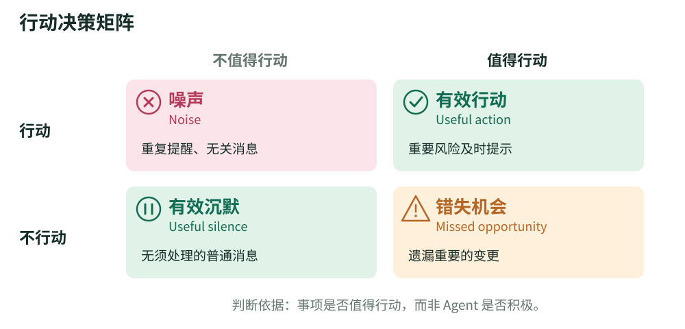
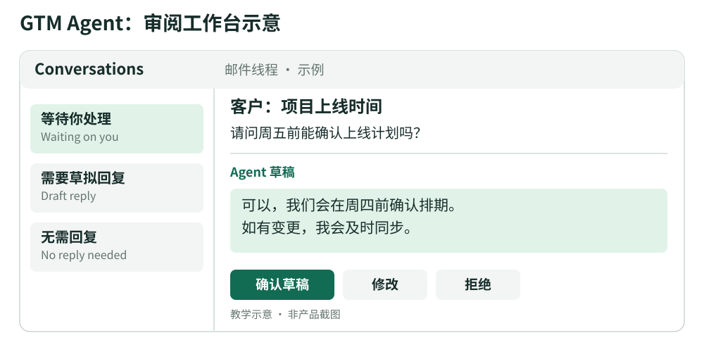
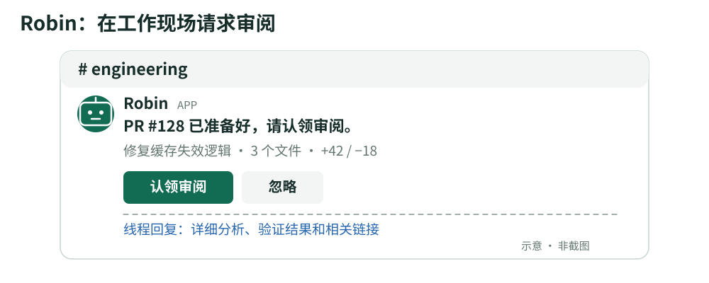
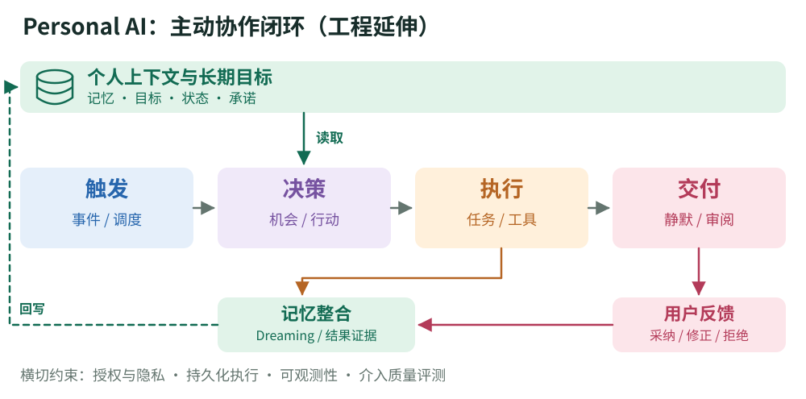

# 构建 Proactive Agents：工程学习手册

> 基于 Sydney Runkle（LangChain）2026 年 11 月 17 日的文章 [What We’ve Learned Building Proactive Agents](https://www.langchain.com/blog/what-weve-learned-building-proactive-agents)。

**阅读定位**：理解从被动任务执行走向持续目标协作后，如何设计触发、记忆、主动介入和人工审阅机制。本文不是全文翻译，而是面向 Agent 工程建设的学习笔记。第 1 节为原文要点索引，之后的工程设计、场景、接口与指标为学习延伸，不代表 LangChain 的内部实现。

**核心问题**：一个 Agent 能够自主执行更多工作之后，如何确保它持续提供价值，而不是持续增加人的工作量？

## 全局信息图

<picture>
  <source srcset="figures/langchain-proactive-infographic.webp" type="image/webp">
  
</picture>

一张图看完全貌，下文逐节展开：顶部是「从明确任务到主动推进」的定位、三条核心洞察与一句话结论；左侧是三类唤醒来源；中部是「理解情境 → 决策处理 → 采取行动」的运行链条，以及 Seed / Feedback / Outcomes 的记忆闭环与 Dreaming 后台作业；右上是行动决策矩阵（有效行动 / 有效沉默 / 无效打扰 / 错失机会），右中是 UX 三条原则与两个内部 Agent 案例；底部是「反馈 → 更新记忆 → 更精准介入 → 建立信任 → 更多自主权」的 Flywheel 正循环。

## 阅读导引

| 节 | 主题 | 图示 |
|---|---|---|
| §1 | 原文主线与学习地图 | 全局信息图 |
| §2 | 从任务执行到目标协作：任务与目标不是同一层抽象 | — |
| §3 | 主动触发：三种来源，一套运行协议 | 图 1 |
| §4 | 记忆生命周期：Seed、Feedback、Outcomes | 图 2 |
| §5 | Dreaming：维护记忆比写入记忆更难 | 图 3 |
| §6 | 主动介入：有效行动与有效沉默 | 图 4 |
| §7 | 审阅体验：让反馈变成低成本交互 | 图 5 |
| §8 | 交付渠道：在用户工作的地方完成协作 | 图 6 |
| §9 | 从 LangChain 的经验映射到 Personal AI 架构 | 图 7 |
| §10 | 如何评测主动智能，而不仅是任务成功 | — |
| §11 | 建设顺序与学习结论 | — |
| §12 | 原文与延伸阅读 | — |

阅读顺序建议：先看全局信息图建立整体印象，§1 对照原文，§2–§8 逐主题展开工程含义，§9 落到 Personal AI 与 Java Workflow 的映射，§10–§11 收束到评测与建设顺序。

## 1. 原文主线与学习地图

原文从新员工逐步承担更大职责的过程切入：Agent 从接收具体任务转向承担目标，用户注意力因而成为稀缺资源。作者以内部销售助手 GTM Agent 和工程助手 Robin 为例，围绕三种触发来源、记忆、交互体验展开实践经验。

| 原文章节 | 关键术语与观点 | 学习图示 |
|---|---|---|
| Proactive agents | Real-world events、Developer schedules、Agent schedules；后台任务由环境与时间触发 | 图 1 |
| Memory makes an agent better over time | Seed、Feedback、Outcomes；Dreaming；Salience、Expiry、Duplication | 图 2、3 |
| UX design for proactive agents | High signal、Built for review、Where you already work | 图 4、5、6 |
| The proactive agent era | 不仅为模型组织上下文，也为人组织恰当时机、形式和内容 | 图 7 |

原文披露，在 LangChain 的 Managed Deep Agents 中，超过 70% 的 Run 由调度而非临时人工提示触发。这是该平台在文章发表时的观察，不能外推为所有 Agent 的行业比例，也不意味着调度触发本身就是成功指标。

原文中的 GTM Agent 关注销售线索、回复、简报及外发邮件草稿；Robin 负责 PR 草拟和审阅，文章还提到使用 Jev 辅助判断是否加入 Slack 对话。原文未给出 Jev 的训练方法、阈值或详细线上指标。

以下各节从这些问题出发，进行独立的工程化解读。

## 2. 从任务执行到目标协作

### 2.1 任务与目标不是同一层抽象

用户提出“总结这个 PR”，可以执行一次模型调用或一个固定工作流；用户提出“持续帮我关注这个项目的工程质量”，则没有天然的终点。系统必须在未来持续判断哪些变化值得关注，哪些工作需要继续推进，以及什么时候需要人参与。

| 维度 | 任务型 Agent | 目标型 Proactive Agent |
|---|---|---|
| 典型指令 | 整理今天的 PR | 持续关注项目质量风险 |
| 开始条件 | 用户请求 | 用户请求、事件或未来检查 |
| 完成边界 | 当前输出完成 | 目标关闭、委托取消或到期 |
| 核心状态 | 本次对话、执行上下文 | 目标、关注范围、未完成事项、长期策略 |
| 用户负担 | 输入指令、验收结果 | 审阅少量必要的决策和重要结果 |

这一区别不是通过把模型推理循环改成无限循环就能实现。无限循环会增加成本，且难以应对进程重启。更合适的抽象是：**长期存在的委托 + 可持久化的任务状态 + 由事件唤醒的有限运行实例**。

### 2.2 注意力为什么会成为瓶颈

假设一个工程负责人同时关注十几个仓库，Agent 可以快速分析大量 PR，但如果每个 PR 都发送一条长报告，负责人仍需要逐条阅读。此时模型提高吞吐量，并未相应提高组织的有效产出。

应区分三个环节：发现候选问题、完成分析和决定交付。发现十个候选项，不代表要发十条消息；完成后台分析也不代表必须立即通知。系统可以合并重复信息、形成简报，并仅在关键风险达到条件时即时请求人工决策。

## 3. 主动触发：三种来源，一套运行协议




图 1：根据原文图注重绘：三种触发来源均可唤醒 Agent。

### 3.1 三种来源在实现上有什么不同？

- **外部事件**：数据源主动或通过轮询提供变更；重点是可靠接入、去重、事件新鲜度、订阅范围。
- **开发者调度**：例如对所有已启用助手进行定期健康检查；重点是配置版本、全局预算、可观测性。
- **Agent 自设调度**：例如为某项未完成的委托约定下次检查时间；重点是任务关联、取消条件、有效期限和用户授权。

调度与事件源不应各自维护一套 Agent 执行机制。可以把它们转换为统一 Event，投递至持久化收件箱，然后根据 eventId、goalId 和 taskId 找到对应状态。

### 3.2 建议的数据契约

```yaml
Event:
  event_id: evt_001
  source: external | developer_schedule | agent_schedule
  type: pr_updated | goal_check | follow_up_due
  observed_at: datetime
  subject_ref: repository/pr/123
  goal_id: optional
  dedup_key: string
  evidence_ref: string

Watch:
  watch_id: watch_001
  goal_id: goal_001
  scope: authorized_repository
  trigger: event | interval | deadline
  next_due_at: datetime
  expires_at: datetime_or_null
  state: active | paused | canceled
  max_runs_per_day: integer
```

Watch 是本文建议新增的持久化对象，而不是原文中披露的数据结构。它把“持续关注某件事”的语义转成可以调度、暂停、取消、检查预算的机制。若用户取消目标，相应的 Watch 也应停用；已经排队的事件在执行前需要重新验证目标是否有效。

### 3.3 事件风暴与重复执行

同一个 PR 可能先后出现提交、评论、CI 变更三类事件。系统应先按对象聚合，再按变更类型判断是否需要重跑。仅仅把所有事件送给 LLM，会把无意义变化放大为费用和重复打扰。需要注意，事件去重与外部动作幂等不是同一件事：即使只消费一次事件，工具调用仍可能因网络超时而重复提交。

## 4. 记忆生命周期：Seed、Feedback、Outcomes




图 2：依据原文图注重绘：Seed 写入记忆，Feedback 与 Outcomes 经 Dreaming 更新记忆。

### 4.1 三类信号各自解决的问题

| 信号 | 工程理解 | 可以如何利用 | 需要防止的错误 |
|---|---|---|---|
| Seed（历史） | 冷启动材料 | 从授权历史中提取常见格式、对象和工作习惯 | 把旧习惯当成永久偏好 |
| Feedback（反馈） | 当前人的判断 | 保存修改差异、拒绝原因、确认动作 | 将一次选择过度泛化 |
| Outcomes（结果） | 动作之后的观察 | 关联任务结果、外部反馈和后续状态 | 把时间先后误认为因果 |

例如，用户把技术报告里的“技术架构领先”改为“相较当前方案减少一次模型调用”，系统可以记录用户更偏好可验证的技术结论。但这不意味着所有写作任务都必须有数字，记忆仍需附加适用场景。

反馈不只来自聊天输入。用户直接编辑草稿、调整候选项排序、要求删除某个段落，也可能提供高价值信息。与自然语言总结相比，原始提议与修改后的差异往往更容易定位哪些判断发生了变化。

### 4.2 结果反馈并不天然等于奖励

一封邮件没有得到回复，可能是内容不好，也可能是对方在休假。一次提醒被忽略，可能代表无价值，也可能代表用户正在忙。因此应保存观察事实，而不要立即将其解释为负反馈。

建议将证据与推断分开：`observed_outcome` 保存实际发生的事情，`hypothesis` 保存可能原因，后者附带置信度和来源。高风险策略变化应要求更强证据或人工确认。

### 4.3 记忆的读取需要服务当前决策

一次主动触发通常没有用户的即时解释。运行实例需要根据触发对象与长期委托选择记忆，而不是把用户全部历史塞进上下文。一个可行的读取次序是：权限与明确指令 → 当前目标及约束 → 当前对象的状态 → 相关历史先例 → 必要时检索其他资料。

这样既减少上下文成本，也降低不同任务之间的偏好串扰。

## 5. Dreaming：维护记忆比写入记忆更难




图 3：根据原文三个记忆治理问题扩展出的工程处理流程。

### 5.1 建议的记忆数据模型

```yaml
MemoryItem:
  id: mem_001
  kind: fact | preference | precedent | hypothesis
  statement: 用户在工程调研中偏好有实际实现的方案
  scope: engineering_research
  provenance: [feedback_123, review_456]
  confidence: medium
  recorded_at: datetime
  valid_until: optional_datetime
  state: candidate | active | superseded | expired
  version: integer
```

重要性是这条记忆对未来决策的预期贡献，不只是使用频次。低频出现的明确禁止事项可能比高频出现的普通话题更重要。时效也不是简单按天删除：明确的用户偏好、临时会议安排和已完成任务应采用不同的更新机制。

### 5.2 Dreaming 作为后台作业

建议采用以下步骤：读取最近一段时间内授权范围内的执行轨迹；抽取候选记忆；与已有项对比；对重复、冲突、过期项提出变更；将变更写入新版本并记录来源。对于影响重大的变更，保留人工确认或回滚能力。

Dreaming 的任务应该有时间、Token 和写入范围预算。不能让整理任务递归生成更多无边界的整理任务。日常决策依赖的关键即时状态也不应等到夜间作业才更新，例如用户刚取消了一项长期委托，应立刻生效。

### 5.3 记忆效果如何验证

保存了多少条记忆、向量库有多少数据，不是有效指标。可以用相同的一批任务对比启用记忆与不启用记忆两种配置，检查重复错误率、草稿修改量、重复澄清次数、重要事件召回率和无效打扰率。对照时保持模型、工具能力、任务和权限一致，才能尽量隔离记忆的影响。

## 6. 主动介入：有效行动与有效沉默




图 4：原文四象限概念重绘，场景示例为本文原创。价值判断是结合用户目标及实际情境的事后标注，不是模型自身的分数。

### 6.1 四个象限如何用于评测

一个只会积极提醒的 Agent 可能召回很多重要事项，同时制造大量噪声；一个始终沉默的 Agent 则可能没有打扰，却错过关键机会。评估时必须同时记录候选事件、采取的行为和事后判定。

工程上可建立一个可回放的事件集，例如项目变更、会议冲突、截止日期、重复通知。由人工为每个事件标注：是否值得关心、是否需要后台准备、是否需要触达、最晚合理触达时间。这样可以检查系统是否误把重要事项过滤掉。

### 6.2 把行动决策与触达决策分开

原文四象限提供的是行为质量框架；进一步落地时，建议拆为三个策略：

| 策略 | 输入 | 输出 |
|---|---|---|
| Opportunity | 事件、目标、证据、相关状态 | 忽略、记录、进入候选 |
| Action | 候选事项、预算、权限、风险 | 观察、准备方案、请求授权、执行 |
| Attention | 当前可打扰度、信息增量、紧急性 | 静默、即时通知、延后、合并摘要 |

比如，发现用户关注的仓库出现重大接口变更，可以立即分析潜在影响，但在用户会议结束后再交付；若存在紧急的线上风险，则依据用户预设规则及时升级。模型的价值评分不能覆盖权限硬约束。

### 6.3 轻量门控不是万能路由

通过规则或轻量分类器去掉重复、明显无关的事件，可以降低高成本模型调用次数。但如果过滤器只允许已知目标匹配的事项进入下一阶段，就可能漏掉新的机会。可保留低成本抽样审查和高风险兜底通道，记录每一层的丢弃理由，以便离线回放。

## 7. 审阅体验：让反馈变成低成本交互




图 5：原文 GTM Agent 图示主题的重新设计；不是产品截图，示例邮件、按钮与附加反馈字段均为教学内容。

### 7.1 为什么需要专门的审阅界面

对批量工作来说，在聊天里逐条复制、修改、确认往往不是最佳方式。例如审阅二十封邮件，如果每次都要回到对话查看完整历史，人工时间仍然很长。一个批量列表可先展示待处理数量、优先级、建议动作和关键证据，再在详情页允许用户审阅原始内容与草稿。

这种产品设计本身也是数据采集机制。用户能够直接修改模型输出，系统就能更准确地识别反馈对象与变更内容。

### 7.2 可审阅产物的建议字段

```yaml
ReviewItem:
  id: rev_001
  task_id: task_001
  evidence_refs: [source_001]
  proposal_version: 3
  summary: string
  proposed_action: string
  risk_level: low | medium | high
  changes_preview: object
  allowed_decisions: [approve, edit, reject, defer]
  status: pending | resolved | expired
```

审阅应明确被确认的具体动作与版本。例如用户批准邮件草稿版本 3，执行器不能偷偷改成版本 4 再发送。若对象状态发生变化，应重新校验授权有效性。审阅意见可以沉淀为记忆，但对外行动授权应由独立权限策略管理。

## 8. 交付渠道：在用户工作的地方完成协作




图 6：按原文 Robin 短消息与线程审阅形式重绘，不是原始 Slack 截图。

### 8.1 消息结构的工程建议

建议即时消息优先回答四个问题：发生了什么、为什么与我有关、需要我做什么、多久前必须处理。详细分析和证据则放在线程、详情链接或可展开卡片中。

对于工程 Agent，PR 审阅消息可包含影响模块、风险级别、验证状态和审阅入口。用户没有必要看到完整工具日志；但需要能追溯证据，确认建议是否可信。将业务决策链与底层执行日志分开也有助于保持交互简洁。

### 8.2 渠道不是简单的推送配置

同一个事项可能适合在团队群里汇报，也可能只能私聊。通知策略必须考虑数据敏感性、接收人权限、是否已有线程、重复投递和用户偏好。跨渠道投递应有统一消息 ID，避免邮箱、IM 和推送同时发送同一条低价值消息。

对于必须确认的事项，等待时间长不意味着可以绕过审批。应把待审批状态持久化，并根据有效期决定继续等待、取消或请求重新确认。

## 9. 从 LangChain 的经验映射到 Personal AI 架构




图 7：结合本文学习主题提出的独立工程设计，并非 LangChain 官方架构。

| Personal AI 能力 | 对应学习主题 | 可落地组件 |
|---|---|---|
| 个人世界模型 | 记忆与结果 | 画像、目标、OpenLoop、证据及版本管理 |
| 目标驱动机制 | 自设调度 | Goal、Watch、定时检查、取消与失效 |
| 主动智能 | 行动质量 | 候选发现、机会评分、权限与风险判断 |
| Always-on Runtime | 三类触发 | Inbox、Timer、Worker、Run、检查点与恢复 |
| Attention Management | UX 与审阅 | 策略、Outbox、频控、审阅工作台 |
| 学习治理 | Dreaming 与评估 | 反馈事件、记忆整理、回放与版本评测 |

在这一架构下，长期意图是持续工作的业务起点；事件是运行实例的技术起点；个人状态是判断的输入；审阅和外部结果则形成学习闭环。不要让单一模型调用既拥有全量数据、又决定长期授权、又直接执行外部操作。

### 9.1 一个完整的教学场景：持续跟踪 Agent 工程技术

用户委托 AI 每天寻找值得团队关注的工程实践，但不希望收到大量资讯。

1. 创建长期 Goal，并保存关注主题、来源范围和简报策略；由 Watch 按日调度，同时允许重要来源变更触发增量处理。
2. 数据接入后先检查文章去重、发布日期和来源，再判断内容是否存在真实实现价值；将候选项写入可回放的决策记录。
3. 后台为高价值候选补充参考实现、适用人群和可能的工程应用。不确定的内容标记证据不足，不编造结论。
4. 按用户注意力策略合并为定期简报；特别紧急或高度相关的事项可在授权范围内即时告知。
5. 用户标记某项推荐“有用但太偏理论”，系统保存这一反馈及其适用场景，不因此擅自扩大外部操作权限。
6. Dreaming 作业整合多个反馈，调整下一轮候选筛选与呈现方式；通过历史样本评估是否提高质量而不是简单减少推荐量。

这一场景可以验证闭环是否有效，不要求先实现通用个人助理的全部能力。

### 9.2 Java Workflow 工程接入建议

将既有 Workflow 视为 Task 的执行单元，在其外部增加 Goal/Watch 服务、持久化事件接收、机会判断和投递管理。已有模型路由、节点级监控、工具调用和工作流配置仍可复用。

| 增量模块 | 最小实现 | 工程验收 |
|---|---|---|
| Goal & Watch | 数据库状态、周期调度、取消机制 | 重启后持续工作；取消后停止 |
| Inbox | 唯一事件键、消费状态、重试 | 事件重复投递不产生重复任务 |
| Opportunity | 规则与模型决策节点 | 每次过滤和决策可回放 |
| Memory | 结构化条目与证据引用 | 用户纠正及时生效、可追溯 |
| Review & Outbox | 审阅状态、消息幂等键 | 审批与实际动作版本绑定 |
| Watchdog | 超时、预算、重试限制 | 卡死任务可暂停及恢复 |

具体数据库、中间件和调度引擎无需在早期一次定型。先验证领域对象和状态转移是否成立，再基于团队已有技术栈选择组件。

## 10. 如何评测主动智能，而不仅是任务成功

建议建立四类指标，并明确样本分母。以下是本文提出的工程指标，不是 LangChain 披露的产品指标。

| 指标 | 建议口径 | 主要局限 |
|---|---|---|
| 重要事项介入召回率 | 正确介入的重要事项 / 标注的重要事项 | 依赖人工标注和完整候选集 |
| 有效介入率 | 有价值的介入 / 全部介入 | 不能单独使用，否则可能诱导过度沉默 |
| 无效打扰率 | 无价值或重复的触达 / 全部触达 | 需要区分后台行动与通知 |
| 审阅耗时 | 从开始审阅到确认或拒绝的时间 | 应区分等待时间和实际操作时间 |
| 重复纠正率 | 已明确纠正但再次发生的错误 / 可评估同类案例 | 需要统一错误分类 |
| 委托完成率 | 满足成功条件的已到期委托 / 已到期委托 | 无终点的长期委托需采用周期达标率 |
| 单位价值成本 | 执行与模型成本 / 经验证的有价值结果 | 价值难量化时需按场景分层 |

其中，漏报需要通过事件回放和主动抽样才能观测，不能只统计已经推送的消息。反馈学习也不能只看采纳率：用户可能经常批准低风险、低价值的小事，却仍然需要人工处理所有重要工作。

建议每次修改门控、记忆和触达策略前运行同一份模拟事件流，包含重复消息、失效目标、用户忙碌、权限撤回、外部工具超时等边界条件。上线后以真实事件抽样校验模拟集是否仍具有代表性。

## 11. 建设顺序与学习结论

优先选择一个长期委托场景，建立最小的可靠触发、状态持久化、权限和可审计执行能力；随后加入机会判断、消息聚合与反馈回流；最后逐渐提升记忆维护和授权范围内的自主执行。早期不必引入复杂多 Agent 协作，但不能省略暂停、取消、去重、权限与预算边界。

真正值得学习的是三个相互关联的问题：

- **目标如何持续存在**：从用户指令生成可维护的长期委托，而不是无限延长聊天历史。
- **经验如何持续积累**：从人类反馈与外部结果中获得可验证、可更新的记忆，而不是无限追加文本。
- **注意力如何被珍惜**：让后台工作和用户通知解耦，尽量用低成本审阅完成必要的人机协作。

一个长期运行的 Agent 未必具有高质量的主动性；一个善于发现机会的 Agent 也未必能可靠完成长任务。Personal AI 的价值需要持续目标、准确理解、可靠执行和适当交付共同成立。

## 12. 原文与延伸阅读

- 原文：[What We’ve Learned Building Proactive Agents](https://www.langchain.com/blog/what-weve-learned-building-proactive-agents)，Sydney Runkle，2026-11-17。
- 延伸阅读（供后续学习）：[Anthropic — Building always-on agents](https://claude.com/resources/articles/building-always-on-agents)、[DeepSeek Super-agent 原型](https://github.com/deepseek-ai/dsh-superagent-prototype)。这两项在本手册中只作为架构对照方向，不作为 LangChain 实现细节的证据。

**图示与证据说明**：已直接核对 LangChain 文章正文及五处核心图注；原始 CDN 图片在本次访问中无法打开，因此未逐像素核验原图。篇首「全局信息图」为单张总结图，用于建立整体印象；正文图 1、2、4 对应原文概念主题，图 5、6 为原文界面描述的教学示意，图 3、7 是工程扩展。所有图均为重新绘制的静态 SVG；具体数据契约、架构映射、案例和指标为作者学习分析，尚未经过生产原型验证。
