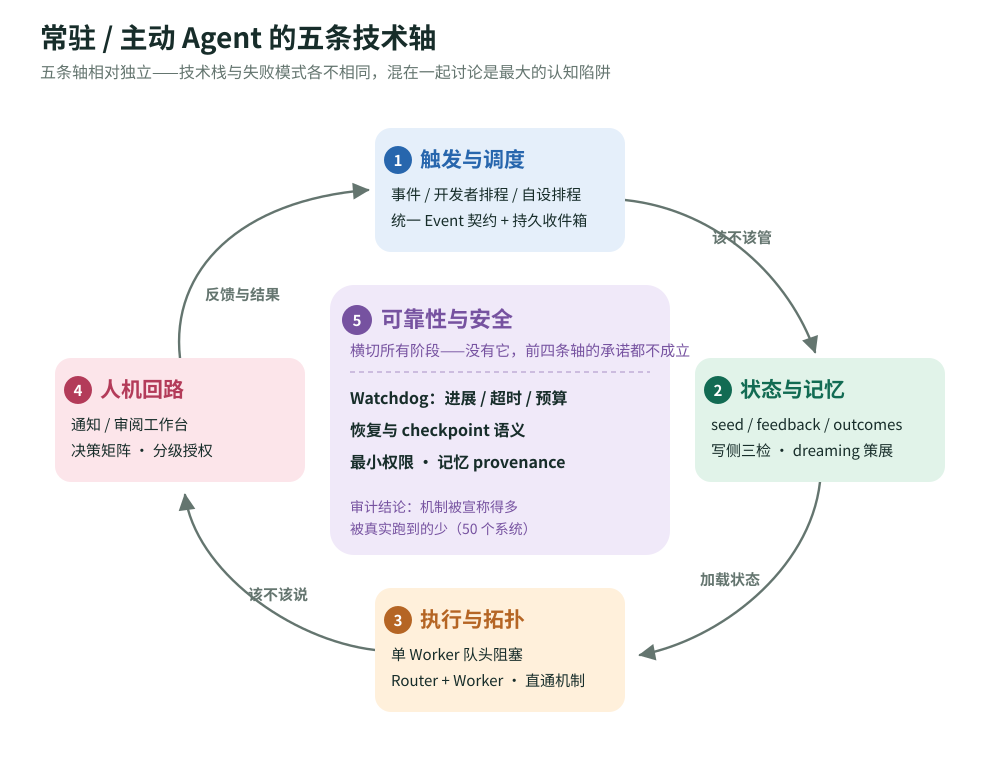

# 常驻 / 主动 Agent：领域综述与手册索引

> 一个领域的入口页。**先建立坐标系和证据判断力，再去看具体怎么搭。**
> 本页是阅读导航 + 我的归纳，不是论文；每个可争议的结论都标了出处，数字都标了口径。

---

## 0. 这个领域在说什么

一句话：**把 agent 从"等指令的调用"变成"有目标、自己有节奏的长期实体"。**

三个判据，缺一不可：

| 判据 | 含义 | 反例 |
|---|---|---|
| **触发** | 没人给提示也会动 | 只有用户发消息才启动的 chat |
| **持久** | 状态跨会话、跨重启存活 | 会话结束上下文即丢 |
| **主动** | 自己决定何时介入、何时闭嘴 | 每个事件都推一条通知 |

### 术语先分清（这是最容易混的地方）

| 词 | 归属 | 真正含义 |
|---|---|---|
| always-on | 运行属性 | 不在前台也持续推进 |
| proactive | 决策属性 | 自己决定时机与是否打扰 |
| long-horizon | **任务**属性 | 任务本身跨小时/天 |
| long-context | **模型**属性 | 单次窗口装得下多少 |
| long-term memory | **系统**属性 | 跨会话保存的状态 |

后三个常被当同义词用。`The Horizon Gap`（1547 篇系统 survey）专门做了这个分离，值得先读一遍——三篇主要来源文章里都有不同程度的混用。

---

## 1. 领域被切成五条轴

五条轴**相对独立**，各自的技术栈和失败模式完全不同——这是这个领域最容易被搞乱的地方：讨论"要不要做 Router"和"记忆怎么维护"经常被混成一件事，但它们没有因果关系。

| 轴 | 一句话问题 | 主要失败模式 |
|---|---|---|
| ① 触发与调度 | 什么让 agent 醒过来 | 漏触发（任务消失）/ 重复触发（重复外发） |
| ② 状态与记忆 | 它凭什么记得你的偏好 | 记忆膨胀、过期事实、矛盾条目 |
| ③ 执行与拓扑 | 多任务怎么并发而不互相污染 | 队头阻塞 / 上下文串味 / 中枢过载 |
| ④ 注意力与人机回路 | 什么时候值得打扰你 | 噪音（该沉默时说） / 漏报（该说时沉默） |
| ⑤ 可靠性与安全 | 崩了、被注入了怎么办 | 空转被当健康 / 恢复不安全 / 注入持久化 |

---

## 2. 五条轴：已知、争议、空白

### ① 触发与调度

**已知**
- 三类来源：真实世界事件、开发者配置的排程、**agent 自己设的排程**（LangChain）。
- 生产流量里排程占大头：LangChain 自述其 Managed Deep Agents 中**超过 70% 的 run 来自排程，而非临时人工提示**（口径：其平台自身观察，不可外推为行业比例）。
- 三类来源应收敛成统一的 Event 契约，投递到持久化收件箱，再按 `eventId / goalId / taskId` 找到状态。

**争议**
- 架构文章都在讲"事件驱动"（push），但真实流量是 cron 为主。**这个错位三篇原文都没处理。**

**空白（三篇都没写）**
- 漏触发补偿、重复触发去重、排程本身的 SLO。
- "Agent 自设排程"需要**取消/失效语义**——目标已关闭，排程还在跑，是最典型的浪费。
- 事件去重 ≠ 外部动作幂等：事件只消费一次，工具调用仍可能因超时重发。

→ 工程细节见 [构建 Proactive Agents 工程学习手册](/notes/langchain-proactive-handbook/) §3

### ② 状态与记忆

**已知（这一轴证据最硬）**
- **记忆是写侧问题，不是读侧问题。** Anthropic 的真实评测：强模型自己判断该写什么，显著优于给它固定规则（Opus 5.5 CL-Bench 0.655 → 0.838）；而给出"只记失败"这类硬规则，反而**降低**增益。
- **记忆质量不靠文件数量。** 同一任务：Sonnet 3.7 写了 400+ 个文件拿 1 个徽章，Fable 5 只写约 10 个文件拿 4 个徽章。差距在"知道什么不该记"。
- **Dreaming（后台策展）有效但有边界。** 它把检索命中率从 13% 提到 48%；但当 wiki 本身大于原文时，收益归零（博尔赫斯的"精确的地图"）。
- **写侧三检。** LangChain 给出可执行清单：salience（该不该记、多重要）、expiry（何时过期）、duplication（合并而非追加，否则两条矛盾记忆共存）。

**争议**
- 图结构记忆 vs 文件记忆：两者都有生产案例，尚无对照实验。
- 复杂记忆系统 vs 简单基线：`Anatomy of Agentic Memory` 警告——大量复杂记忆方案是在"全上下文或简单检索就够"的场景里被测的，真实收益被高估。

**空白**
- **注入的记忆通道**：单次 agent 被注入，伤害止于当次；常驻 agent 被注入，错误指令写进记忆后**每个后续 run 都会加载**。三篇原文都只防动作通道，没防记忆通道。可行方向是记忆条目带 provenance / taint 标记。
- 跨月、跨季的长期记忆压缩。

→ 见 [Always-on Agent 手册](/notes/always-on-agent-handbook/)（memory 原语）与 [LangChain 手册](/notes/langchain-proactive-handbook/) §4–§5

### ③ 执行与拓扑

**已知**
- 单 active worker 会**队头阻塞**：一个长任务堵死整条队列。
- Router / Worker 双层在合成负载上：p50 12.4 min、p95 15.7 min；对照组（单 session + "请委派 subagent" 提示词）p95 29.5 min，且 5 次运行 0 次真的委派。结论是**结构比提示词可靠**。
- **直通机制（已归属事件绕开 Router）是成本优化而非质量优化**：去掉它完成时间不变，读缓存 token 从 2323 万 → 3177 万（+37%）。
- Router 批处理**近乎免费**：触发率 1 → 40 条/分时，单请求耗时仅 2.5 → 3.9 s，单决策分摊推理时间 6.4 → 1.6 s（prefill 阶段并行）。

**争议**
- 中心编排 vs 去中心：DeLM、Agensh 指出中心 orchestrator 是扩展瓶颈（agent 等别人、重复别人做过的事、主 agent 阻塞在 subagent 上），主张 append-only 共享日志 + 自行 claim 任务。

**空白**
- **Router 的上下文预算是整个系统最硬的约束**，但没人量化。批处理的免费性依赖"输入小、输出短"，一旦 Worker 回传胖摘要就崩。
- 真实编码负载下多个 Worker 改同一个 PR 的行为，实验没覆盖（原实验用"只消耗时间的工具"替代真实工作）。

→ 见 [DeepSeek Super-agent 工程学习手册](/notes/super-agent-handbook/)

### ④ 注意力与人机回路

**已知**
- **人的注意力是稀缺资源**，系统本质是注意力预算分配器。
- 行动决策矩阵（价值 × 是否行动）：有效行动 / 有效沉默 / 无效打扰 / 错失机会。**四象限都要测**，只测"发出去了多少"会诱导过度打扰，只测采纳率会诱导过度沉默。
- **复核速度决定学习速率。** 复核一次 3 分钟 → 一天核 10 件；10 秒 → 核 100 件。所以审阅界面不是美观问题，是反馈管道的吞吐。
- **分级授权可计算**：按动作类统计 `(n_proposed, n_edited, n_rejected)`，编辑率降到阈值以下才解锁自动执行。这是三篇里唯一回答"信任怎么挣来的"的机制。
- 唯一的运营指标：**acted-on rate**（发出的检查点里被真正处理的比例）。

**争议**
- "活在用户已有的渠道里" vs "另建专用界面"：LangChain 自己的两个 agent 各走一边——Robin 在 Slack 里请求评审，GTM Agent 因为 Slack 里翻积压太慢而专门做了复核工作台。合理规则是**按复核量路由**：低量走 IM，成批积压走专用界面。

**空白**
- **cost per acted-on check-in**：`Σ(全部 run 的 token) / 被处理的检查点数`。70% 流量来自排程意味着大量算力换 0 次交互，这个数决定商业模式，但没人算。

→ 见 [LangChain 手册](/notes/langchain-proactive-handbook/) §6–§10

### ⑤ 可靠性与安全

**已知**
- **恢复机制被宣称得多、被真实跑到的少。** `Exercised, Rarely Recovered` 在冻结协议下审计 50 个 harness/runtime（12 持久 runtime + 26 coding harness + 12 research runtime）、8 种恢复机制，两轮盲评 + 仲裁 + 回溯复核。这篇直接打两篇架构文章的乐观叙述。
- **忠实恢复 ≠ 安全恢复**：恢复出的状态组合可能从未在任何有效历史中共存。
- **权限过供约 15×**：开放 runtime 默认把全部工具给每个会话，摘要任务和部署任务拿到同样的 shell / 派生 subagent / 凭据访问能力。
- 常驻 agent 的安全主体不是用户：agent 在每个系统里有自己的账号（Slack app、GitHub App），权限治理是新的平台层问题。

**空白**
- **任务级抢占**：新事件在 run 进行中到达时，"推到下轮 / 并入当前 / 中断重启"怎么选——现状是三篇都只用一行糊过去，而抢占必须依赖 checkpoint，恰好是审计说大部分系统没做的那部分。
- 端到端的信任边界（记忆通道 + 动作通道 + 多设备）。

→ 见 [Always-on Agent 手册](/notes/always-on-agent-handbook/)（permissions / outbox）

---

## 3. 证据等级：读这个领域最该先有的判断力

**同类文章的可信度差一个数量级，混读会误判。** 这是我自己整理时踩过的坑。

| 材料 | 类型 | 证据强度 | 该怎么用 |
|---|---|---|---|
| Anthropic《Building always-on agents》 | 架构指南 | **零量化实验**，成本数字来自自家基准 | 当零件清单用，别当结论 |
| DeepSeek《Super-agent 设计探索》 | 架构 + 消融/压测 | 有实验，但**自评合成负载**，编码任务用"只消耗时间的工具"替代 | 测的是调度不是执行质量 |
| Anthropic《Components of agent memory》 | 实证研究 | **最硬**：CL-Bench、Pokémon、35 万文件语料、128 次 dreaming | 记忆怎么做，以它为准 |
| LangChain《Proactive Agents》 | 生产复盘 | 无对照实验，只有观察与比率 | 当运维经验用 |
| 《Exercised, Rarely Recovered》 | 系统审计 | 高：50 个系统、冻结协议、盲评仲裁 | **哪些承诺不要信，以它为准** |
| 《The Horizon Gap》 | 1547 篇 survey | 高（覆盖面） | 术语与分类基线 |

一句话记法：**架构怎么搭**看两篇指南；**记忆怎么做**看 Anthropic 实证；**哪些承诺别信**看审计。

---

## 4. 可直接引用的硬数字

| 数字 | 内容 | 口径注意 |
|---|---|---|
| **> 70%** | LangChain Managed Deep Agents 中来自排程的 run 占比 | 其平台自身观察，2026-11 |
| **12.4 / 15.7 min** | Router+Worker 双层 p50 / p95 完成时间 | 合成负载 |
| **29.5 min** | 单 session + 委派提示词方案 p95 | 同上，5 次运行 0 次委派 |
| **+37%** | 去掉直通机制后的读缓存 token 增幅（2323 万 → 3177 万） | 同实验，时间不变 |
| **6.4 → 1.6 s** | 单 Router 决策分摊推理时间（触发率 1 → 40 条/分，批处理生效） | 依赖输入小、输出短 |
| **13% → 48%** | dreaming 对 wiki 检索命中率的提升 | wiki 大于原文时收益归零 |
| **0.655 → 0.838** | Opus 5.5 CL-Bench（模型自判"该记什么" vs 固定规则） | 固定规则反而降低增益 |
| **约 15×** | 默认权限配置相对任务所需能力的过供倍数 | Aethelgard，开源 runtime 抽样 |
| **50 / 8** | 被审计的 agent runtime 数 / 恢复机制种类 | 2611.27090 |
| **6h / $200 vs 20min / $9** | 完整 harness vs 单 agent 做应用开发 | Anthropic 自家基准，约 20× 成本换质量 |

---

## 5. 三本手册：分工与阅读路径

| 手册 | 从哪来 | 它给你什么 | 什么时候读 |
|---|---|---|---|
| [**Always-on Agent 工程学习手册**](/notes/always-on-agent-handbook/) | Anthropic《Building always-on agents》 | 五个可持久化原语（Event Inbox / Timers / Memory / Permissions / Outbox）、权限与凭据边界、deferred 挂起、故障注入验证清单；8 张架构图 | **先读这本**：它是地基。没有 inbox + 唯一 active worker，其他都是空谈 |
| [**构建 Proactive Agents 工程学习手册**](/notes/langchain-proactive-handbook/) | LangChain《What We've Learned Building Proactive Agents》 | 三类触发与 Watch 对象、Seed/Feedback/Outcomes 记忆生命周期、Dreaming 三检（salience/expiry/dup）、行动决策矩阵、审阅工作台字段、分级授权、主动智能评测指标；7 张图 + 总结信息图 | **第二本**：系统能跑之后，怎么做到"少打扰、越用越准" |
| [**DeepSeek Super-agent 工程学习手册**](/notes/super-agent-handbook/) | DeepSeek Harness《Super-agent 设计探索》 | Router/Worker 双层、订阅-直通、Fast/Slow Path 两级过滤、Inline & Spill、投机执行、存算分离、Watchdog；14 张图 + 官方信息图 | **第三本**：当你要"多任务真并发"时再读。它是三本里最重的架构 |

### 三条阅读路径

- **30 分钟，只要坐标系**：本页 + 三本手册的开篇信息图。
- **半天，要能设计方案**：Always-on（原语）→ LangChain（人机回路）→ DeepSeek（拓扑）。顺序别反：先有持久化地基，再谈不打扰，最后才谈并发。
- **要动手写代码**：上面三本的"建议数据契约 / 最小实现 / 工程验收"三张表直接抄；再补一个 durable execution 引擎（不必自建 scheduler），最后按手册里的故障注入清单做验收。

---

## 6. 这个领域仍未解决的问题

按"想动手做研究/做产品"的视角排序：

1. **任务级抢占与 checkpoint 的合并**。当前所有方案的抢占都是"工具级异步"，不是"任务级中断"。而恢复机制的实证又显示大部分系统没做对。
2. **记忆的 provenance / taint 治理**。注入从一次性事故变成持久状态腐蚀，目前没有框架级解法。
3. **cost per acted-on check-in**。整个商业模式的分界线，没有人在测。
4. **Router 的上下文预算**。批处理经济性成立的前提，没有任何量化。
5. **排程的可靠性工程**。70% 流量走 cron，但没有一篇写漏触发/重复触发/幂等键。
6. **去中心多 worker 组合**：共享 append-only 状态 + 去中心执行 + 唯一出口，比双层更简单，但目前没有把它讲清楚的工程文章。
7. **agent 身份治理**。agent 有自己的账号之后，谁批准、谁付费、权限边界谁给，是平台层问题而非技术问题。

---

## 7. 延伸材料

完整清单（约 60 篇，按主题分组、标注"补哪个缺口"）在本地笔记里。若只加读六篇，按这个顺序：

1. [The components of agent memory](https://www.anthropic.com/research/components-of-agent-memory) — 记忆的全部细节与实证（证据最硬）
2. [Scaling Managed Agents](https://www.anthropic.com/engineering/managed-agents) — brain / hands / session 三接口 + 安全边界的具体做法
3. [Exercised, Rarely Recovered](https://arxiv.org/abs/2611.27090) — 给所有乐观叙述泼冷水
4. [The Horizon Gap](https://arxiv.org/abs/2608.06663) — 术语与分类基线（1547 篇）
5. [PITCH — When Should AI Chime In?](https://arxiv.org/abs/2610.25896) — 把"该不该插话"隔离成可测问题
6. [Harness design for long-running application development](https://www.anthropic.com/research/harness-design-long-running-apps) — 元教训：harness 的每个组件都编码了"模型当时做不到什么"，随模型变强而变成死代码

---

*本页为领域的持续索引，会随新材料更新。三本手册的原始材料、横向对照分析与个人洞察记在本地工作区。*
