# DeepSeek Super-agent：从单次会话到持续协作的 Agent 系统

> 工程学习手册 · 2026-11-25
>
> 研读对象：DeepSeek Harness 团队《Super-agent 设计探索：迈向更自主的 Agent 系统》。本文是独立的技术解读，不是原文转载，也不是对正式产品功能的说明。

## 阅读导引

这篇文章最值得研究的不是多开几个 Agent，而是**在多个任务、多个会话、多个工作环境和多个人类交互入口之间，建立一个持续运转的协调系统**。阅读时可以追问三个问题：系统如何知道新信息属于哪个任务？如何让多个任务彼此不阻塞？任务跨越进程、设备和时间后，如何恢复并保持可控？

本文以原文的五个模块为主线，使用重新设计的 SVG 图解释机制；工程分析、示例、数据结构和风险判断均为学习扩展。公众号链接本次无法直接打开，正文由[中文全文收录版](https://pureskyblog.dpdns.org/posts/deepseek-super-agent/)、[另一中文转载](https://guobug.github.io/posts/2026/11/01/deepseek-harness-super-agent-architecture/)与[英文全文译本](https://chinamodelapi.com/super-agent-design-deepseek)交叉核对，原图的主题和图注来自收录版。未逐像素核验公众号原图。开源实现则以[官方原型 README 及设计文档](https://github.com/deepseek-ai/dsh-superagent-prototype)为准。

| 原文章节 | 研读重点 |
|---|---|
| §1 | 产品形态为何变化；整体系统 |
| §2 | Router / Worker 的职责与上下文边界 |
| §3 | Trigger、Thread、过滤、直通、上下文、投机执行 |
| §4 | 异步 ReAct 与信道交互 |
| §5 | 计算、状态与执行环境的分离 |
| §6 | Watchdog 外部控制回路 |
| §7 | 实验数据与可解释边界 |
| §8–9 | 开放问题与工程取舍 |

## 全局信息图

一张图看完整个系统：左上对比"人管理多个 Session"与"Super-agent 统一交互、多任务并发"；中部是完整数据流——从 IM/GitHub/邮件/CI 等信源经 Trigger 与 Fast Path 规则过滤后进入 Router 层，Router 负责统一交互、全局协调与任务分配（不执行具体任务），已订阅 Thread 走直通路径绕过 Router；右侧为并发执行的 Worker Sessions 与外部控制回路 Watchdog；下部是持久化状态、云端无状态 Agent Loop 与可切换的执行环境；最下方是五个模块的要点与研究证据。

<picture>
  <source srcset="figures/super-agent-architecture.webp" type="image/webp">
  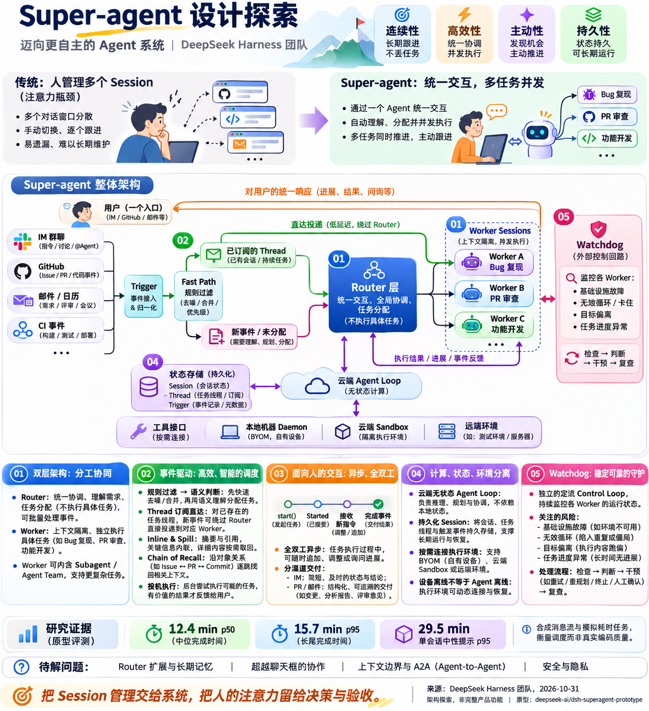
</picture>

> 说明：此图由 DeepSeek Harness 团队发布的信息图整理而成，用于快速建立全局认知，与下文自绘的图示互为对照；数据与结论以原文和官方原型 README 为准。

## 1. 为什么需要 Super-agent

### 1.1 从管理会话到管理工作

通常一个 CLI Coding Agent 的工作边界是一个 Session：上下文、工具调用和正在处理的任务都依附于它。如果人要推进多个任务，就必须记住每个会话正在做什么、何时需要补充指令，以及哪个会话掌握某个事实。即使模型可以自行完成较长任务，人依然承担了任务管理与上下文转移的开销。

文章报告了团队对人同时跟进约 3–5 个活跃 Session 的观察。这不是普遍适用的人体认知容量测量，而是产品设计的动机。对多任务系统，更值得考察的是每单位人类注意力能获得多少有效交付，而不只是单个模型任务的通过率。


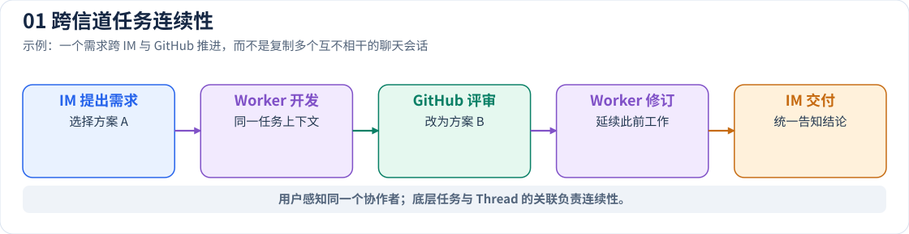


**图 1 解读：** 假设用户在 IM 里提出一项需求，又在 GitHub PR 评论里改变方案。两条消息来源不同，但指向同一个业务任务。Agent 应恢复该任务的事实、决策和执行上下文，而不是新建一个不知前因的会话。连续性的关键是任务身份及关联关系，而不是简单同步聊天记录。


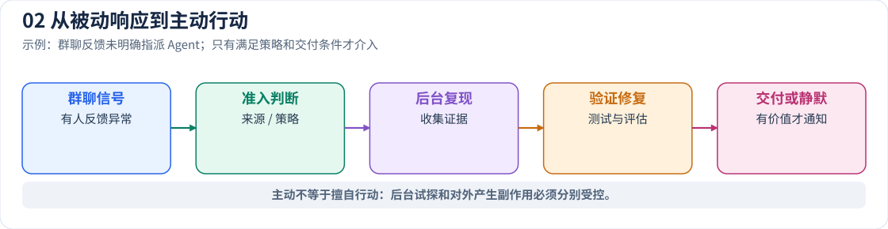


**图 2 解读：** 主动性有三个不同层级：观察信号、低风险尝试、外部交付。观察到群里有故障不代表拥有修改仓库的授权；复现成功也不代表应该直接合并 PR。系统必须分别控制这三层权限与触发门槛。

### 1.2 四个产品特征与五个架构模块

| 产品特征 | 可观察的用户体验 | 支撑机制 |
|---|---|---|
| 连续 | 在不同入口讨论同一事项，无需重新说明背景 | Router、Thread、上下文召回 |
| 高效 | 接受新任务时，不必等现有任务完成 | Worker 并发、直通、异步工具 |
| 主动 | 合适的外部事件触发行动，平常不打扰用户 | 事件策略、后台尝试 |
| 持久 | 计算实例重启、设备暂时离线后仍能继续 | 持久状态、环境解耦、Watchdog |


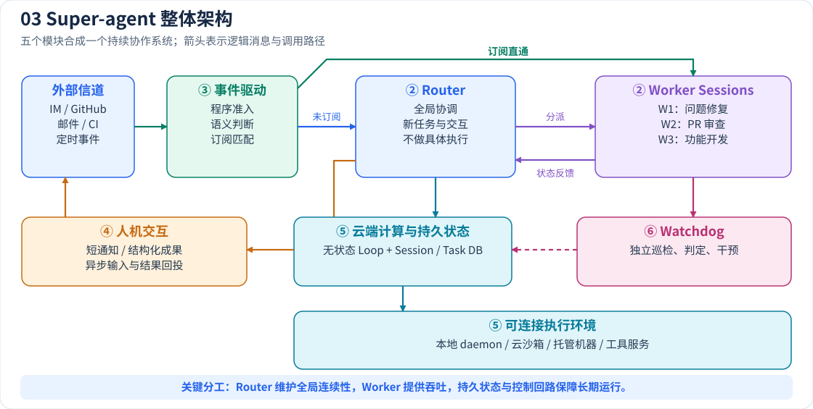


**总图阅读方式：** 先沿左侧输入读到事件驱动层，再区分绿色直通路径与经过 Router 的语义分派路径。Worker 将关键状态反馈给统一协调层；运行时访问持久状态及具体执行环境；Watchdog 在主链路之外观察任务健康度。人类看到的是交互结果，而不必了解背后有多少个 Session。

这里有一个重要区别：五个模块不是五个必须独立部署的微服务，而是五类职责。Router 与 Worker 也不一定各自对应固定进程。一个 Session 是逻辑上下文的单位；实际可由不同进程、容器或服务承载，不能从逻辑架构图直接推断操作系统进程拓扑。

## 2. 双层架构：Router 和 Worker


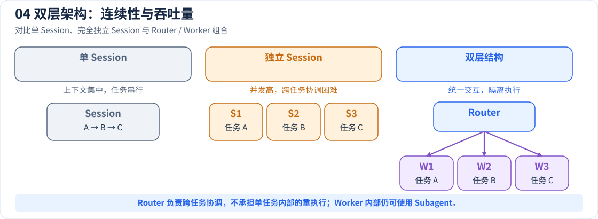


### 2.1 为什么不是一个 Session，或者每条消息一个 Session

单 Session 的历史最完整，但无关任务的信息互相污染，并且执行链路容易串行化。每条输入都新开 Session 又会失去已经建立的任务归属与跨任务知识。双层设计把连续性和具体执行分配给不同职责。

| 维度 | Router | Worker |
|---|---|---|
| 主要对象 | 多任务及全局交互 | 一项具体工作 |
| 上下文 | 高层意图、任务索引、关键结论 | 完整任务历史、代码、工具结果 |
| 工具 | 查找、分派、协调、沟通 | 文件、命令、测试、业务工具等 |
| 模型选择 | 可考虑更快、更轻量模型 | 根据任务难度选高能力模型 |
| 失败影响 | 可能阻塞全局分派 | 理想情况下限于任务本身 |

Router 可以理解为逻辑上的协调序点：当存在跨任务决策时，要有一个地方形成一致的决定。这不意味着所有后续消息都需要它重新判断，更不意味着所有执行操作都应该通过它。

### 2.2 Router 为什么不应该亲自做复杂任务

考虑两个任务 A、B 同时到来。若 Router 为了方便直接执行 A 中的 10 分钟测试，那么 B 即使只是一个很简单的任务，也可能等待很久。问题不是模型有没有能力执行测试，而是它所在的位置不允许承担这个耗时职责。

更可靠的边界是缩小 Router 的工具集合：允许它创建任务、读取摘要、请求状态，不提供通用执行能力。这样可以减少模型临场决定是否委派的波动。不过，删除 Bash 并不自动保证低延迟；查询历史、复杂推理、长时间等待其他服务也可能成为瓶颈。

### 2.3 Worker 与 Agent Team / Subagent 的差别

Super-agent 的 Worker 处理的是可独立推进的工作；Agent Team 或 Subagent 可以作为 Worker 内部解决复杂问题的实现。举例：Router 同时派发三个无关需求，其中修复数据库性能问题的 Worker 再派出两个 Subagent 分析 SQL 与 JVM 指标。Router 不需要了解这些子步骤。

所以需要区分**跨任务的组织**和**任务内部的分解**。把所有 Subagent 的中间推理都同步到主 Agent，虽然称为多 Agent，但可能仍然形成一个高负载的主上下文。

### 2.4 工程扩展：Router 的最小契约

建议先把 Router 设计成结构化决策而非自由文本控制：

```json
{
  "decision": "CREATE_TASK",
  "triggerId": "evt-001",
  "threadIds": ["im:topic-17"],
  "taskBrief": "复现并验证登录失败问题",
  "constraints": ["只读诊断，提交变更前确认"],
  "priority": "NORMAL"
}
```

这只是本文的设计示例，不是 DeepSeek API。模型建议需要通过宿主代码进行 schema 校验、授权检查、去重与资源配额控制。

## 3. 事件驱动：主动性的基础

### 3.1 Trigger：把输入从 Prompt 扩展为业务事件

Prompt 是模型接收信息的一种表达形式；Trigger 是系统能够记录、分类、分派和追踪的业务事件。它可以来自聊天、PR、CI、邮件、日程或定时检查。一个成熟的事件系统应避免每个连接器自行启动一个 Agent Loop。

| 字段（建议） | 含义 |
|---|---|
| eventId / sourceEventId | 全局标识与来源侧去重键 |
| source / type | 来源信道和事件类型 |
| threadId | 所属外部讨论或工作对象 |
| actor / occurredAt | 行为主体和发生时间 |
| payloadRef / summary | 正文引用与有限摘要 |
| policyVersion | 用于记录当时适用的策略版本 |

这些字段属于工程建议。真实接入时，还应保留事件原始数据与可追溯的归属信息。

### 3.2 两级过滤：把确定性留给程序


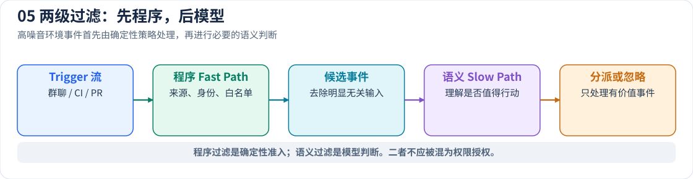


程序层适合解决明确规则：是否在允许的群组、发送者是否满足准入条件、消息是不是已处理过的重复投递。模型层适合判断语义：这是一个闲聊、一个需要解释的问题、一个已有任务的进展，还是一个值得进一步调查的异常？

不要将语义判断作为最终安全判断。模型认为某条群消息很重要，不应因此绕过资源访问控制。过滤、路由、授权是三种不同的功能：**要不要理会、交给谁处理、允许做什么**。

工程上还需要注意次序：已订阅事件和新任务事件并非总是走完全相同的 LLM 路径。先执行确定性规则、查找已有归属并针对确需判断的事件使用模型，可以避免每次经过全局语义决策。具体的过滤与订阅优先级应由系统策略明确，不能用架构图代替实现细节。

### 3.3 Thread：事件流与会话不是同一种对象


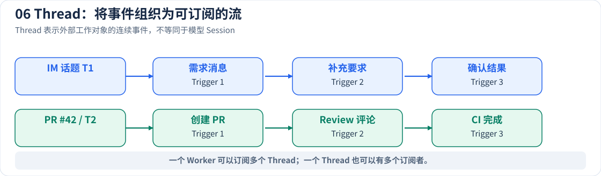


IM 话题、一个 PR 或一串往来邮件，都可以成为 Thread。它承载的是外部世界的关联关系，而 Session 承载的是某次模型工作的上下文。这两种关系不可混为一谈。例如，一个修复任务可能同时关联一个 IM 话题和一个 GitHub PR；一个 PR 也可能被修复 Worker 和安全审查 Worker 同时关注。


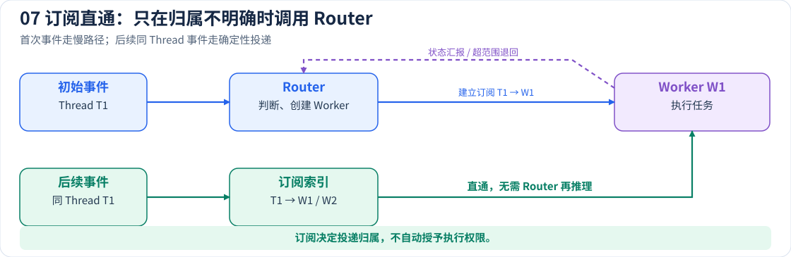


初始事件可能需要 Router 判断是否开工、创建哪个 Worker，并登记订阅。后续属于已知 Thread 的事件，宿主可以按订阅索引直接交给对应 Worker。Worker 如果发现事件超出工作范围，可将其交还协调层。Router 保有全局可见性不意味着每个直通事件都需要一次 Router 模型推理。

**典型数据关系（示意）：**

```text
Trigger  N : 1  Thread
Thread   N : M  Worker/Task  （通过 Subscription）
Task     1 : N  Execution / Assignment
Execution     → Session / Run
```

如果多个 Worker 同时订阅一个 PR，事件扇出后它们可能自行发现共享环境中的冲突。但订阅机制并不能保证消除写冲突，仍应通过工作目录隔离、分支、版本检查、合并规则或资源锁实现并发控制。

### 3.4 Inline & Spill：把上下文窗口当作有限缓存


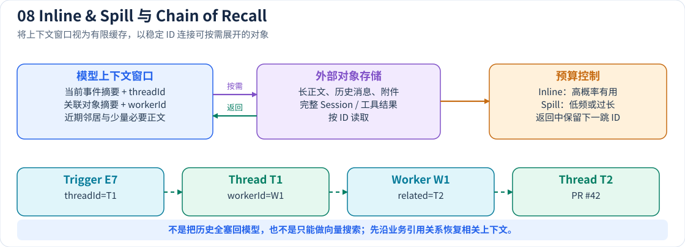


上下文预算不仅是 token 上限，还关系到推理注意力。Inline 的作用是使当前高相关信息无需二次工具调用；Spill 则让低频信息留在可检索存储中。它们可以一起使用：先传入摘要、关键字段和关联 ID，需要全文时再读取。

假设当前事件只有如下信息（教学示例）：

```json
{
  "id": "e-301",
  "summary": "评审人要求补充并发测试",
  "threadId": "pr-42",
  "relatedTaskId": "task-18",
  "bodyRef": "trigger:e-301:body"
}
```

模型先查阅 `task-18` 的最新进度，如果仍缺背景，再根据任务记录找到最早的 IM 需求。每次返回对象还可以提供下一跳标识。这里形成的是一张业务对象引用图，不要求专门建设图数据库；关系型数据库、文档数据库和索引均可支撑。

与常见 RAG 相比，引用召回能利用确切的业务关联，适合知道某个任务或 PR 的情形；语义检索则适合用户只记得模糊描述、无法指出对象的情形。两者可以组合。工程难点是历史对象的保留期限、关联完整性、访问权限继承、循环引用和查询预算。

### 3.5 投机执行：把机器时间换成人的时间


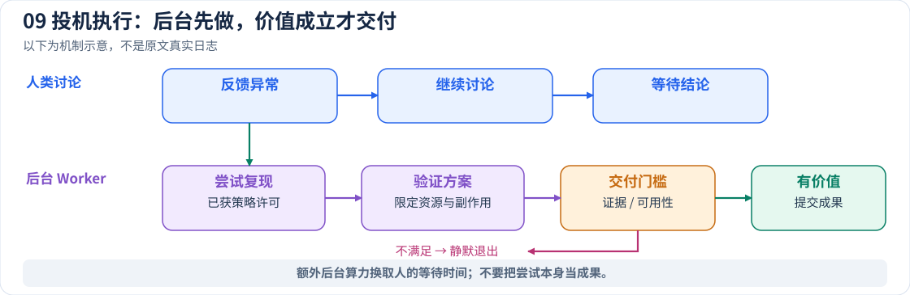


如果在群聊反馈出现时就启动只读复现，而不是等人明确请求，可能在人准备询问时已经拿到了证据。但后台尝试也可能失败、浪费算力或产生不适当的外部动作，因此必须设置交付门槛。

推荐将任务行为划分为：观察、受限探查、准备草稿、产生副作用。前三类也要受数据权限约束；第四类则应该有明确授权。统计指标除了后台成功率，还应包含实际被采用的成果比例、无用尝试成本、未经授权的副作用次数以及对用户的打扰次数。原文描述的是思路和内部案例，不是经过全面验证的主动行为安全策略。

## 4. 面向人的交互

### 4.1 异步 ReAct Loop：解除长工具调用阻塞


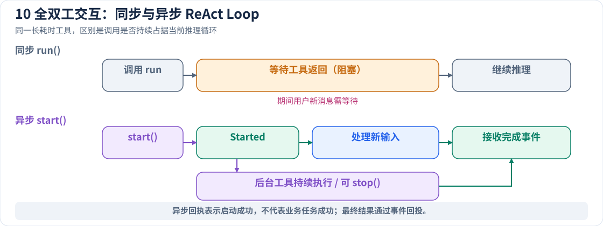


传统同步工具调用要等结果才能进入下一推理步骤。改成异步协议后，启动动作先返回操作标识和接受状态，执行结果稍后以事件的形式回到 Session。用户发来新的指令时，只需等当前推理步到达可处理输入的边界，而不必等后台长工具结束。

工程上可以设计三个操作：`start(tool, args, idempotencyKey)`、`stop(operationId)`、`getStatus(operationId)`。运行时负责投递结果事件。不要把 `Started` 解释为最终成功；取消与完成可能发生竞态，需要定义状态机和最终结果的裁决规则。后台执行也不会让同一个模型在同一次推理中突然拥有可任意插入消息的能力。

```text
ACCEPTED → RUNNING → SUCCEEDED / FAILED
                 ↘ CANCEL_REQUESTED → CANCELLED（或已完成）
```

例如正在执行回归测试时，用户要求改测另外一个模块。系统应该明确旧测试是继续、停止还是仍有价值。若旧结果之后到达，不能把它误当成新测试结果。可以通过 `operationId`、任务版本与控制指令序号匹配。

### 4.2 多信道交互：同一个结果，不同表达方式

对 IM、PR、文档、面板统一处理身份和任务归属，但分别设计输出方式。

| 信道 | 适合呈现 | 不宜默认呈现 |
|---|---|---|
| IM 群聊 | 需要决策的问题、简短进展、成果链接 | 每次模型推理和工具调用 |
| GitHub PR | 变更说明、验证记录、评审证据 | 无关全局任务细节 |
| 邮件 | 结构化摘要、请求与下一步 | 高频实时执行日志 |
| 任务面板 | 当前任务、负责人、状态、阻塞原因 | 强制用户逐个管理底层 Session |
| 研发控制台 | Trace、工具结果、成本、回放 | 以此替代业务交付内容 |

这是对原文信道设计的扩展。核心不是所有内容由一个窗口展示，而是用户可以在已有工作流中自然地给出指令和验收结果。生产系统还需要控制通知频率、跨信道重复投递，以及将私有上下文发送到公开群组的风险。

## 5. 计算、状态与执行环境的分离


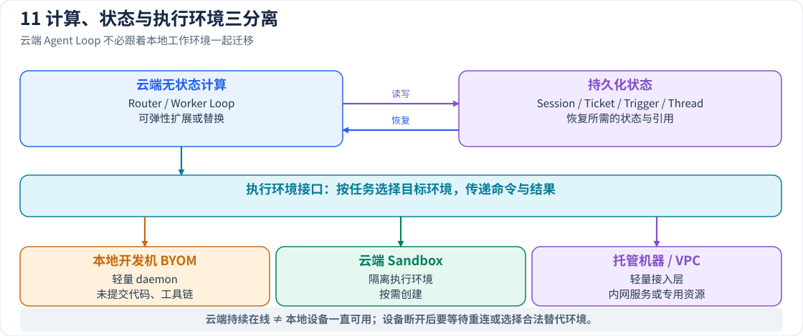


### 5.1 计算与状态分离

计算是推进推理、处理事件、选择工具的过程；状态是恢复任务所需的信息。把 Loop 放在可替换的运行实例中，把 Session、任务及进度放在持久存储中，就不会因单个进程退出而丢失全部工作。不过，保存 transcript 并不足以恢复所有工作：还需知道哪些外部操作已经提交、哪些工具仍运行、哪个任务版本有效。

| 故障时刻 | 工程处理建议 |
|---|---|
| 事件已接收但尚未分派 | 从持久事件记录重新消费 |
| 工具已成功但结果还未持久化 | 使用幂等键、查询外部结果或人工确认 |
| 状态已更新但通知未发送 | 通过可靠发件记录补发，避免重复 |
| 原 Worker 已失联 | 租约过期后接管；检查是否已有外部执行 |

这些可靠性处理是本文补充，并非原文宣称的具体实现。尤其是对任意外部工具，不能仅靠消息队列保证业务动作 exactly-once；幂等必须落实到副作用边界。

### 5.2 计算与环境分离：为什么不是把一切搬到云沙箱

云 Sandbox 适合可重建的依赖和需要隔离的工作负载。但真实开发环境可能有未提交修改、专用设备、内网依赖等不易复制的状态。BYOM（Bring Your Own Machine）的思路是把 Loop 放云端，在真实环境附近运行轻量代理，按需接收任务命令并返回结果。

注意 BYOM 中的 M 指 Machine，而非 Model。具体传输协议未在原文中固定；不能把某种 RPC 或 WebSocket 方案当作团队的官方实现。机器断开时，云端任务状态可以继续存在，但依赖该设备的实际操作必须等待重连、暂停或在有授权的替代环境执行。

**工程上建议将环境接入当成单独的权限边界：** 短期凭据、设备身份、按工具授权、工作目录隔离、命令审计、敏感信息脱敏、网络出站限制。守护进程的轻量化不等于安全隔离；它连接的设备越多，云端失陷的潜在影响就越广。

## 6. Watchdog：从进程监控到任务健康监控


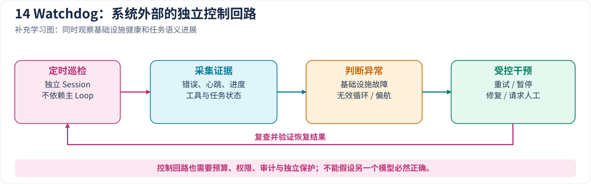


此图是学习补充图。原文章节强调独立的外部控制机制：定时检查基础设施和执行进展，由独立的 Agent 判断任务是否偏离目标或停滞。它不同于单纯的 JVM 心跳或 API 健康探针。

| 异常场景 | 可观察证据 | 建议干预 |
|---|---|---|
| Worker 进程退出 | 心跳消失、租约过期 | 检查外部操作后接管 |
| 重复调用失败工具 | 相同错误多次出现 | 退避、切换合法替代工具或人工处理 |
| 推理循环无进展 | 多轮相同动作，没有新产物 | 暂停并核对目标与历史 |
| 任务方向偏离 | 计划与验收条件冲突 | 请求重规划或人工确认 |
| 等待外部审批 | 明确的等待状态 | 保持等待，不误判死锁 |
| 成本异常 | token、工具费用、耗时超预算 | 限流、终止或请求追加预算 |

模型判定是否存在实质进展，需要任务目标、里程碑、已获得的证据等结构化输入，不能只看自由文本日志。Watchdog 自己也可能判断错误或消耗过多资源，所以应把它的自动干预限制在低风险动作，高风险变更进入审批流程。修改系统提示词、触发策略等管理动作宜有版本控制和回滚能力。

## 7. 如何正确理解实验

### 7.1 消融实验：吞吐量、尾部延迟与 token 代价

[原文全文收录 §7.1](https://pureskyblog.dpdns.org/posts/deepseek-super-agent/) 给出四种对照方案。实验使用合成消息负载，每轮约 300 条消息，约 20 个工作请求；真实编码工作用耗时模拟工具替代，各方案运行 5 次。以下为公开汇总统计值。


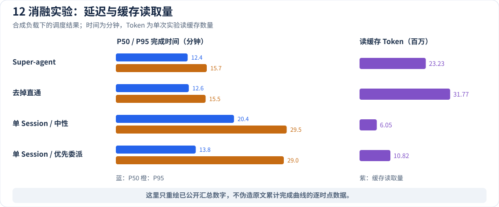


| 架构 | P50（分钟） | P95（分钟） | 读缓存 token（万） |
|---|---:|---:|---:|
| Super-agent | 12.4 | 15.7 | 2323 |
| 去掉直通 | 12.6 | 15.5 | 3177 |
| 单 Session + Subagent：中性提示 | 20.4 | 29.5 | 605 |
| 单 Session + Subagent：优先委派 | 13.8 | 29.0 | 1082 |

从这些数字能看出三种取舍：

- 双层方案相对提示优先委派，P50 只减少 1.4 分钟，但 P95 减少 13.3 分钟。更明显的差异在长尾表现，而不是所有任务都成倍加速。
- 去掉直通后，时间表现近似，缓存读取量从 2323 万升到 3177 万（相对完整版增加约 36.8%）。从反方向看，完整版相对无直通版减少约 26.9%，两种百分比的分母不同。不能说直通让实际代码质量提高了 37%。
- 独立上下文不是免费的。相对单 Session 中性提示，完整双层方案读取缓存 token 约为其 3.84 倍。缓存读取 token 只是成本的一项，不能直接当作全部 token 或总费用。

这些数据不能证明真实研发交付必然更快，也不能证明某个模型的编码能力更强。实验的任务是模拟耗时工具，且消息间隔和工作时长按比例缩放；样本量有限，结论应局限于此类调度负载。图 12 使用柱形比较而非复刻原文累计曲线，因为没有取得完整逐时点数据。

### 7.2 Router 批处理：摊薄每个决策的固定开销


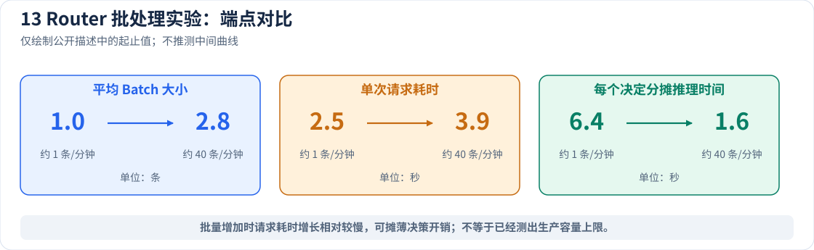


原文 §7.2 使用真实 Router 模型和模拟 Worker，改变需要判定的 Trigger 到达率。约从每分钟 1 条增加至 40 条时，平均批大小由 1.0 增至 2.8；单次请求用时由 2.5 秒增至 3.9 秒；每个决定分摊推理时间由 6.4 秒降至 1.6 秒。

这里的三组指标统计边界并不完全相同，不应简单用单次请求时间除以批大小反推出第三项。公开汇总数据没有给出完整的原始调用轨迹，不能进一步归因这些差异。

工程上的启示是，当事件密集到达时，可以将多项待判断输入汇总成一次或一组模型决策，减少固定推理开销。代价是批内结果可能互相干扰，并且等待凑批会增加单条事件时延。因此应观测待处理队列年龄、首响时间、批内遗漏率和每事件成本，而不仅是平均 batch size。该实验不是线上系统的最大容量认证。

## 8. 开源原型与文章蓝图的边界

官方 README 明确把 `dsh-superagent-prototype` 定位为研究原型，并说明它与内部实现及文章设计不完全一致。它面向单一 GitHub 仓库，可选连接飞书。不要把文章中的每一种设想都视为已由仓库交付。

从公开的[领域模型](https://github.com/deepseek-ai/dsh-superagent-prototype/blob/main/docs/001-domain.md)、[执行机制](https://github.com/deepseek-ai/dsh-superagent-prototype/blob/main/docs/003-execution.md)和[架构说明](https://github.com/deepseek-ai/dsh-superagent-prototype/blob/main/docs/007-architecture.md)可以进一步理解其具体领域对象：

| 文章中的概念 | 原型研读入口 | 注意事项 |
|---|---|---|
| 环境事件 | Source、Trigger、Thread | Source 负责来源的接入与读取位置 |
| 任务判定与分派 | Eval、Decision、Ticket | 原型的领域模型不能逐字等同于文章 Router Session |
| 订阅路由 | Subscription | 关注事件不等于拥有执行权限 |
| 执行 | Ticket、Assignment、Executor | Ticket 生命周期独立于某个 DSH Session |
| 人类协作 | Channel、Report、Panel | 聚焦需要人处理的事项 |
| 独立 Watchdog、BYOM、完整链式召回 | 原文 §3、§5、§6 | 本手册未逐项运行或审计源码，不能据此确认实现覆盖度 |

实际读代码时，可先读 `docs/000-philosophy.md`，再看 `001-domain.md`、`002-authorization.md`、`003-execution.md`、`007-architecture.md`。特别关注 Engine 如何统一处理事件、订阅、任务状态与授权。默认执行目录和命令包装器并不等于安全沙箱，原型自身的执行文档也明确提示了这一点。本文没有安装或运行原型，不对生产稳定性作保证。

## 9. 一个贯穿全架构的工程例子（学习推演）

设想公司代码库的线上故障协作助手，用户在 IM 报告一个疑似问题，同时另一位用户请求评审一个 PR。

| 阶段 | 事件与动作 | 主要职责 |
|---|---|---|
| 1 | IM 反馈产生 E1；PR 评审请求产生 E2 | Source / Trigger |
| 2 | 程序校验来源和准入；模型判断新任务归属 | Fast / Slow Path |
| 3 | Router 为故障创建 T1，为审查创建 T2 | 任务协调 |
| 4 | W1 查日志，W2 看 diff；各自使用任务上下文 | Worker |
| 5 | W1 订阅故障讨论和新创建的修复 PR；CI 结果直接回投 | Thread / Subscription |
| 6 | 用户发来新要求；异步测试仍在后台执行 | 异步 ReAct |
| 7 | W1 提交验证结果；W2 报告审查意见，Router 对外协调 | 多信道交付 |
| 8 | 测试环境断连，任务状态继续保留，等待设备重连 | 存算与环境解耦 |
| 9 | Watchdog 识别没有进展的任务，核查并触发受控恢复 | 外部控制回路 |
| 10 | 用户审批后继续；交付结果及最终状态可查询 | 人机闭环 |

这一例子展示了全系统的边界：主动响应并不意味着 Agent 可以不经授权访问线上生产环境；PR 创建与生产部署应该采用不同风险等级。对于研发任务，用户应看到明确的任务目标、进展、验收证据和需要本人决定的事项。

## 10. 映射到 Java / Workflow Agent 的工程设计（学习扩展）

如果现有系统已经具备 Graph/DAG 和节点执行引擎，不一定要把所有节点重写为自由 ReAct。可以在已有 Workflow Runtime 外引入跨任务协调和事件调度，再按需升级单个节点或工具。

| 能力 | 建议的系统职责 | 可以复用的现有能力 |
|---|---|---|
| Event ingress | 来源适配、去重、准入、事件存档 | HTTP、Kafka、业务消息适配 |
| Task router | 新任务分类、任务分派、超范围重路由 | 业务 Router / Decision Node |
| Subscription index | Thread 与任务的关联及确定性扇出 | 关系表、消息消费端 |
| Worker runtime | 每任务独立上下文、任务内计划及执行 | Workflow 或 ReAct Runtime |
| Async operation | 长工具执行状态、取消、结果回投 | 异步 Job、任务队列 |
| State / recall | 任务、会话、事件与引用索引 | 数据库、上下文服务 |
| Environment adapter | 选择执行环境并调用受控工具 | MCP、HTTP 工具、沙箱 |
| Control loop | 任务健康、重试、人工介入 | 监控 SDK、调度任务、告警 |

建议的标识层级是 `agentId → taskId → executionId / sessionId → runId → stepId`，并把 `triggerId` 和 `threadId` 作为可跨层关联的标识。箭头描述逻辑关系而非严格的一对一嵌套。同一任务可能跨越多个执行与会话；同一 Session 也可存在多次运行。已有一次执行级的 traceId 可以继续沿用，通过 taskId 把跨 Run 的链路串起来。

优先观测哪些指标：

| 指标 | 能回答的问题 |
|---|---|
| Router 每事件推理次数 / token | 是否把确定性工作不必要地交给模型 |
| 订阅直通比例与错误归属率 | 是否正确节省路由开销，而非错误投递 |
| 首响时间、任务完成 P50 / P95 | 响应与交付是否被长任务拖累 |
| 人工注意力事件数 / 有效交付 | 系统是否真的减少人的负担 |
| 每个达标任务成本 | 多 Worker 与后台尝试是否划算 |
| 跨 Run 恢复成功率 | 是否真正实现长期连续性 |
| 重复副作用次数与权限拦截 | 自动化是否具有可控边界 |

这些指标是学习推演，不是 DeepSeek 已公开的线上指标。应按实际业务验收标准设置分母、统计窗口和失败定义。

## 11. 与 Anthropic Always-on Agents 的联系

这两篇文章解决的是相邻而非完全相同的系统问题。[Anthropic 的 Building always-on agents](https://claude.com/resources/articles/building-always-on-agents) 更强调单次 Run 如何被触发、保存状态并在未来恢复；DeepSeek 文章则进一步聚焦多个复杂任务如何统一协调、并发执行与跨信道合作。二者可以组合，但不必强行把概念一一对应。

| 关注点 | Anthropic 文章 | DeepSeek 文章 |
|---|---|---|
| 事件与调度 | Inbox、Timers、Run 生命周期 | Trigger、Thread、过滤、订阅直通 |
| 上下文 | 持久 Memory 与会话恢复 | Router / Worker 隔离、Inline & Spill |
| 执行与人交互 | 延迟工具调用、Outbox | 异步 ReAct、统一协调与多信道 |
| 安全与长期运行 | Permissions、持久状态 | 存算与环境分离、Watchdog、安全开放问题 |

一个可能的综合设计是：事件可靠入库后，由 Router 或订阅索引决定交给哪个任务，任务以有限 Run 的形式执行，写回状态，并通过可靠通知机制交付。定时器驱动后续工作和 Watchdog 巡检；授权机制控制所有产生副作用的操作。这样无需要求模型或进程物理上永久运行。

## 12. 开放问题与学习结论

规模扩大后，单一 Router 的上下文容量和决策队列会成为约束；按团队或领域切分虽然提高隔离与吞吐，却可能损失全局连续性。链式召回解决近期工作关联，并不自动解决跨月记忆的沉淀与更新。不同组织边界之间的 A2A 协作还需要独立的身份、授权和数据共享协议。

产品方面，隐藏底层 Session 后，应该以什么方式展示任务、让人随时接管或干预，仍需结合具体业务决定。对于工程团队，任务面板、PR、IM 和验收证据都可能比一个包含所有推理日志的超级聊天窗口更合适。

**最终理解：** Super-agent 的价值不是多 Agent 数量，而是系统接管会话组织、任务关联、事件处理、并发执行和异常恢复之后，使人能够主要参与关键决策与验收。模型能力、系统约束和产品交互必须共同设计。

## 参考资料与配图说明

1. [DeepSeek Harness 团队：Super-agent 设计探索（公众号原始链接）](https://mp.weixin.qq.com/s/zoS7GlReWPhfCjENGxXCdg)（本次直接访问失败）。
2. [中文全文收录及配图主题说明](https://pureskyblog.dpdns.org/posts/deepseek-super-agent/)；[另一中文转载](https://guobug.github.io/posts/2026/11/01/deepseek-harness-super-agent-architecture/)；[英文全文译本](https://chinamodelapi.com/super-agent-design-deepseek)。
3. [DeepSeek 官方研究原型及文档](https://github.com/deepseek-ai/dsh-superagent-prototype)。
4. [Anthropic: Building always-on agents](https://claude.com/resources/articles/building-always-on-agents)。

图 1–13 对应原文收录版报告的 13 个图示主题，为独立重绘，不是原图逐像素复制；其中实验图仅用公开汇总值。图 14 是额外补充的 Watchdog 控制回路。"全局信息图"一节中的信息图为 DeepSeek Harness 团队发布的原始信息图，与自绘示意图互为对照。图示以独立 SVG / PNG 文件按相对路径嵌入（`figures/`），部分 Markdown 渲染器会出于安全策略过滤内联 SVG，因此另提供自包含的 [HTML 阅读版](super-agent-handbook.html)。
